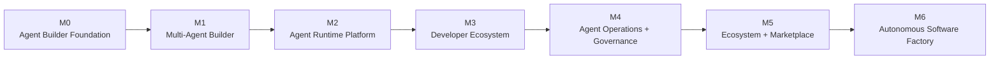

# Product Roadmap — Agentic Platform M0–M6 (PROPOSED)

> **Scope:** dependency-ordered product phases M0–M6, mapped onto the
> engineering layers P0–P6 (the phase model of
> [`DEV_CHECKLIST.md`](DEV_CHECKLIST.md) — unchanged; historical task IDs are
> never renumbered). Vision: [`00-product-vision.md`](00-product-vision.md).
> MVP detail: [`02-mvp.md`](02-mvp.md). Canonical strategy:
> [`12-agentic-platform-strategy.md`](12-agentic-platform-strategy.md).
>
> **Status:** `proposed` — strategy-level roadmap. Engineering task
> breakdown stays in [`DEV_CHECKLIST.md`](DEV_CHECKLIST.md); this document
> defines phase boundaries, value and non-goals, not task lists. Product
> M0–M6 must not be confused with engineering P0–P6 (mapping in
> [`12-agentic-platform-strategy.md`](12-agentic-platform-strategy.md)).
> Last
> reviewed: 2026-11-15.
>
> AaaS-only direction with Web3 as next plan: [`11-aaas-web3-strategy.md`](11-aaas-web3-strategy.md)
> (decision D6, preserved, in
> [`10-decisions-and-open-questions.md`](10-decisions-and-open-questions.md)).

## Governing rule

Do not build all major platform phases in parallel. The M0–M6 sequence is the
**dependency-ordered path** (decision D7), reached by
dependency order; each phase must deliver a sellable increment on its own.

## Phase map

| Phase | Problem solved | Target user | Value proposition | Engineering layers |
|---|---|---|---|---|
| M0 — Agent Builder Foundation ([`02-mvp.md`](02-mvp.md)) | Building one production agent means glue code, ungoverned tools, no ops loop | AI Developers, AI Builders | Describe in NL, inspect visually, run governed on one representation | P0 + P1 slice + P2 slice + P3 slice |
| M1 — Multi-Agent Builder | One agent cannot cover coordinated work; delegation is ad-hoc | Same, teams | Coordinator/worker teams, delegation, parallel execution, team traces | P1 team primitive + P2 composition |
| M2 — Agent Runtime Platform | Long runs are fragile; no durable lifecycle, scheduling, or events | Same, operating | Durable execution, checkpoints, pause/resume, retry, schedules, webhooks, rollback | P3 + P0 quotas |
| M3 — Developer Ecosystem | Builders locked inside the web UI; no programmatic path | External developers | Public API, SDK, CLI, OpenAPI, manifests, Git, import/export, local dev | P5 versioning/diff + P4 workbench |
| M4 — Agent Operations and Governance | Production quality, cost, and policy are unmanaged | Teams/orgs | Observability, evaluation, cost control, approvals, policy management | P3 observability + P0 policy |
| M5 — Ecosystem and Marketplace | Reuse is copy-paste; no distribution or trust | Publishers + users | Agent/tool/skill registries, templates, publisher identity, review, marketplace | P5 |
| M6 — Autonomous Software Factory | "The platform builds the agentic system itself" | All | NL requirements → deployed agents, functions, apps with gates | P6 |

## Per-phase contract

Each phase below must define (and does, in its owner doc or section):
problem solved · target user · value proposition · features · technical
components · dependencies · acceptance criteria · non-goals · metrics.

### M0 — Agent Builder Foundation + ICP/problem validation

Owner: [`01-problem-and-icp.md`](01-problem-and-icp.md) (validation) +
[`02-mvp.md`](02-mvp.md) (builder scope). Exit gates: validated
ICP + problem + WTP evidence; M0 acceptance criteria in
[`02-mvp.md`](02-mvp.md) (NL creation, visual inspect/edit on one
representation, useful task executed, permission-checked auditable tools,
traceable runs, tenant isolation tests green, no unverified critical
boundary).

Proposed first executable increment: the **vertical slice v0** in
[`02-mvp.md`](02-mvp.md) — NL → single agent → governed run → lineage + Git
revision → History/diff/rollback, boundary ON. It is `proposed`, not approved
(O13 in [`10-decisions-and-open-questions.md`](10-decisions-and-open-questions.md)),
and it sequences after the P0 rollout.

### M1 — Multi-Agent Builder

Owner: [`05-agent-runtime.md`](05-agent-runtime.md) (team model) +
[`12-agentic-platform-strategy.md`](12-agentic-platform-strategy.md).
Dependencies: M0 exit gates; engineering P1 team primitive + P2 composition.
Non-goals: the must-not-build list of
[`02-mvp.md`](02-mvp.md) plus durable depth (M2) and public contracts (M3).

### M2 — Agent Runtime Platform

**Add:** durable execution, checkpoints, pause/resume, retry, cancellation,
scheduling, event triggers, webhooks, resource quotas, deployment, rollback.
Dependencies: M0 capability/tenant minimum; engineering P3 durable runtime.
Non-goals: Visual Builder as the mandatory entry point; public SDK/CLI
contracts (M3); advanced evaluation (M4).

### M3 — Developer Ecosystem

**Add:** public API, SDK, CLI, OpenAPI, manifest specs, Git integration,
import/export, local development, self-hosting docs, community templates,
registry. Dependencies: M0–M2 representations; engineering P5 versioning/diff
+ P4 workbench. Non-goals: production governance depth (M4); commercial
marketplace (M5).

### M4 — Agent Operations and Governance

**Add:** advanced observability, evaluation datasets, regression evaluation,
run comparison, cost optimization, advanced permissions, approval policies,
team governance, policy management.
Dependencies: M2 runtime and M3 contracts. Non-goals: third-party supply
(M5); factory synthesis (M6).

### M5 — Ecosystem and Marketplace

Owner: [`08-marketplace.md`](08-marketplace.md). Dependencies: stable
manifests + versioning (P5), tenancy/security (P0), demonstrated demand.
Rule: registry/discovery may precede commerce; never commerce before demand
+ security controls.

### M6 — Autonomous Software Factory

Owner: [`09-software-factory.md`](09-software-factory.md). Dependencies:
M0–M5 surfaces; engineering P6.

## Roadmap non-goals (global)

- No phase skips its gate; no module is pulled forward "for completeness".
- No generic positioning (see the do-not-position-as list in
  [`00-product-vision.md`](00-product-vision.md)).
- No technology candidate becomes a commitment without an ADR
  ([`10-decisions-and-open-questions.md`](10-decisions-and-open-questions.md)).
