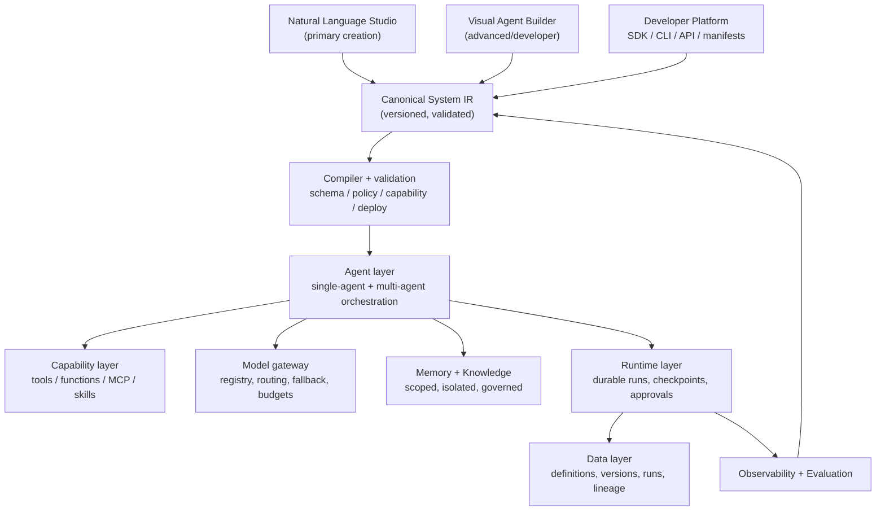

# System Architecture — Agentic Platform Layers & Candidates (PROPOSED)

> **Scope:** target system architecture for the VibeSDK Agentic Platform: the
> layer model, the Canonical System IR flow, and the technology-candidate
> register. Vision:
> [`00-product-vision.md`](00-product-vision.md). Canonical strategy:
> [`12-agentic-platform-strategy.md`](12-agentic-platform-strategy.md).
> Agent / function / tenancy
> detail: [`05-agent-runtime.md`](05-agent-runtime.md) ·
> [`06-functions-and-tools.md`](06-functions-and-tools.md) ·
> [`07-multitenancy-security.md`](07-multitenancy-security.md).
> **Current implementation is documented elsewhere and differs**:
> [`llm.md`](llm.md) and [`architecture-diagrams.md`](architecture-diagrams.md)
> describe the live dual-plane system (Go control plane + light Cloudflare
> Worker + React SPA).
>
> **Status:** `proposed` — nothing here is implemented beyond the live seeds
> named per layer. Technology candidates
> are **assumptions under evaluation, not decisions** (constraint from the
> strategy task: never hard-code them as irreversible; each adoption needs an
> ADR). Last reviewed: 2026-11-15.

## Architecture principles

Natural Language First · Visual Builder for Developers · One Canonical System
Representation · Developer First-Class · Open Ecosystem · Composable Agentic
Systems · Provider-Agnostic Model Access · Runtime-Enforced Security ·
Durable and Observable Execution · Versioned and Reproducible Systems ·
Human Control over Sensitive Side Effects · Open Core and Managed Cloud ·
Progressive Complexity · Vendor Replaceability.

## System layers

- **Creation surfaces** — Natural Language Studio (primary), Visual Agent
  Builder (advanced/developer), Developer Platform (SDK/CLI/API/manifests).
  All three compile into the same Canonical System IR; no surface executes
  unvalidated state.
- **Canonical System IR** — the versioned, validated intermediate
  representation every creation path compiles to and every runtime executes
  (PROPOSED; see [`12-agentic-platform-strategy.md`](12-agentic-platform-strategy.md)).
- **Compiler + validation** — schema validation, policy validation,
  capability resolution, deployment planning.
- **Agent layer** — intent extraction, plan generation, capability
  selection, permission checks, observation, recovery, escalation;
  single-agent plus coordinator/worker teams with delegation and parallel
  execution ([`05-agent-runtime.md`](05-agent-runtime.md)).
- **Capability layer** — typed, authorized, tenant-scoped tools, functions,
  MCP connections, and skills
  ([`06-functions-and-tools.md`](06-functions-and-tools.md)).
- **Model gateway** — provider/model registries, routing, fallback, budgets
  (TARGET; per-role models are the live seed).
- **Memory + Knowledge** — scoped (run/conversation/agent/team/tenant),
  isolated, governed; provider-independent abstractions.
- **Runtime layer** — durable serverless execution with retries, schedules,
  events,
  approvals and observability behind a replaceable Runtime Adapter
  interface (engineering P3,
  [`DEV_CHECKLIST.md`](DEV_CHECKLIST.md)). Agents are fully serverless:
  no always-on servers per agent, event-driven scale-to-zero, state in
  platform stores (never agent-local) — see
  [`08-marketplace.md`](08-marketplace.md) for the "manifests, not servers"
  distribution rule.
- **Data layer** — system/agent definitions and versions, runs, checkpoints,
  approvals, lineage, usage/billing, audit. **Ownership rule:** data is owned
  by the
  platform's data layer, never by an AI-orchestration vendor (see the
  candidate register below).
- **Application layer (reference workload)** — tenant-specific interfaces
  the platform generates
  (today's App Builder output is the seed;
  [`09-software-factory.md`](09-software-factory.md)); it exercises the
  platform, it does not define it.

## Outcome → agent → functions → runtime → data

One builder run reads: the user outcome (NL, visual, or API) → compiled into
the Canonical System IR → schema/policy/capability validation → the agent
extracts intent and
produces a plan → the plan selects capabilities from the registry → each
capability executes durably on the runtime (approval-gated where it has
side effects) → every write lands in tenant-scoped data with an audit
trail → the result is reported back as the outcome the user asked for, with
traces, versions, and evaluation feeding the next iteration.

## Technology candidate register (ASSUMPTIONS — not decisions)

| Concern | Live today | Candidate under evaluation | Status / boundary |
|---|---|---|---|
| Frontend | React SPA (`src/`) | SvelteKit | Open (O2). Rewrite only via ADR; the live SPA stays until then. |
| Identity | D1-backed auth in the light Worker | Appwrite | Open (O2). Replacement boundary: auth/session interfaces, not business logic. |
| AI orchestration | Eino (Go) DeepAgent team | Dify | Open (O5). **Dify is never the source of truth for business data**; agents must remain replaceable. |
| Database | Redis (VFS/state) + D1 | TiDB | Open (O2). Tenant business schema candidate; isolation rules in [`07-multitenancy-security.md`](07-multitenancy-security.md). |
| Durable execution | Cloudflare Workflows (7 node types) | Rivet or equivalent | Open (O4). Boundary: the execution interface, not the vendor. |
| Generated app builder | Go control plane generation pipeline | Bolt / bolt.diy | Open (O2). Today's builder remains the reference implementation. |
| Backend gateway | Go Fiber control plane | FastAPI or Rivet gateway | Open (O4). Decide with the runtime choice. |
| Support surface | — | Chatwoot | Candidate; must stay independently deployable and operational. |
| Function runtime | Go tools in the control plane | Bun-based execution where appropriate | Open (O2). Security boundary: sandboxed, tenant-scoped, audited. |
| Agent/function identity | — (platform-internal ids only) | DID + verifiable credentials (W3.1) | Open (O7 is chain selection). Gated to M4; no chain chosen; must stay vendor-neutral (D5). |
| Settlement rail | — (no payment rail for third-party supply) | Fiat first, then stablecoin escrow with revenue split (W3.2) | Open (O8). Gated to M4; no token in scope; interface must remain replaceable. |

Reading rule: the "live today" column is verified in
[`DEV_STATUS.md`](DEV_STATUS.md); every other cell is an option recorded for
evaluation in [`10-decisions-and-open-questions.md`](10-decisions-and-open-questions.md),
not a commitment. Vendor replaceability is a standing principle: no layer
may couple business logic tightly to one vendor.

## Security model (summary)

Tenant-aware authn/authz on every function call, credential references
(never plaintext), per-call audit with tenant/agent/function identity,
rate limiting, idempotency for business writes, human approval for
external side effects. Full model:
[`07-multitenancy-security.md`](07-multitenancy-security.md).
