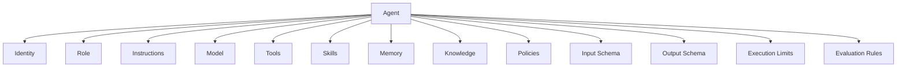

> **Ecosystem consolidation (2026-11-21):** preserved as the VibeSDK agent-model
> history (thirteen-part contract, Eino DeepAgent team). Canonical ecosystem
> contract: `05-agent-platform-architecture.md`. Commerce agents: `13-agentic-commerce.md`.

# Agent Runtime Model (PROPOSED)

> **Scope:** how single agents and multi-agent systems are modeled in the
> Agentic Platform. Layer
> context: [`04-system-architecture.md`](04-system-architecture.md). MVP
> usage: [`02-mvp.md`](02-mvp.md). Capability detail:
> [`06-functions-and-tools.md`](06-functions-and-tools.md). Canonical
> strategy: [`12-agentic-platform-strategy.md`](12-agentic-platform-strategy.md).
> Live agent
> implementation today: [`MULTI_AGENT.md`](MULTI_AGENT.md) (Eino DeepAgent
> coordinator/coder/reviewer).
>
> **Status:** `proposed` — the model below is the target; the live system
> implements only the App Builder team today. Last reviewed: 2026-11-15.

## Principle

**Agents orchestrate capabilities; they do not contain arbitrary business
logic.** If a rule, calculation or action matters, it lives
in a versioned, typed, testable capability
([`06-functions-and-tools.md`](06-functions-and-tools.md)) — the agent
selects, sequences and supervises it. This keeps agent behavior reviewable
(plan + selections) and behavior verifiable (typed capabilities with
tests and audit).

## Canonical Agent definition (target)

> Every Agent is exactly this thirteen-part contract — no more, no less.
> It is serialized as a versioned **Agent Manifest** (`kind: Agent`) from
> day one; minimal target shape and examples in
> [`06-functions-and-tools.md`](06-functions-and-tools.md). Full field list
> in [`12-agentic-platform-strategy.md`](12-agentic-platform-strategy.md).

| # | Part | Contract |
|---|---|---|
| 1 | Identity | DNS-safe name + semver + publisher; immutable once published; resolves the exact closure executed. |
| 2 | Role | One coherent responsibility the agent owns in a composition. |
| 3 | Instructions | How it behaves: steps, tone, edge cases, output format; may reference Skill manifests. |
| 4 | Model | Model ref + policy (temperature, maxTokens, fallback); routed via the model gateway, never hardcoded. |
| 5 | Tools | Pinned Tool Manifest refs it may invoke; least privilege — nothing unlisted is callable. |
| 6 | Skills | Pinned Skill Manifest refs that extend what it knows how to do. |
| 7 | Memory | Scoped memory (run/conversation/agent/team/tenant) + retention; explicit scope, tenant-isolated. |
| 8 | Knowledge | Knowledge refs (documents, vector search, retrieval) it may consult; governed, provenance-tracked. |
| 9 | Policies | Approvals, permissions, tenant rules, side-effect gates enforced at runtime — never in prompts alone. |
| 10 | Input Schema | Typed contract the agent validates incoming data against. |
| 11 | Output Schema | Typed contract every result must satisfy before it leaves the agent. |
| 12 | Execution Limits | Max steps, timeouts, budgets; the run stops safely instead of drifting. |
| 13 | Evaluation Rules | Dataset ref + thresholds + success criteria the agent's runs are scored against. |

Lifecycle (created, versioned, deployed, paused, retired) is tracked in the
data layer, never inside the contract itself.

## Agent flow (target execution loop)

1. **User outcome** — the result requested in natural language (M0), a
   visual composition (M1), or an API/SDK call (M3) — all compiled into the
   Canonical System IR.
2. **Intent extraction** — classify and structure the request.
3. **Plan generation** — decompose into capability invocations with success
   criteria.
4. **Capability selection** — resolve named tools/functions/skills from the
   registry
   (metadata: typed IO, side-effect level, required approval).
5. **Permission check** — tenant + user + agent authorization per
   capability, enforced in the execution path, never only in the prompt
   ([`07-multitenancy-security.md`](07-multitenancy-security.md)).
6. **Execution** — durable steps on the runtime layer (single-agent in M0;
   delegation + parallel execution in M1).
7. **Observation** — structured results feed the next plan step.
8. **Recovery/retry** — policy-driven retries; failure degrades to an
   explicit logged error, never silent loss.
9. **Human approval** — when a step has real external side effects or the
   tenant's policy requires it.
10. **Final outcome** — report against the original intent, with traces,
    versions, and evaluation hooks (M4).

## Relationship to the live Eino team

The live coordinator/coder/reviewer team
([`MULTI_AGENT.md`](MULTI_AGENT.md)) already proves steps 1–4 in the App
Builder domain: intent → plan (planner), delegation in dependency order
(coordinator), least-privilege execution and review (coder/reviewer). The
target model generalizes that loop from "write files" to "invoke governed
capabilities across single agents (M0) and multi-agent teams (M1)".
Eino remains the live orchestration substrate (Eino is an implementation
dependency, never the canonical public Agent model); Dify is an open
alternative
(see the candidate register in
[`04-system-architecture.md`](04-system-architecture.md)) with a hard rule:
**orchestration vendors never own business data**.

## Agent composition rules

- One agent per coherent role — composed per outcome; coordinator/worker
  roles with delegation semantics in M1 (see
  [`12-agentic-platform-strategy.md`](12-agentic-platform-strategy.md)).
- Agents share context through plans and the data layer, not through
  hidden prompt state; shared context uses explicit scopes
  (run/conversation/agent/team/tenant).
- Every agent run is observable end-to-end: intent, plan, selections,
  approvals, results — linked by the lineage discipline the platform
  already applies to generations.
- Agents are tenant-aware: tenant-specific configuration and behavior are
  inputs to the run, not forks of agent logic.
- Parallel execution, structured input/output contracts, agent communication
  contracts, and team-level traces land in M1.

## Failure and escalation

- Missing capability → explicit error + human escalation.
- Conflicting guidance → project/tenant-local rules outrank generic
  behavior; the conflict is logged.
- Approval timeout → safe default (no side effect) + escalation.
