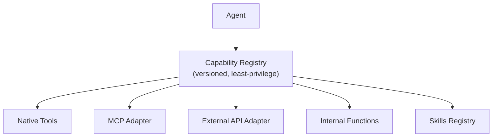
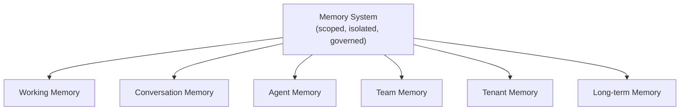
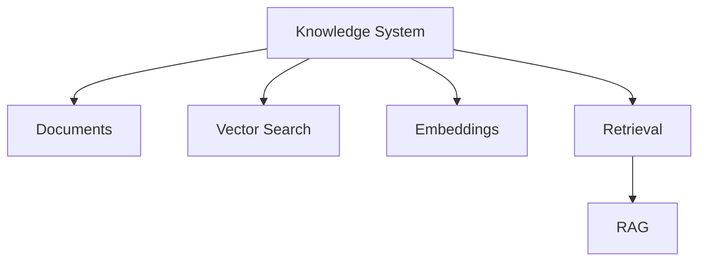

# Capabilities — Tools, Functions, Skills & MCP (PROPOSED)

> **Scope:** the capability layer — reusable tools, functions, skills, and MCP
> connections that agents invoke. Layer context:
> [`04-system-architecture.md`](04-system-architecture.md).
> Consumer: [`05-agent-runtime.md`](05-agent-runtime.md). MVP usage:
> [`02-mvp.md`](02-mvp.md). Canonical strategy:
> [`12-agentic-platform-strategy.md`](12-agentic-platform-strategy.md).
> Security/tenancy:
> [`07-multitenancy-security.md`](07-multitenancy-security.md).
>
> **Status:** `proposed` — the unified capability registry does not exist
> yet; the manifest specs below are targets.
> Live tools today are the App Builder's VFS/REST toolset in the Go control
> plane ([`MULTI_AGENT.md`](MULTI_AGENT.md)) and the 7 workflow node types
> ([`DEV_CHECKLIST.md`](DEV_CHECKLIST.md) P2 registry content). MCP support is
> PROPOSED and gated on the trust/security slice of M0 — no MCP client
> exists in the tree today. Last
> reviewed: 2026-11-15.

## Concepts (Tool vs Function vs Skill vs MCP)

- **Tool** — a directly invocable capability with a typed manifest (name,
  version, I/O schemas, permissions, side-effect level, timeouts, retry and
  idempotency policy, secrets requirements, publisher, provenance).
- **Function** — a reusable business capability with typed input/output
  that an agent can invoke: the unit of real work. Agents plan and supervise;
  functions act. Business logic lives in functions (versioned, typed,
  testable), never inside agent prompts.
- **Skill** — a reusable instruction/behavior package (name, version,
  description, instructions, required capabilities, compatibility, publisher,
  license, provenance) that extends what agents know how to do.
- **MCP connection** — a governed bridge to an external MCP server (server
  registration, tool discovery, permission mapping, auth/secret handling,
  lifecycle, timeouts, audit, tenant isolation, trust policy). MCP servers
  are **untrusted external boundaries**: tool discovery never grants
  execution permission.
- All four live behind one **Capability Registry** with versioning,
  compatibility validation, and least-privilege wiring.

## Canonical structure (PLANNED target — not live)

> The tree below is the **target** capability/memory/knowledge shape the
> M0–M6 roadmap builds toward. Only the seeds named in
> [Relationship to today's tools](#relationship-to-todays-tools) exist
> today; everything else is PROPOSED. Canonical strategy:
> [`12-agentic-platform-strategy.md`](12-agentic-platform-strategy.md).

Reading rule: memory scopes are Run, Conversation, Agent, Team, Tenant (see
[`12-agentic-platform-strategy.md`](12-agentic-platform-strategy.md));
knowledge (documents, vector search, embeddings, retrieval, RAG) is a
provider-independent abstraction governed by the storage rule in the strategy
(no new vector/relational store decision until Redis + D1 capabilities are
evaluated against workload, scale, isolation, and cost).

## Initial capability catalog (M0 scope)

Built-in Tools first (every one ships as a versioned Tool Manifest with
typed I/O, permissions, side-effect level, and approval metadata):

| Tool | Side-effect | Approval |
|---|---|---|
| HTTP Request | external | policy-gated |
| Database Query | external | policy-gated, tenant-scoped connection |
| Browser | external | approval required |
| Email | external | approval required |
| File System | tenant-scoped | scoped to tenant VFS (live seed: `vfs_read`/`vfs_write`/`vfs_list`) |
| GitHub | external | approval + scoped token (vault reference, never plaintext) |
| Search | safe | none (rate-limited) |
| Payment | irreversible | approval required, idempotency key mandatory |
| Custom API | external | policy-gated |

Starter Skills (every one ships as a versioned Skill Manifest with
instructions + required capabilities + compatibility):

| Skill | Teaches | Requires |
|---|---|---|
| SEO Research | Keyword + content-gap workflow with scoring rubric | Search, HTTP Request |
| Market Analysis | TAM/competitor synthesis format with sources | Search, HTTP Request |
| Python Development | Repo conventions, test-before-commit, review checklist | File System, GitHub |
| Data Analysis | Dataset profiling, chart spec, caveat reporting | Database Query, File System |
| Financial Research | Filing lookup, metric extraction, uncertainty flags | Search, HTTP Request |
| Customer Support | Triage, tone, escalation rules, macro format | Knowledge, Email (approval-gated) |

The AI Sales reference
template (lead qualification + follow-up + CRM write-back) may exercise the
catalog as a demo — it is not the MVP. The catalog grows per roadmap phase —
never wholesale.

## MCP: a product priority (M0 trust slice → M1 execution → M5 catalog)

MCP support is a **core product priority**, not an accessory: it is how the
platform reaches third-party tools and data without rebuilding integrations.
Phased, with security gates at every step:

1. **M0 — trust slice first.** MCP client adapter behind the permission
   boundary: server registration, permission mapping, auth/secret handling
   (vault references), lifecycle, timeouts, per-call audit, tenant
   isolation, trust policy. Discovery never grants execution; every
   MCP-exposed tool executes only through a versioned Tool Manifest with the
   same approval and side-effect rules as native tools. No community MCP
   server grants execution without this slice.
2. **M1 — multi-agent use.** Delegated MCP calls across coordinator/worker
   agents with the same tenant context and audit trail; team-level traces
   show which agent invoked which MCP tool.
3. **M5 — MCP Catalog.** Governed discovery and install of MCP server
   configurations (see [`08-marketplace.md`](08-marketplace.md)): publisher
   identity, security scanning, trust/provenance, versioned configs,
   install/update flows, usage tracking.

Security rule (normative, unchanged): MCP servers are **untrusted external
boundaries** — tool discovery is read-only metadata until a human or policy
explicitly grants execution, and every grant is auditable, revocable, and
tenant-scoped.

## Capability requirements (every tool/function/skill/MCP, no exceptions)

1. **Typed input/output** — a schema the agent plans against and the
   platform validates.
2. **Authorization** — capability-level permission check in the execution
   path.
3. **Tenant context** — every call carries the tenant; no cross-tenant
   access is representable.
4. **Audit log** — who (user/agent), what (function, inputs summary,
   result), when, under which approval.
5. **Rate limiting** — per tenant and per function.
6. **Retry policy** — explicit, per function (idempotent ones may retry;
   external side effects may not silently retry).
7. **Idempotency where needed** — business writes deduplicate by intent key.
8. **Observability** — structured logs/metrics linked to the run lineage.
9. **Side-effect level** — declared metadata: `safe` / `external side
   effect` / `irreversible` — driving human-approval requirements
   ([`05-agent-runtime.md`](05-agent-runtime.md) flow step 9).

## Registry and manifests (proposed shape)

Each tool/function is registered with a manifest: name, version, typed IO
schema,
side-effect level, required approvals, tenant-policy hooks, retry/idempotency
policy, rate limits, secrets requirements, publisher, provenance. Each skill
is registered with: name, version, description, instructions, required
capabilities, compatibility, publisher, license, provenance. This extends the
capability-registry direction
already planned as engineering P1/P2 content (node packages as first registry
entries — [`DEV_CHECKLIST.md`](DEV_CHECKLIST.md)).

Forward compatibility (not implemented): the manifest must stay able to accept a
signed provenance claim for the publisher identity described as W3.1
([`11-aaas-web3-strategy.md`](11-aaas-web3-strategy.md)) without changing its
current shape — add the claim as an optional field with its own ADR when M4
starts. No DID, chain or token field is introduced by this document.

## Relationship to today's tools

- The VFS tools (`vfs_read`/`vfs_write`/`vfs_list`) prove typed,
  least-privilege, tenant(room)-scoped tooling today — in the App Builder
  domain.
- The workflow node types (`trigger/http/db/ai/email/condition/sleep`) are
  the first *executed* capability primitives; business functions generalize
  them with typed IO and authorization.
- Function execution technology is open (Go today; Bun-based execution is a
  candidate — see [`04-system-architecture.md`](04-system-architecture.md)
  register; security boundaries are defined in
  [`07-multitenancy-security.md`](07-multitenancy-security.md), not by the
  runtime vendor).

## Non-goals

- No plugin ecosystem in M0–M3 (capabilities are first-party, curated until
  M5 preconditions hold).
- No capabilities without manifests, audit and tenant scoping.
- No data ownership outside the platform's data layer.
- No community MCP servers granted execution without the M0 trust slice and
  M5 review gates.

## Manifest-first rule (normative, from day one)

The four manifests below are **foundational design contracts, not a later
phase**: every Agent, Skill, Tool/Function/MCP capability, and System is
defined by a versioned, validated, serializable manifest from the first
implementation slice (M0). No agent, skill, tool, or system ships without
one; no execution path accepts an unmanifested artifact. The manifests are
the portable surface of the platform: authoring (NL Studio, Visual Builder,
SDK/CLI/API, Git) produces manifests, the compiler validates manifests, and
the registry stores, versions, diffs, imports, and exports manifests. Full
field lists and the System IR reconciliation live in the strategy doc
([`12-agentic-platform-strategy.md`](12-agentic-platform-strategy.md)) and
the IR spec (P7.2). The concrete schemas, canonical form and validation gate
now live in [`architecture/manifest-schemas.md`](architecture/manifest-schemas.md) (P7.1).

## The four manifests (minimal target shapes, PROPOSED)

Conventions shared by all four (normative): `kind` + `apiVersion` envelope,
`metadata.name` (DNS-safe, immutable once published), semantic `version`
(`MAJOR.MINOR.PATCH`), `spec` for the contract, `status` never stored in the
manifest (runtime state lives in the data layer, not the file). Serialization:
canonical YAML or JSON with deterministic key ordering; UTF-8; file extension
`.vibesdk.yaml` / `.vibesdk.json`. Compatibility: same `MAJOR` must validate
and execute; `MINOR` adds optional fields only; `PATCH` changes no contract.
Breaking changes require a new `MAJOR` plus a migration note. Provenance:
`publisher`, `license`, and an optional signed claim slot reserved for the
W3.1 identity work (no DID/chain/token field is introduced here).
Import/export: every manifest round-trips byte-identical through
validate, store, export (canonical serialization); references between
manifests are content-addressed (`kind/name@version`, never raw paths).

<!-- MANIFEST_EXAMPLES -->

### 1. Agent Manifest (`kind: Agent`)

Identifies and bounds one runnable agent: who it is, what model it may use,
what it may touch, what it remembers, what it accepts/returns, and under
which policy it runs. Minimal shape:

`metadata.name` (DNS-safe, immutable), `version` (semver), `publisher`,
`license`; `spec.role`, `spec.instructions`, `spec.model` (ref + policy),
`spec.tools` (Tool refs), `spec.skills` (Skill refs), `spec.memory` (scope +
retention), `spec.knowledge` (Knowledge refs), `spec.inputSchema` /
`spec.outputSchema`, `spec.policies` (approvals, resource limits). Example:
a `lead-qualifier` agent at `1.2.0` pinning `tool/crm-read@2`,
`tool/score-lead@1`, `skill/qualification-rubric@3`, conversation memory
with 30-day retention, and `maxSteps: 25` / 300s timeout.

### 2. Skill Manifest (`kind: Skill`)

A reusable instruction/behavior package: what it teaches, what capabilities
it needs, and what it is compatible with. Skills never execute code directly;
they extend what Agents know how to do. Minimal shape: `metadata` as above;
`spec.description`, `spec.instructions`, `spec.requires.capabilities` (Tool
refs), `spec.requires.agentApiVersion`, `spec.compatibility` (agents,
models). Example: a `qualification-rubric` skill at `3.0.1` requiring
`tool/score-lead@1`.

<!-- MANIFEST_PART2 -->

### 3. Tool Manifest (`kind: Tool`)

One invocable capability: native tool, internal function, MCP-exposed tool,
or external API call. This is the permission and safety contract the runtime
enforces; prompts never substitute for it. Minimal shape: `metadata` as
above; `spec.description`, `spec.inputSchema` / `spec.outputSchema`,
`spec.permissions`, `spec.tenant` (isolation required + context key),
`spec.sideEffect` (`safe` / `external` / `irreversible`), `spec.approvals`,
`spec.timeoutSeconds`, `spec.retry`, `spec.idempotency`,
`spec.rateLimits`, `spec.secrets` (references only, never values),
`spec.provenance`. Example: a `score-lead` tool at `1.0.0` with
`leads:read, leads:score` permissions, 30s timeout, 3-attempt retry,
intent-key idempotency, and a 120/min tenant rate limit. An MCP-exposed tool
uses the same `kind: Tool` with an adapter pointer
(`type: mcp`, server + tool name); the MCP trust policy is enforced at the
adapter, and discovery never grants execution by itself.

### 4. System Manifest (`kind: System`)

The complete agentic system: the composition the compiler validates,
versions, deploys, and operates. It references, never inlines, the other
three manifests, so every part stays independently versioned, diffable, and
reusable. The System Manifest is the serializable form of the Canonical
System IR v1 (minimal viable scope); the full IR field list stays in the
strategy doc until the `system-ir.md` spec lands. Minimal shape: `metadata`
as above; `spec.outcome`, `spec.agents` (named Agent refs + delegation),
`spec.topology` (run order, conditions, error policy), `spec.routing`,
`spec.approvals`, `spec.deployment`, `spec.evaluation` (dataset + thresholds).
Example: an `inbound-sales` system at `0.3.0` composing a `lead-qualifier`
agent and a `followup-drafter` agent with a qualified-gated edge, an
external-message approval for the sales-lead role, and a 0.85 precision
evaluation threshold.

## Import/export and versioning contract (normative)

1. Every manifest validates against its JSON Schema before the registry
   accepts it; invalid manifests are rejected with field-level errors.
2. Versioning is semantic and enforced: `MAJOR` breaks, `MINOR` extends
   optionally, `PATCH` fixes. A System pins exact `kind/name@version` refs;
   floating refs are rejected at deploy time.
3. Export is canonical: exporting a System produces the System Manifest plus
   its pinned Agent/Skill/Tool closures in one content-addressed bundle;
   importing a bundle revalidates the whole closure before storing anything.
4. Diff is structural: contract changes (schemas, permissions, policies) are
   reported separately from text changes (instructions).
5. Provenance travels with the file: publisher, license, optional signature
   slot; secrets are references only, never values.
