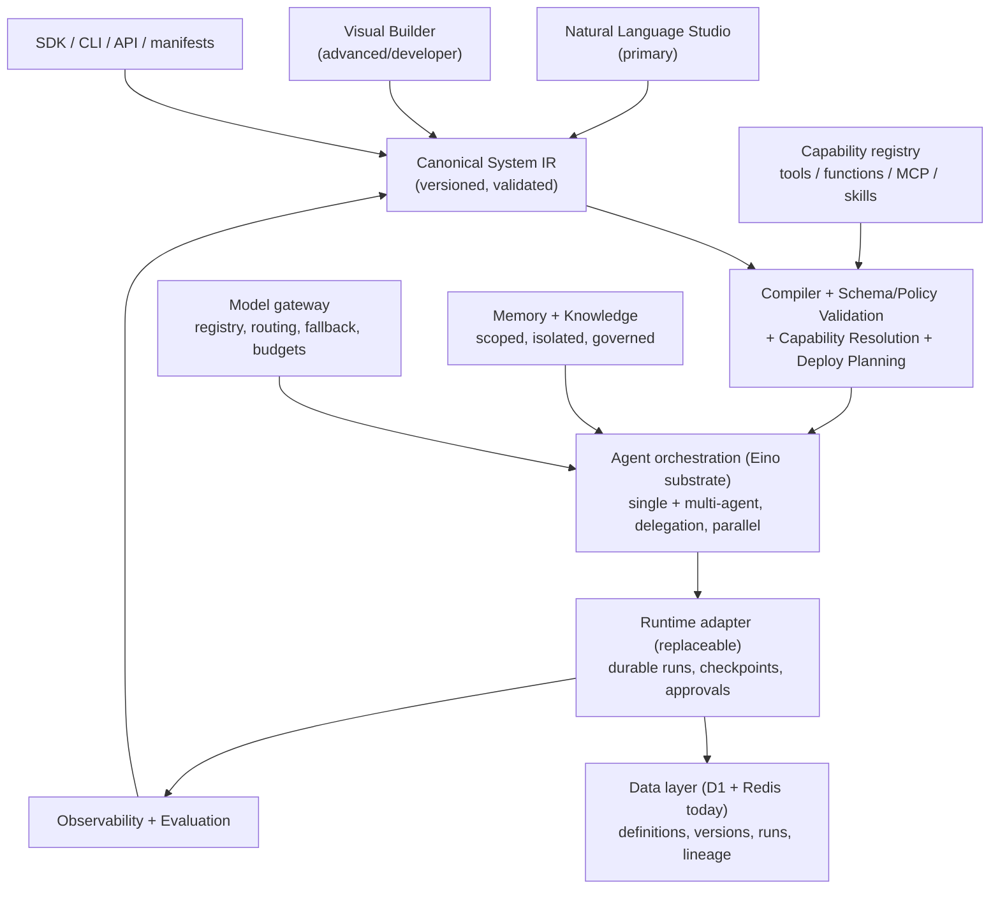
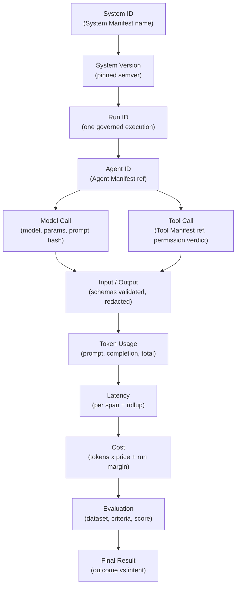
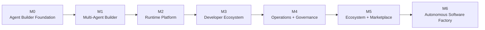

# VibeSDK Agentic Platform Strategy (CANONICAL)

> **Scope:** canonical product and engineering strategy for VibeSDK as an **Open
> Agentic Platform**. Strategy apex: product identity, canonical system model,
> target architecture, technology boundaries, and the M0–M6 roadmap mapped onto
> engineering P0–P6. Strategy, not status: reality in [`DEV_STATUS.md`](DEV_STATUS.md),
> ordered work in [`DEV_CHECKLIST.md`](DEV_CHECKLIST.md).
>
> **Status:** `adopted` 2026-11-15. Supersedes the Business OS / AI Sales wedge
> positioning of [`00-product-vision.md`](00-product-vision.md) **as product
> positioning only**. Preserved: the system model and moats of
> [`PRODUCT_THESIS.md`](PRODUCT_THESIS.md); the P0–P6 backlog and task IDs of
> [`DEV_CHECKLIST.md`](DEV_CHECKLIST.md); all verified statuses of
> [`DEV_STATUS.md`](DEV_STATUS.md).
> Decision record: [`10-decisions-and-open-questions.md`](10-decisions-and-open-questions.md)
> (D7). Last reviewed: 2026-11-15.

## Contents

| Section | Anchor |
|---|---|
| Executive Summary | [`#executive-summary`](#executive-summary) |
| Product Identity and Positioning | [`#product-identity-and-positioning`](#product-identity-and-positioning) |
| Market and User Segments | [`#market-and-user-segments`](#market-and-user-segments) |
| Natural Language First and Visual Builder Strategy | [`#natural-language-first-visual-builder-for-developers`](#natural-language-first-visual-builder-for-developers) |
| Canonical System IR | [`#canonical-system-ir`](#canonical-system-ir) |
| Target Architecture | [`#target-architecture`](#target-architecture) |
| Technology Stack | [`#technology-stack`](#technology-stack) |
| Agent and Multi-Agent Model | [`#agent-and-multi-agent-model`](#agent-and-multi-agent-model) |
| Model Gateway | [`#model-gateway`](#model-gateway) |
| Tools, Skills and MCP | [`#tools-skills-and-mcp`](#tools-skills-and-mcp) |
| Memory and Knowledge | [`#memory-and-knowledge`](#memory-and-knowledge) |
| Runtime | [`#runtime`](#runtime) |
| Data Layer | [`#data-layer`](#data-layer) |
| Security and Governance | [`#security-and-governance`](#security-and-governance) |
| Observability and Evaluation | [`#observability-and-evaluation`](#observability-and-evaluation) |
| Open Core and Developer Ecosystem | [`#open-core-and-developer-ecosystem`](#open-core-and-developer-ecosystem) |
| Marketplace Strategy | [`#marketplace-strategy`](#marketplace-strategy) |
| Business Model | [`#business-model`](#business-model) |
| Product Roadmap M0–M6 | [`#product-roadmap-m0-m6`](#product-roadmap-m0-m6) |
| Engineering Roadmap Mapping | [`#engineering-roadmap-mapping`](#engineering-roadmap-mapping) |
| Competitive Differentiation Hypotheses | [`#competitive-differentiation-hypotheses`](#competitive-differentiation-hypotheses) |
| Risks and Mitigations | [`#risks-and-mitigations`](#risks-and-mitigations) |
| Metrics and Launch Gates | [`#metrics-and-launch-gates`](#metrics-and-launch-gates) |
| Open Decisions | [`#open-decisions`](#open-decisions) |
| References | [`#references`](#references) |

## Executive Summary

VibeSDK is an **open, managed agentic platform**: developers, AI builders, and
businesses create, compose, deploy, operate, evaluate, and evolve autonomous AI
agents and multi-agent systems. The platform takes a stated outcome — expressed
first in **natural language** — and turns it into an operating, governed,
improvable agentic system.

Three corrections define this revision:

1. **The platform is the product.** The 2026-10-06 wedge (AI-Native Business OS
   sold through one AI Sales outcome) is retired as the product identity. The
   initial product is the **Agent Builder** (M0): single agents first, then
   multi-agent systems (M1), runtime (M2), ecosystem (M3), operations (M4),
   marketplace (M5), Autonomous Software Factory (M6). The live App Builder is
   the first **reference workload** and factory seed — repositioned, kept.
2. **One canonical system model, multiple interfaces.** Natural Language Studio
   (primary), Visual Builder (advanced/developer), SDK/CLI/API, and
   code/manifest configuration all compile into the same versioned, validated
   **Canonical System IR**. One agent model — never two parallel models.
3. **Implementation honesty is load-bearing.** Capabilities are labeled
   `CURRENT_IMPLEMENTED`, `IMPLEMENTED_UNVERIFIED`, `PLANNED`, `PROPOSED`,
   `DEPRECATED`, or `OPEN_DECISION` (see mapping below). Engineering P0–P6 and
   historical task IDs are preserved verbatim; M0–M6 maps onto them.

## Product Identity and Positioning

- **Name:** VibeSDK. **Category:** Open Agentic Platform.
- **Positioning:** Build, Compose, Deploy, Operate and Evolve AI Agent Systems.
- **Core definition:** open-core, managed platform to create, compose, deploy,
  operate, evaluate, and evolve autonomous agents and multi-agent systems.
- **Primary interaction:** Natural Language Agent Builder.
- **Advanced interaction:** Visual Agent Builder (developers / advanced users).
- **Developer interaction:** Visual Builder, SDK, CLI, API, code/manifest config.
- **Strategic principle:** one canonical system model, multiple interfaces, one
  validation and execution architecture.
- **Long-term direction:** Agentic Platform into Autonomous Software Factory
  (M6 destination, never the MVP).

Not: generic ERP/CRM/vertical SaaS; generic workflow canvas or chatbot
builder; general IDE; model host; marketplace-first product (M5 follows demand).

## Market and User Segments

| Segment | Description | Priority |
|---|---|---|
| AI Developers | Production agents/multi-agent apps. Needs: control, visual editing, SDK/API, custom tools, MCP, versioning, debugging, deploy, observability. | INITIAL_PRIMARY |
| AI Builders | Technical/semi-technical, NL + components. Needs: NL creation, templates, tools, simple config, testing, deploy. | INITIAL_PRIMARY |
| Businesses and Teams | Operations deployment. Needs: ready agents, collaboration, governance, approvals, reliability, cost controls, outcomes. | SECONDARY_EXPANSION |

Status: candidate segments, hypothesized pains (fragmented orchestration,
tooling, deploy, runtime, evaluation, ops). Not validated — validate in M0.

## Natural Language First and Visual Builder Strategy

- **Natural Language Studio (primary):** intent extraction, clarification,
  planning, composition, tool/skill/model selection, generation, validation,
  approval, deployment.
- **Visual Agent Builder (advanced):** agent/model/tool/MCP/memory/knowledge/
  condition/router/approval nodes, parallel execution, team composition, I/O
  contracts, trace, debugging, validation, import/export.
- **Visual constraints (normative):** same Canonical System IR; never executes
  raw frontend graph state; read-only inspection before advanced editing;
  preserves validation/authorization; graph is advanced, never mandatory entry.
- **Operations Console:** runs, history, health, errors, latency, resources,
  cost, approvals, versions, evaluation results.
- **Developer Platform:** SDK, CLI, REST API, webhooks, OpenAPI, manifests,
  import/export, Git integration, docs, examples.

## Canonical System IR

**Status: PROPOSED target architecture.** All creation paths (NL Studio,
Visual Builder, SDK, CLI, API, manifests) compile into one versioned,
validated, serializable intermediate representation of a complete agentic
system. No direct execution of unvalidated IR.

Pipeline: User Intent, Intent Parsing, Requirement Clarification, System
Planning, System Compiler, Canonical System IR, Schema Validation, Policy
Validation, Capability Resolution, Deployment Planning, Agent Runtime,
Execution, Observability, Evaluation, Versioning and Improvement.

The IR must represent: system identity/version, outcome/purpose, agents,
teams, agent relationships, delegation semantics, models + model policies,
tools, MCP connections, skills, memory scopes, knowledge sources, policies,
input/output contracts, execution topology, retry/timeout policies, approval
requirements, resource limits, evaluation criteria, deployment configuration.

IR requirements: schema versioning + backward-compatibility strategy,
validation, deterministic serialization, import/export, diff support, migration
strategy, source provenance, separation of desired vs runtime state.

The System Manifest is the serializable form of the Canonical
System IR v1 (minimal viable scope); the full IR field list stays in the
strategy doc until the `system-ir.md` spec lands. Minimal manifest shapes
(Agent, Skill, Tool, System) and the import/export + versioning contract:
[`06-functions-and-tools.md`](06-functions-and-tools.md).

Design warning: do not build an over-general universal IR prematurely. Define
a minimal viable schema and test it against four cases — the current App
Builder, a single Agent, a multi-agent team, a visual workflow — before any
expansion. A dedicated specification (`docs/architecture/system-ir.md`) and ADR
are PLANNED, not written here; writing them requires alternatives and
trade-offs first.

## Target Architecture

CURRENT (live dual-plane: Go control plane + light Worker + React SPA) stays
labeled CURRENT in [`llm.md`](llm.md) and
[`architecture-diagrams.md`](architecture-diagrams.md). Everything above
beyond the live App Builder team, workflow interpreter, and lineage tables is
PLANNED and dependency-ordered (M0–M6).

## Technology Stack

Frontend (React + TypeScript + Vite + Bun baseline; evolve the live SPA, no
rewrite): Tailwind CSS (styling, CANDIDATE), shadcn/ui (reusable components,
CANDIDATE — legacy `src/components/ui/` stays, no new primitives where Kumo
covers), XYFlow/React Flow (visual editor, CANDIDATE_REQUIRES_ADR —
`@xyflow/react@12.11.6` already a dependency for the inspection visualizer;
promotion to editor needs ADR), Zustand (client state, CANDIDATE — today
transitive via XYFlow only), TanStack Query (server state, CANDIDATE —
`@tanstack/react-query@5.101.4` already a dependency; centralize keys per
AGENTS.md), Monaco Editor (code/JSON editing, CANDIDATE — `monaco-editor`
already a dependency). Must serve: NL Studio, Visual Builder, Operations
Console, realtime updates, accessible UI, i18n readiness.

Backend control plane (Go + Fiber baseline, keep and evolve): auth integration,
tenant context, system/agent management, model configuration, capability
registry, system compiler API, execution/approval/deployment management,
audit, usage/quotas.

Agent orchestration (Eino + DeepAgent coordinator/coder/reviewer baseline,
retain; add VibeSDK-owned agent abstractions/adapters): single-agent,
multi-agent coordination, delegation, parallel execution, structured I/O,
communication contracts, tool invocation, context management, error recovery,
budgets, evaluation hooks. Warning: Eino is an implementation dependency, not
the canonical public Agent model — never leak Eino types into manifests/APIs.

## Agent and Multi-Agent Model

Canonical Agent definition (target): identity, role/instructions, model +
policy, tools, skills, memory/knowledge scopes, I/O contracts, policies,
execution limits, lifecycle (created, versioned, deployed, paused, retired).
Single-agent execution plus multi-agent coordination: coordinator/worker roles,
delegation, parallel execution, structured results, shared context with
explicit scopes, review/approval, team traces, failure/recovery, evaluation.
Live seed: DeepAgent team in `backend/pkg/engine/team.go` (App Builder domain);
generalizing it from "write files" to "invoke governed capabilities" is the
M0–M1 path. Detail: [`05-agent-runtime.md`](05-agent-runtime.md).

## Model Gateway

Status: TARGET ARCHITECTURE (no gateway exists today; per-role models via
`backend/pkg/agent/eino_engine.go` NewRoleModel). Requirements: provider
registry, model registry, OpenAI-compatible adapter (+ provider adapters),
per-agent selection, routing, fallback, retry, rate limits, timeouts, context
window awareness, cost estimation, usage tracking, provider health, evaluation,
secret references. Rule: provider integrations are replaceable and never
hardcoded into Agent business logic.

### Open and open-source models (normative direction)

The gateway serves **all models behind one contract**: proprietary APIs and
open-source / self-hostable models alike. Open models are first-class
entries in the model registry (same routing, fallback, budgets, evaluation
as hosted ones); the choice of which open models to serve, and where they
run, is an OPEN deployment decision — never a claim made here. No model is
bundled or hardcoded into any Agent Manifest; Agents reference a model
policy, the gateway resolves it.

### LoRA fine-tuning (FUTURE direction, not a commitment)

Adapter-style fine-tuning (LoRA and equivalents) is a **future direction**:
per-tenant or per-use-case adapters trained from the platform's own
evaluation/feedback data (the eleven Observability streams), versioned like
any other artifact, and served through the gateway behind the same policy
and cost attribution. No training pipeline, dataset, or serving target is
chosen by this document; no timeline is claimed. What is normative today:
evaluation data is collected attribution-clean (Run → Agent → Model Call),
so a future tuning phase has something trustworthy to learn from.

## Tools, Skills and MCP

Native Tools + Internal Functions + MCP Adapter + External API Adapter +
Skills Registry, all behind one Capability Registry. **MCP is a core
product priority** (M0 trust slice → M1 multi-agent use → M5 MCP Catalog),
phased behind security gates — full plan in
[`06-functions-and-tools.md`](06-functions-and-tools.md). **Manifest-first
(normative, from day one):** the four manifests — Agent, Skill, Tool, System —
are versioned (`MAJOR.MINOR.PATCH`), validated against JSON Schema, and
import/export round-trippable from the first implementation slice (M0); no
agent, skill, tool, or system ships without one, and the System Manifest
references (never inlines) the other three. Full minimal shapes and the
normative versioning contract:
[`06-functions-and-tools.md`](06-functions-and-tools.md). Tool manifest: name,
version, description, I/O schemas, permissions, tenant requirements,
side-effect level, timeout, retry/idempotency policy, rate limits, secrets
requirements, publisher, provenance. Skill manifest: name, version,
description, instructions, required capabilities, compatibility, publisher,
license, provenance. MCP: client adapter, server registration, tool discovery,
permission mapping, auth/secret handling, lifecycle, timeouts, audit, tenant
isolation, trust policy. Security warning (normative): MCP servers and
community tools are untrusted external boundaries — discovery never grants
execution permission. No MCP client exists in the tree today (verified by
search); MCP support is PROPOSED, gated on the trust/security slice of M0.
Detail: [`06-functions-and-tools.md`](06-functions-and-tools.md).

## Memory and Knowledge

Provider-independent abstractions. Scopes: Run, Conversation, Agent, Team,
Tenant. Components: working/conversation/agent/team memory, tenant knowledge,
long-term memory, retrieval, vector search, document ingestion. Requirements:
explicit scope, access control, retention/deletion policies, tenant isolation,
provenance, versioning where required, provider replaceability. Storage rule:
no new vector/relational store decision until Redis (VFS/state, `vfs:{chatId}`,
snapshots) and D1 (lineage `generations` family, `workflow_*`, users/sessions)
capabilities are evaluated against workload, query patterns, scale,
persistence, isolation, and cost.

## Runtime

Baseline: Go control plane + Cloudflare Workflows (`VibeWorkflow`, schema v2,
7 node types) + Redis state. Strategy: separate orchestration decisions (Eino)
from durable execution (replaceable runtime adapter owns run lifecycle).
Required: long-running execution, durable state, checkpointing, retry,
timeout, cancellation, pause/resume, human approval, scheduling, event
triggers, parallel execution, idempotency, recovery, history, resource limits,
tenant quotas. Architecture: define a Runtime Adapter interface, a canonical
Run State Machine, event/checkpoint contracts; at-least-once + idempotency
explicit; never claim exactly-once without proof. Analyze Workflows limits
(see [`CF_LIMITS.md`](CF_LIMITS.md)) before expanding its role.
Detail: [`04-system-architecture.md`](04-system-architecture.md).

## Data Layer

Baseline preserved (D1 + Redis + lineage tables) until workload evidence
forces a move. Logical domains: users/sessions, tenants/memberships, agent
definitions, system definitions/versions, tool/skill manifests, runs, run
events, checkpoints, approvals, memory/knowledge metadata, usage/billing,
audit, generation lineage. Requirements: clear ownership, tenant isolation,
migrations, retention, backup/recovery, versioning, auditability. Warning: do
not force all data into D1 or Redis — produce a data-ownership/workload matrix
before any database decision.

## Security and Governance

Priority: FOUNDATIONAL BLOCKER FOR PUBLIC LAUNCH. Requirements:
authentication, tenant isolation, authorization, RBAC, agent identity,
capability permissions, secret management, API keys, sandbox boundaries, tool
trust policies, rate limits, resource quotas, audit logs, approval gates, data
retention, abuse prevention. Principles: prompts are not authorization; every
tool call is runtime permission-checked; every request/run carries tenant
context; cross-tenant access denied by construction; external side effects are
approval/policy controlled; untrusted code never runs with control-plane
privilege; secrets never in plaintext manifests/logs. Public-launch gates
(verbatim blockers): no launch without tenant isolation tests green (P0.7),
per-call audit with identity, approval gates on external side effects,
credential-vault references (no plaintext), rate limits/quotas enforced.
Detail: [`07-multitenancy-security.md`](07-multitenancy-security.md).

## Observability and Evaluation

> This is the layer that separates a **Demo from a Production platform**:
> every execution carries a complete, queryable trace from System down to
> Final Result. Status: PROPOSED target — the live lineage discipline
> (`generations` / `generation_audits` in D1, see `worker/database/schema.ts`)
> is the seed; the full run-trace hierarchy below does not exist yet.

Requirements: run tracing, agent/model-call/tool-call tracing, structured
logs, latency, token/resource usage, cost attribution, error classification,
evaluation datasets + criteria, human feedback, regression tests, run
comparison, quality metrics. Strategy: build observability into execution
contracts and the lineage model (extend `generations`/`generation_files`/
`generation_audits` discipline to runs), not as an isolated dashboard later.

### Canonical Run Trace (PLANNED target — every execution, no exceptions)

Each level carries its own identity + timestamps; a child never exists
without its parent's ID. Trace identity propagates top-down
(System → Version → Run → Agent → Calls); cost and evaluation roll up
bottom-up (Calls → Run → System).

Level contracts (normative for the target design):

| Level | Must record |
|---|---|
| System ID / Version | Manifest name + pinned semver; resolves the exact Agent/Tool/Skill closure executed. |
| Run ID | Tenant + user identity, trigger, policy snapshot, approval states, final status. |
| Agent ID | Agent Manifest ref, delegation parent (if any), scoped memory snapshot pointer. |
| Model Call | Model ID + version, parameters hash, prompt hash (never raw secrets), retry count, error class. |
| Tool Call | Tool Manifest ref, permission verdict, side-effect level, approval ref, idempotency key. |
| Input / Output | Validated against the manifest schemas; secrets redacted at write time, never at read time. |
| Token Usage | Prompt / completion / total per model call, rolled up per agent and per run. |
| Latency | Per-span durations plus critical-path rollup per agent and per run. |
| Cost | Token usage x model price + run margin; attributed per agent, per run, per tenant. |
| Evaluation | Dataset ref + version, criteria, score, human-feedback pointer, regression delta vs baseline. |
| Final Result | Outcome vs the stated intent, linked back to the Run ID for replay and audit. |

Honesty note: today only generation-level lineage exists (open/finish +
diff + audit per generation). Model-call/token/latency/cost capture,
agent-level spans, evaluation datasets, and run comparison are all PROPOSED
(M2–M4 work, not live) — no benchmark, cost, or quality numbers are claimed.

### Capability checklist (normative target — all eleven, M2–M4)

| # | Capability | What it answers | Rolls up to |
|---|---|---|---|
| 1 | Agent Execution Tracing | Which agent ran, in what order, with what delegation parent | Run → System |
| 2 | Tool Call Logs | Which tool, with which inputs, under which permission verdict and approval | Agent → Run |
| 3 | Model Usage | Which model + version, how many calls, prompt/completion/total tokens | Agent → Run |
| 4 | Cost per Run | Tokens x price + margin for one governed execution | Tenant, System |
| 5 | Cost per Agent | Same attribution sliced by Agent Manifest ref | Run, System, Tenant |
| 6 | Latency | Per-span durations + critical-path rollup | Agent → Run |
| 7 | Error Tracking | Error class per span (retryable, approval-denied, policy-blocked, provider, timeout) + recovery action | Agent → Run |
| 8 | Evaluation Scores | Dataset ref + version, criteria, score per run | System version |
| 9 | Success Rate | Share of runs meeting thresholds over a window, per System version | System, Tenant |
| 10 | Human Feedback | Thumbs/ratings + free text linked to a Run ID and span | Evaluation, Agent |
| 11 | Regression Testing | Same dataset re-run on a new System version; delta vs baseline blocks or warns promotion | System version |

All eleven are PROPOSED (none live beyond generation-level audit); each
ships with its retention policy and tenant scoping before it counts as done.

### Future: the self-improvement loop (M6 direction, not a claim)

These eleven data streams are collected from day one of the target design so
that a later phase can close the loop: traces + scores + feedback + cost feed
an **execution → evaluation → repair** cycle where measured runs improve the
system — prompt/instruction tuning, model routing changes, tool-policy
tightening, or version rollback — with human approval at sensitive
side-effect boundaries. The loop itself is M6 factory work
([`09-software-factory.md`](09-software-factory.md)); collecting clean,
attributed data in M2–M4 is what makes it possible later. No autonomous
self-modification is authorized by this document.

## Open Core and Developer Ecosystem

Strategy: Open Core with Managed Cloud. Local/self-hosted development plus
managed execution/operations. Components: SDK (Go or TS per public API needs),
CLI, REST API, OpenAPI, Agent/Tool/Skill/System manifests, Git
integration, import/export, examples, docs, community process. Requirements:
stable versioned contracts + compatibility rules, local dev path, self-hosting
strategy, contribution guidelines, license clarity, security review for
community artifacts. Warning: no component is assumed open source — the
open-core boundary and license need an explicit strategy/ADR before code.
(ADR placeholder, OPEN — do not choose a license here.)

## Marketplace Strategy

Status: FUTURE PHASE (M5). Artifacts: Agents, Agent Teams, Tools, Skills, MCP
configurations, System Templates. Prerequisites (all normative): stable
manifests, versioning, compatibility validation, publisher identity, security
scanning, trust/provenance, install/update flows, usage tracking. Rule: a
registry/discovery experience may precede a commercial marketplace; never build
commerce before ecosystem demand + security controls. Detail:
[`08-marketplace.md`](08-marketplace.md).

## Business Model

Direction (from D6, unchanged): charge where durable value accrues — runs (cost
pass-through + margin), evaluated outcomes, marketplace take-rate; never raw
tokens or seats. Self-hosted/BYO-cloud packaging matters; keep control plane
separable from any single substrate account. Usage/credits UI
([`usage-limits-ui.md`](usage-limits-ui.md)) aligns to runs/systems as the
platform matures. No token, no mandatory wallet, no chain settlement in initial
phases; Web3 stays a deferred trust/settlement layer per
[`11-aaas-web3-strategy.md`](11-aaas-web3-strategy.md).

## Product Roadmap M0–M6

Governing rule: no phase is skipped; no module pulled forward "for
completeness"; each phase ships a sellable increment. Product M0–M6 must not
be confused with engineering P0–P6 (mapping below).

### M0 — Agent Builder Foundation

Goal: first usable VibeSDK for creating/running individual agents. Features:
NL agent creation, agent config, basic visual editor, model selection, native
tool integration, basic MCP (only if trust/security slice lands), basic
memory, execution, history, versioning, import/export, auth, tenant isolation.
Exit: user creates an agent in NL; same agent inspects/edits in visual editor;
both use the same canonical representation; agent runs one useful task; every
tool call permission-checked + auditable; runs traceable; tenant isolation
tests pass; no critical security boundary unverified.

### M1 — Multi-Agent Builder

Goal: compose coordinated multi-agent systems. Features: agent teams,
coordinator/worker roles, delegation, parallel execution, communication
contracts, shared context (explicit scopes), review/approval, multi-agent
visual composition, team traces. Exit: user composes a system; delegation with
structured results; failures/retries observable; permissions stay isolated.

### M2 — Agent Runtime Platform

Goal: reliable deployment/lifecycle. Features: durable execution,
checkpoints, pause/resume, retry, cancellation, scheduling, events, webhooks,
quotas, deployment, rollback. Exit: long runs recover from supported failures;
state durable; retry/idempotency documented + tested; provider boundary
replaceable.

### M3 — Developer Ecosystem

Goal: extend/integrate without the web UI. Features: public API, SDK, CLI,
OpenAPI, manifest specs, Git integration, local dev, self-hosting docs,
community templates, registry. Exit: developer creates/deploys an agent
without the UI; import/export + compatibility validation work; external
contributions possible.

### M4 — Agent Operations and Governance

Goal: production reliability/quality/control. Features: advanced
observability, evaluation datasets, regression evaluation, run comparison,
cost optimization, advanced permissions, approval policies, team governance,
policy management. Exit: measurable quality/cost; policy enforced; versions
comparable/rollback-able.

### M5 — Agent Ecosystem and Marketplace

Goal: discovery/distribution/reuse/exchange. Features: agent/tool/skill
registries, templates, publisher identity, compatibility checks, security
review, marketplace, revenue sharing. Exit: third-party artifacts install
safely; versions/provenance traceable; real publisher/user demand evidenced.

### M6 — Autonomous Software Factory

Goal: generate/operate complete agentic systems from NL. Features: system
synthesis, generated agents/functions/applications, automated tests, review,
deployment, evaluation, repair, rollback. Exit: generated systems pass
validation/security gates; deployments versioned/reversible; human approval at
sensitive side-effect boundaries. The live App Builder stays the reference
workload and future capability seed — it never defines the whole identity.

## Engineering Roadmap Mapping

Product M-phases map onto engineering P-layers; M-numbers never equal
P-numbers. Historical task IDs are never renumbered. Source-of-truth sample:

| Capability | Status | Evidence |
|---|---|---|
| React SPA + Go Fiber control plane + light Worker | CURRENT_IMPLEMENTED | `src/`, `backend/pkg/api/routes.go`, `worker/light/lightApp.ts`, `wrangler.v2.jsonc` |
| Eino v0.9.21 DeepAgent team (coordinator/coder/reviewer) | CURRENT_IMPLEMENTED | `backend/pkg/engine/team.go`, `backend/go.mod`, `docs/MULTI_AGENT.md` |
| Cloudflare Workflows 7-type interpreter | CURRENT_IMPLEMENTED | `worker/light/` Workflows binding, `backend/pkg/engine/workflowschema.go` |
| D1 lineage tables + Redis VFS/state | CURRENT_IMPLEMENTED | `worker/database/schema.ts`, Redis `vfs:{chatId}` |
| P0.3–P0.9 session/ownership/tenancy guards | IMPLEMENTED_UNVERIFIED | Code + unit tests exist, E2E rollout open (`docs/DEV_CHECKLIST.md` P0) |
| Per-user auth (D1-backed), GitHub export | IMPLEMENTED_UNVERIFIED | Light Worker auth routes; rollout per checklist |
| Canonical System IR / compiler / model gateway / MCP adapter / evaluation | PROPOSED | No code in tree (verified by search); target only |
| Visual editing beyond inspection visualizer | PROPOSED | `src/components/workflow/WorkflowVisualizer.tsx` is inspection-only |
| ThinkAgent/SpaceDO/`worker/api/routes`/`worker/agents/**` | DEPRECATED | Deleted; documented in `docs/llm.md` historical section |
| Frontend rewrite (SvelteKit), Dify, TiDB, Appwrite, Rivet, Bun runtime | OPEN_DECISION | Candidates, need ADRs (`docs/10-decisions-and-open-questions.md`) |

Reuse map: M0 needs P0 (tenancy/security gates) + P1 (lineage/versioning
seed) + P2 slices (compiler/validation start) + P3 slice (durable minimum)
+ new P7 slices (P7.1 manifests, P7.2 System IR, P7.3 MCP trust, P7.6 scoped
memory); M1 needs P1 team primitive + P2 composition + P7.3 multi-agent MCP
use; M2 needs P3 runtime + P0 quotas + P7.4 model gateway + P7.5 runtime
adapter; M3 needs P5 versioning/diff + P4 workbench surfaces; M4 needs P3
observability + P0 policy + P7.7 run trace; M5 needs P5 registry/marketplace;
M6 needs P6 factory loop. Owner of the full matrix: [`DEV_CHECKLIST.md`](DEV_CHECKLIST.md);
reality: [`DEV_STATUS.md`](DEV_STATUS.md).

## Competitive Differentiation Hypotheses

Hypotheses to validate, not claimed advantages. Categories: agent builders
(NL-first creation), agent frameworks (code-first orchestration), workflow
builders (canvas automation), agent runtimes (durable execution primitives),
developer platforms (API/SDK ecosystems). VibeSDK's hypothesized edge, in
ranked order: (1) outcome-to-system synthesis (intent to validated executable
system); (2) one Canonical System IR every creation path compiles to and every
runtime executes; (3) runtime-enforced policy/permissions (not prompts); (4)
system state + lineage (intent to outcome across versions/runs/evaluations);
(5) execution-evaluation-repair loop; (6) versioning/diff; (7) durable
semantics (approvals, schedules, idempotency, recovery); (8) capability
registry/extensibility; (9) distribution network effects. No claim of "no
competitors", no benchmark claims, no PMF/revenue claims.

## Risks and Mitigations

| Risk | Mitigation |
|---|---|
| Parallel-module build-out | Dependency-ordered M0–M6; each phase ships alone; roadmap gates. |
| Two divergent agent models (NL vs visual) | One Canonical System IR, normative; visual never executes raw graph. |
| Over-general IR prematurely | Minimal viable schema; 4-case test (App Builder, single agent, team, workflow) before expansion. |
| Workflows fit for all long-running execution | Runtime Adapter boundary; Workflows limits analyzed first; replaceable vendor. |
| MCP/community supply-chain | Untrusted-boundary rule; discovery grants nothing; trust slice gates M0 MCP; review before M5. |
| Security/tenancy afterthought | P0 gates M0 exit; public-launch blockers explicit; prompts never authorize. |
| Marketplace cold start | Registry before marketplace; commerce only on proven demand. |
| Factory hype without gates | M6 last; validation/security/approval gates normative; App Builder stays reference. |

## Metrics and Launch Gates

Adoption: agent creation activation, successful runs, run retention, developer
contributions. Quality: evaluation pass rates, regression deltas, run
comparison coverage. Cost: cost per run/system, quota adherence. M0 launch
gates: NL-create plus visual-inspect/edit on one representation; useful task
executed; permission-checked + auditable tool calls; traceable runs; tenant
isolation tests green; no unverified critical security boundary.

## Open Decisions

D7 (adopted here): Agentic Platform as primary identity; NL first + Visual for
developers; Canonical System IR requirement; Open Core + Managed Cloud
direction (license/packaging need decisions). Carried open (O1–O8 in
[`10-decisions-and-open-questions.md`](10-decisions-and-open-questions.md)):
ICP validation evidence; SvelteKit/Appwrite/TiDB/Bolt/Bun choices (each needs
trade-off ADR); tenant data-model granularity; durable/gateway choice; Eino vs
Dify; pricing/WTP; Web3 chain/currency (gated M4+, no token, no wallet in
initial phases). New open: System IR schema/ADR, manifest specs, runtime
contract, open-core boundary/license — specified only as planned work.

## References

Product: [`00-product-vision.md`](00-product-vision.md),
[`01-problem-and-icp.md`](01-problem-and-icp.md),
[`02-mvp.md`](02-mvp.md),
[`03-product-roadmap.md`](03-product-roadmap.md),
[`PRODUCT_THESIS.md`](PRODUCT_THESIS.md).
Architecture: [`04-system-architecture.md`](04-system-architecture.md),
[`05-agent-runtime.md`](05-agent-runtime.md),
[`06-functions-and-tools.md`](06-functions-and-tools.md),
[`07-multitenancy-security.md`](07-multitenancy-security.md),
[`08-marketplace.md`](08-marketplace.md),
[`09-software-factory.md`](09-software-factory.md),
[`architecture-diagrams.md`](architecture-diagrams.md).
Decisions: [`10-decisions-and-open-questions.md`](10-decisions-and-open-questions.md),
[`11-aaas-web3-strategy.md`](11-aaas-web3-strategy.md),
[`architecture/adr-aaas-only-end-of-saas.md`](architecture/adr-aaas-only-end-of-saas.md).
Reality: [`DEV_STATUS.md`](DEV_STATUS.md),
[`DEV_CHECKLIST.md`](DEV_CHECKLIST.md),
[`DEV_TASKS_SPEC.md`](DEV_TASKS_SPEC.md),
[`llm.md`](llm.md), [`MULTI_AGENT.md`](MULTI_AGENT.md),
[`CF_LIMITS.md`](CF_LIMITS.md).

