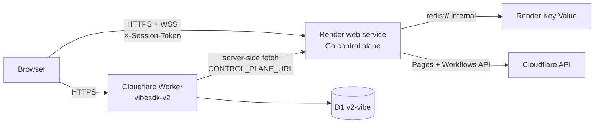

# Deploy: Go + Redis on Render, dashboard on Cloudflare

> Split deployment of the two live planes. Go control plane: `backend/`;
> Worker config: `wrangler.v2.jsonc`; Render blueprint: `render.yaml`.
> Last reviewed: 2026-11-11.

## What runs where

| Piece | Platform | Notes |
|---|---|---|
| React SPA (`dist/client`) + auth, D1, KV, Workflows | Cloudflare Worker `vibesdk-v2` | Serves the dashboard, `/api/auth/*`, GitHub export, `/api/apps`, Workflows |
| Go Fiber control plane (rooms, VFS, LLM streaming, Pages deploys, WS) | Render **web service** (Docker) | `backend/Dockerfile`, health check `/health` |
| Redis-compatible store (`vfs:{chatId}`, `vfs:snap:*`, checkpoints) | Render **Key Value** | Wired into the web service as `REDIS_URL` |



The browser talks to both planes directly: the SPA is served by the Worker, and
every chat/project/WebSocket call goes to the Render URL baked in at build time
(`VITE_CONTROL_PLANE_URL`). That makes CORS a first-class requirement, not a
detail — see step 2.

## Prerequisites

- A Render account and this repository pushed to GitHub.
- A Cloudflare account with D1 `v2-vibe`, the KV namespace `VibecoderStore` and
  the Workflows binding already created (`bun run setup`).
- An OpenAI-compatible gateway URL + key (Cloudflare AI Gateway / Workers AI).
- A Cloudflare API token for the **control plane** with D1 `Edit`, Pages `Edit`
  and Workflows `Edit` on the account.

## Step 1 — Create the Render Blueprint

1. Render Dashboard → **New → Blueprint** → select this repository.
2. Render reads `render.yaml` and creates `vibesdk-backend` (Docker web
   service) plus `vibesdk-redis` (Key Value) in `oregon`.
3. Fill the `sync: false` variables when prompted:

| Key | Required | Value |
|---|---|---|
| `AI_GATEWAY_URL` | yes — **or** the Workers AI fallback below | `https://gateway.ai.cloudflare.com/v1/<account>/<gateway>` |
| `AI_GATEWAY_API_KEY` | yes — **or** the fallback below | static token with Workers AI + AI Gateway access |
| `CLOUDFLARE_ACCOUNT_ID` | yes | account id used by Pages/D1/Workflows — **also enables the LLM fallback**: with `AI_GATEWAY_URL` empty, `backend/pkg/llm` uses Workers AI's OpenAI-compatible endpoint and `CLOUDFLARE_API_TOKEN` as the bearer (the token then needs Workers AI **Run** too) |
| `CLOUDFLARE_API_TOKEN` | yes | D1 `Edit` + Pages `Edit` + Workflows `Edit` (+ Workers AI `Run` when using the fallback) |
| `D1_DATABASE_ID` | yes | `d1_databases[0].database_id` from `wrangler.v2.jsonc` |
| `CORS_ALLOWED_ORIGINS` | only for a custom dashboard domain | comma-separated origins, e.g. `https://vibe.example.com` |
| `CONTROL_PLANE_REQUIRE_SESSION` | no | preset to `false` (see “Cross-origin auth”) |
| `CONTROL_PLANE_REQUIRE_SNAPSHOT` | no | default unset (`false`). When true, every new workflow run must reference a stored composition snapshot; an unbound run is refused **before** the instance row exists. Since the snapshot producer landed (ADI-FOUND-004c) a run can satisfy this by carrying an inline `system` document, which the control plane resolves against the bundled example catalog, persists and compiles before starting; a run that names neither `snapshotId` nor `system` is refused (`architecture/run-snapshot.md`) |

`PORT=10000`, `WORKFLOWS_NAME` and `SKILLS_DIR=/app/skills` are preset in the
blueprint. `REDIS_URL` is injected from the Key Value service over Render's
private network; `backend/cmd/main.go` accepts both the `redis://…` URL form and
a bare `host:port`.

4. Wait for the first deploy and confirm the health check:

```bash
curl -fsS https://vibesdk-backend.onrender.com/health
# {"status":"ok","rooms":0}
```

If the service name was already taken, Render appends a suffix and the URL
changes — use the real URL in step 3.

## Step 2 — CORS between the Worker origin and Render

`backend/pkg/api/routes.go` always allows the Vite dev/preview servers and the
known `workers.dev` dashboard hosts. Anything else (a custom domain, a renamed
Worker) must be added to the Render service:

```
CORS_ALLOWED_ORIGINS=https://vibe.example.com,https://vibesdk-v2.example.workers.dev
```

Rules: scheme + host only, no trailing slash, one entry per origin (Fiber also
accepts a subdomain wildcard such as `https://*.example.com`). Changing the
variable redeploys the Go service.

Verify the preflight from the dashboard's origin:

```bash
curl -i -X OPTIONS https://vibesdk-backend.onrender.com/api/status \
  -H "Origin: https://vibesdk-v2.apjkala25.workers.dev" \
  -H "Access-Control-Request-Method: GET"
```

Expect `Access-Control-Allow-Origin:` echoing the origin and
`Access-Control-Allow-Credentials: true`.

## Step 3 — Point the SPA at Render

The control-plane URL is **baked into the bundle at build time** (`VITE_*` is
read by Vite, not by the Worker). Only one value is required:

- `VITE_CONTROL_PLANE_URL=https://vibesdk-backend.onrender.com`

Auth needs nothing: `authPlane.baseUrl` falls back to the page's own origin, and
the Worker that serves the SPA also serves `/api/auth/*` (`src/config/api.ts`).
Set `VITE_AUTH_PLANE_URL` only if auth ever moves to a different origin.

Where the value comes from:

- **Default for every build**: the committed `.env.production` — Vite loads it
  in production mode, so Cloudflare git builds, CI and local `bun run build`
  all bake the Render URL with no dashboard setup.
- **Optional override**: a Cloudflare **Build variable** named
  `VITE_CONTROL_PLANE_URL` (Settings → Builds → Build variables) wins over the
  file. Runtime Variables under Settings → Variables do nothing for the bundle.
- **GitHub Actions** (optional): the deploy workflows already default to the
  Render URL and accept `VITE_CONTROL_PLANE_URL` / `VITE_AUTH_PLANE_URL` repo
  variables as overrides.
- `wrangler.v2.jsonc` `vars.CONTROL_PLANE_URL` must match the Render URL — the
  Worker uses it server-side for GitHub export (`GET /api/projects/:id/files`).
- Local development overrides the Worker's var with `CONTROL_PLANE_URL` in
  `.dev.vars` (`.dev.vars.example` sets `http://localhost:8080`).

Changing any of these requires a rebuild and redeploy of the Worker.

### Dashboard drift: the repo config wins

With Workers Builds, `wrangler.v2.jsonc` is authoritative on every git build:
the `CONTROL_PLANE_URL` (and every other var) from the repo replaces what the
dashboard shows, and **plain-text dashboard variables that are not in the
config are deleted** by `wrangler deploy` (`keep_vars` defaults to `false`;
secrets are kept). So never patch var values in the dashboard for a
git-connected Worker — fix them in the repo and push; the stale values you see
in the dashboard belong to the previous deploy and disappear with the next one.

## Step 4 — Git-integrated builds: no CI pipeline needed

Both platforms rebuild on every push to `main` on their own:

### Cloudflare — Workers Builds (serves the dashboard)

1. Dashboard → **Workers & Pages → `vibesdk-v2` → Settings → Builds → Connect**
   the GitHub repository, production branch `main`.
2. Build configuration:

| Field | Value |
|---|---|
| Build command | `bun install --frozen-lockfile && bun run build` |
| Deploy command | `npx wrangler deploy --config wrangler.v2.jsonc` |
| Build variables | `VITE_CONTROL_PLANE_URL=https://vibesdk-backend.onrender.com` |

   The build image ships Bun, so no custom setup is needed; the build variable
   is exported into the build process, and Vite inlines it into the bundle.
   Commits to other branches produce Previews instead of deploys.
3. Worker **runtime** variables/secrets (JWT_SECRET, OAuth apps, AI gateway,
   feature toggles) are not part of the repo — set them once in the Worker's
   **Settings → Variables** (`.prod.vars` only feeds the manual `bun run deploy`
   path). The bindings themselves (D1/KV/Workflows/Assets) come from
   `wrangler.v2.jsonc`, so a dashboard-managed deploy stays in sync with the
   repo.

### Render — Blueprint auto-deploy (runs the control plane)

`render.yaml` already carries `autoDeployTrigger: commit` and `branch: main`:
every push rebuilds `backend/Dockerfile` and redeploys `vibesdk-backend` plus
`vibesdk-redis`. Nothing else to wire.

### Manual fallback

```bash
bun run db:migrate:remote          # applies migrations/ to D1 v2-vibe
bun run build                      # vite build → dist/client
bun run deploy                     # wrangler deploy --config wrangler.v2.jsonc
```

`bun run deploy` reads `.prod.vars` and neither typechecks nor migrates; run
those steps explicitly.

## Step 5 — Verification checklist

1. `GET https://vibesdk-backend.onrender.com/health` → `200`.
2. CORS preflight (step 2) returns the dashboard origin.
3. Open the Worker URL, sign in, and confirm `GET /api/auth/profile` succeeds
   against the Worker (same-origin).
4. Start a chat: `POST /api/agent/session` must hit Render (Network tab) and the
   `/ws/:id` WebSocket must connect to `wss://vibesdk-backend.onrender.com`.
5. Trigger **Deploy to Cloudflare** in a chat: `POST /api/projects/:id/deploy`
   runs on Render and streams `deployment_started` → `deployment_completed`.
6. GitHub export: the Worker fetches project files from Render via
   `CONTROL_PLANE_URL`.

## Cross-origin auth (read before enabling the boundary)

Auth stays on the Worker: the HttpOnly `access_token` cookie belongs to the Worker
origin and is **not** sent to Render. The SPA mirrors the Edge session token in
`localStorage` (`src/lib/control-plane-session.ts`) and the API client sends it
as `X-Session-Token`, which the Go plane accepts (see
`backend/pkg/api/auth.go`).

Consequences:

- With `CONTROL_PLANE_REQUIRE_SESSION=false` (blueprint default) the
  control-plane guards are no-ops — a demo setting, not a production boundary.
- To enforce sessions, set `CONTROL_PLANE_REQUIRE_SESSION=true` **and**
  `VIBECODER_STORE_KV_ID` (the `VibecoderStore` namespace id) so the Go service
  can verify Edge tokens against KV.
- Prove the verifier against the real namespace before any deployment does:

  ```bash
  cd backend && VIBE_P03_KV=real CLOUDFLARE_ACCOUNT_ID=… CLOUDFLARE_API_TOKEN=… \
    VIBECODER_STORE_KV_ID=<VibecoderStore id> go test -tags e2e ./e2e/ -run P03 -v
  ```

  The harness seeds one throwaway `session:token:<nonce>` key and deletes it on
  exit, so it is safe to run against the live namespace while the boundary is
  still off. The token needs Workers KV Read+Write (a D1-only token is not
  enough); emulator mode (`VIBE_P03_KV=emu`, the default) needs no credentials.
- The Worker's server-side GitHub export fetch (`worker/light/lightApp.ts` →
  `GET /api/projects/:id/files`) **now forwards the caller's Edge session token**
  as `X-Session-Token` (fixed 2026-11-22 for the P0.3 rollout; previously it sent
  no token, so every export path answered `404 No generated files` once
  enforcement was on). The forwarding contract is pinned by
  `worker/light/lightApp.test.ts`; keep it when adding new control-plane calls
  from the Worker.

## No dedicated staging environment (D17, 2026-11-22)

**Decision:** Vibe operates **one** control plane. There is no staging
environment and none will be provisioned — a Render workspace allows one Free Key
Value and a second environment was only ever a cost, so the deploy target is
production plus a locally-deployed plane for proofs.

**What that means in practice:**

- `render.yaml` is the only blueprint. A `render.staging.yaml` was drafted and
  then removed with this decision; do not re-add one without a new decision
  record.
- The deployed-plane proof of the session boundary runs against **production**
  (`CONTROL_PLANE_REQUIRE_SESSION=true`, `VIBECODER_STORE_KV_ID=<Edge
  namespace>`) and, for a non-production instance, against the local binary —
  `docker-compose.yml` forwards both variables so this is one command
  (`docs/07-multitenancy-security.md`, P0-SEC-001 evidence). The proof is the
  matrix, not the host: `/health` 200, anonymous 401, unknown token 503
  fail-closed, cross-tenant 403.
- `deploy-staging.yml` still exists and still targets **the production control
  plane** by default (`VITE_CONTROL_PLANE_URL` → `vibesdk-backend.onrender.com`).
  It is a Worker preview from the `staging` branch, not a second environment. If
  that preview is retired, remove the workflow as its own change; do not point it
  at a plane that does not exist.
- Anything that would only be provable on a "staging" host — proxy behaviour, a
  separate Key Value, cross-origin cookies — is explicitly **not** proven, and no
  document may claim otherwise.


Four steps, in this order. Do not start with the last one: each step fails
loudly and names the credential it is missing.

### Step 0 — credential preflight (read-only)

```bash
bunx wrangler whoami      # must list the account that owns the `v2-vibe` D1
bun run d1:token          # refreshes the OAuth token, validates with SELECT 1, rewrites .env
```

Failure modes observed on 2026-11-18 (this workstation), so they are recognised
instead of re-debugged:

| Symptom | Meaning | Fix |
|---|---|---|
| KV/D1 HTTP `401` with `code 10000` | the `CLOUDFLARE_API_TOKEN` in `.env` is expired or invalid | `bun run d1:token`, or paste a static token |
| `wrangler whoami` → `Invalid access token [code: 9109]` | the stored OAuth grant is revoked, so nothing can refresh it | `bunx wrangler login` (interactive — a browser round-trip) |
| `bun run d1:token` → `HTTP 403` `7403 … not authorized to access this service` | the refreshed token does not cover `CLOUDFLARE_ACCOUNT_ID` | log in to the account that owns the D1, and keep `.env`'s account id in sync |

`CLOUDFLARE_ACCOUNT_ID` must be the account that owns the D1 database id in
`wrangler.v2.jsonc` and the `VibecoderStore` namespace; a token from a different
account authenticates fine and then fails per-resource with 7403.

#### If `wrangler login` cannot complete

Three separate failures were hit on this macOS 12.6 box (2026-11-18). They look
alike and are not the same problem — check them in this order.

1. **Stale link, or two tabs for one code.** Every `wrangler login` run is valid
   for roughly two minutes; restarting the command invalidates the previous URL,
   and a finished run leaves `localhost:8976` closed. A link from an earlier
   attempt shows a consent page and then fails at the redirect. **The
   authorization code is single-use**: opening the URL a second time (e.g.
   `open "$URL"` while wrangler already opened the browser) makes the second tab
   fail and can leave the flow hanging with no error at all — that exact
   duplicate-tab sequence burned four login attempts on 2026-11-18. Use the URL
   of the run that is currently listening
   (`lsof -nP -iTCP:8976 -sTCP:LISTEN`), and let wrangler open the browser.
2. **`bun --bun` cannot exchange the code.** Under Bun, wrangler fails with
   `Failed to fetch auth token: TypeError: fetch failed`
   (`internalConnectMultipleTimeout`) even though the host is reachable. Confirm
   the runtime is the problem, not the network:

   ```bash
   node -e "fetch('https://dash.cloudflare.com/oauth2/token',{method:'POST'}).then(r=>console.log(r.status))"   # 400 = reachable
   ```

   Run wrangler with **Node >= 22** instead (wrangler 4.90 refuses Node 20):

   ```bash
   "$HOME/.nvm/versions/node/v22.23.1/bin/node" node_modules/wrangler/bin/wrangler.js login
   ```

3. **`request_forbidden` on the exchange.** Login reached Cloudflare and was
   refused. That is a grant/account-level decision (the consenting user or
   account is not permitted for this OAuth client), not a local networking
   fault — retrying the same flow will fail the same way. Use a **static token**
   instead: Dashboard → My Profile → API Tokens → Create Token → Custom token
   with `Account → D1 → Edit`, `Account → Workers KV Storage → Edit`,
   `Account → Workers Scripts → Edit`, then put it in `.env` as
   `CLOUDFLARE_API_TOKEN`. A static token needs only `api.cloudflare.com`, which
   this box reaches; after that `bun run db:migrate:remote` and the rollback
   commands work without OAuth at all.


### Step 1 — prove the verifier against the real KV namespace

See **Cross-origin auth** above (`VIBE_P03_KV=real`); the harness seeds and
deletes one throwaway `session:token:<nonce>` key, so it is safe while the
boundary is still off. Run it against the namespace the Edge mints into
(`VibecoderStore` = `56d249930a4447ee92493a7ff061a3ae`) — see the correction
below for why a separate one cannot work.

### Step 2 — apply migrations and read the applied set back

```bash
bun run db:migrate:remote
bun --bun wrangler d1 execute v2-vibe --remote --config wrangler.v2.jsonc --json -y \
  --command "SELECT name FROM d1_migrations ORDER BY id"
```

Expected additions: `0012_github_tokens_seal`, `0013_first_mesmero`,
`0014_outcome_runs`, `0015_skinny_tomorrow_man` (0016/0017 belong to the parked
use-case branch and are not on `main`). Record the returned set in
`DEV_STATUS.md` Immediate Next Tasks item 10 — the step is not done until the
read-back is written down, not just until the command exits 0.

### Step 3 — turn the boundary on (one control plane, D17)

There is **one** control plane (D17), so this is the production service or a
locally-deployed plane — the matrix is identical, only the host differs.

**Correction (2026-11-18, after a live run returned 401 for every
authenticated request):** the Go plane must verify against the namespace the Edge
**actually mints sessions into** — `VibecoderStore`
(`56d249930a4447ee92493a7ff061a3ae`). A separate namespace means the Go plane
sees an empty session store and rejects every real login with 401. Sharing is
safe because the Edge is the identity authority and the Go plane only **reads**
session tokens (`KVClient.Put/Delete` are used solely by the rollout harness).

Diagnostic for exactly this failure (`bun run check:cp-auth --url <plane host>`):
it counts `session:token:*` keys per namespace — the Edge's namespace will show
your live sessions while the one the service is configured with shows zero — then
probes the service anonymously (must be 401: otherwise the boundary is off) and
with one live Edge token (PASS = 404/200, MISMATCH = 401, MISCONFIGURED = 503).

Set `CONTROL_PLANE_REQUIRE_SESSION=true` and
`VIBECODER_STORE_KV_ID=56d249930a4447ee92493a7ff061a3ae` together, then re-run
Step 1 against that id. A `VibecoderStore-staging` namespace exists from the
2026-11-18 investigation but is **unused** — the Edge never mints into it.


**Cost blocker for a dedicated staging service (found 2026-11-22, then declined by
D17):** there is no
staging control plane in `render.yaml` — it declares one web service
(`vibesdk-backend`) plus one Key Value, and a Render workspace allows **one Free
Key Value**, so a second environment needs a paid instance (see *Free-plan
caveats*). The staging Worker (`deploy-staging.yml`) therefore points at the
production Go plane by default. **D17 (2026-11-22) settled it: no staging
environment** — one control plane, proven against production and locally.

**The deployed-plane proof runs locally.** A real HTTP server
with the boundary on exercises the same code path as a hosted plane (the only
difference is the host), and `docker-compose.yml` now forwards both variables:

```bash
CONTROL_PLANE_REQUIRE_SESSION=true \
VIBECODER_STORE_KV_ID=56d249930a4447ee92493a7ff061a3ae \
  docker compose up -d --build backend

# anonymous must be 401 (boundary on); with a live Edge token it must be 404/200
bun run check:cp-auth --url http://localhost:8080
```

That covers the "deployed control plane with the boundary on" leg; the isolation
variants below are **not** provisioned and must not be claimed as proven.

An isolation-complete variant (a staging Edge Worker minting into the staging
namespace) remains open — it is deploy work, not a code change.


## Free-plan caveats

| Caveat | Effect |
|---|---|
| Free web services spin down when idle | First request after idle pays a cold start (tens of seconds); the WebSocket connects only after the service wakes |
| Free web service = 0.1 CPU / 512 MB | Long generations are slower and a large room can hit the memory ceiling; paid instances remove both limits |
| Free Key Value is in-memory only | Rooms/VFS/snapshots are lost when the instance restarts or Render performs maintenance |
| Render Key Value is Valkey without RediSearch | `EnsureVectorIndex` logs a warning and the `idx:vfs` semantic search degrades to no context; use an external Redis Stack instance if code RAG matters |
| One Free Key Value per workspace | A second environment needs a paid instance |
| Free web services cannot receive private traffic | Not a problem here: browsers use the public HTTPS URL and the service dials Key Value internally |

For a real deployment move both services to a paid plan (always-on instance,
persistent Key Value) before pointing users at it.

## Troubleshooting

| Symptom | Cause / fix |
|---|---|
| Browser: “blocked by CORS policy” | The dashboard origin is missing from `CORS_ALLOWED_ORIGINS`; add scheme + host exactly (no trailing slash) and let Render redeploy |
| `401` on mutating routes | `X-Session-Token` missing/expired in `localStorage`, or the boundary is enabled without `VIBECODER_STORE_KV_ID` |
| Chat works but the WebSocket never opens | Service asleep (cold start) or `VITE_CONTROL_PLANE_URL` was not rebuilt into the bundle |
| Chat shows `This feature requires the full backend …` (503 `NOT_AVAILABLE`) | The SPA bundle was built without `VITE_CONTROL_PLANE_URL`, so chat hit the Worker origin; make sure the built commit contains `.env.production` (or set the Build variable) and rebuild — then chat requests must target the Render URL in the Network tab |
| Boot log: `invalid REDIS_URL` | Malformed scheme; copy the Key Value connection string as-is (`redis://red-…:6379`) |
| Boot log: `vector index not created` | Expected with Render Key Value (no RediSearch); code RAG is disabled, everything else works |
| D1 `401`/`403` from Render | The API token lacks D1 `Edit` on the account that owns `v2-vibe` |
| GitHub export has no files | `CONTROL_PLANE_URL` in `wrangler.v2.jsonc` (or `.prod.vars`) does not point at the Render service |
| WebSocket: `Mixed Content … ws://` blocked / `connection failed permanently` | The control plane returned an insecure `ws://` URL from behind the TLS proxy; fixed server-side (`X-Forwarded-Proto` decides ws/wss) and the SPA upgrades `ws://`→`wss://` on https pages — redeploy both planes if you still see it |
| Generation fails with `exceeds max iterations` (node path `[…, ChatModel]`) | The agent's tool loop ran out of budget. The blueprint pins `DEFAULT_MODEL`/`CODER_MODEL` to llama-3.3 because Workers AI's qwen2.5-coder loops on tool results, and the coder/executor budgets are 12 (reviewer 8, plan loop 8). Raise the role budgets only if a legitimate build needs more steps |
| Dashboard shows an old var value (e.g. `CONTROL_PLANE_URL: http://localhost:8080`) or a stray variable (e.g. one named `vibesdk-backend`) | That is the previous deploy's state; the next git build applies the repo's `wrangler.v2.jsonc` and deletes non-config plain vars — fix values in the repo, then push |

