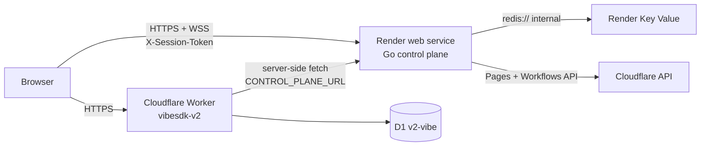

# Deploy: Go + Redis on Render, dashboard on Cloudflare

> Split deployment of the two live planes. Go control plane: `backend/`;
> Worker config: `wrangler.v2.jsonc`; Render blueprint: `render.yaml`.
> Last reviewed: 2026-11-11.

## What runs where

| Piece | Platform | Notes |
|---|---|---|
| React SPA (`dist/client`) + auth, D1, KV, Workflows | Cloudflare Worker `vibesdk-v2` | Serves the dashboard, `/api/auth/*`, GitHub export, `/api/apps`, Workflows |
| Go Fiber control plane (rooms, VFS, LLM streaming, Pages deploys, WS) | Render **web service** (Docker) | `backend/Dockerfile`, health check `/health` |
| Redis-compatible store (`vfs:{chatId}`, `vfs:snap:*`, checkpoints) | Render **Key Value** | Wired into the web service as `REDIS_URL` |



The browser talks to both planes directly: the SPA is served by the Worker, and
every chat/project/WebSocket call goes to the Render URL baked in at build time
(`VITE_CONTROL_PLANE_URL`). That makes CORS a first-class requirement, not a
detail — see step 2.

## Prerequisites

- A Render account and this repository pushed to GitHub.
- A Cloudflare account with D1 `v2-vibe`, the KV namespace `VibecoderStore` and
  the Workflows binding already created (`bun run setup`).
- An OpenAI-compatible gateway URL + key (Cloudflare AI Gateway / Workers AI).
- A Cloudflare API token for the **control plane** with D1 `Edit`, Pages `Edit`
  and Workflows `Edit` on the account.

## Step 1 — Create the Render Blueprint

1. Render Dashboard → **New → Blueprint** → select this repository.
2. Render reads `render.yaml` and creates `vibesdk-backend` (Docker web
   service) plus `vibesdk-redis` (Key Value) in `oregon`.
3. Fill the `sync: false` variables when prompted:

| Key | Required | Value |
|---|---|---|
| `AI_GATEWAY_URL` | yes | `https://gateway.ai.cloudflare.com/v1/<account>/<gateway>` |
| `AI_GATEWAY_API_KEY` | yes | static token with Workers AI + AI Gateway access |
| `CLOUDFLARE_ACCOUNT_ID` | yes | account id used by Pages/D1/Workflows |
| `CLOUDFLARE_API_TOKEN` | yes | D1 `Edit` + Pages `Edit` + Workflows `Edit` |
| `D1_DATABASE_ID` | yes | `d1_databases[0].database_id` from `wrangler.v2.jsonc` |
| `CORS_ALLOWED_ORIGINS` | only for a custom dashboard domain | comma-separated origins, e.g. `https://vibe.example.com` |
| `CONTROL_PLANE_REQUIRE_SESSION` | no | preset to `false` (see “Cross-origin auth”) |

`PORT=10000`, `WORKFLOWS_NAME` and `SKILLS_DIR=/app/skills` are preset in the
blueprint. `REDIS_URL` is injected from the Key Value service over Render's
private network; `backend/cmd/main.go` accepts both the `redis://…` URL form and
a bare `host:port`.

4. Wait for the first deploy and confirm the health check:

```bash
curl -fsS https://vibesdk-backend.onrender.com/health
# {"status":"ok","rooms":0}
```

If the service name was already taken, Render appends a suffix and the URL
changes — use the real URL in step 3.

## Step 2 — CORS between the Worker origin and Render

`backend/pkg/api/routes.go` always allows the Vite dev/preview servers and the
known `workers.dev` dashboard hosts. Anything else (a custom domain, a renamed
Worker) must be added to the Render service:

```
CORS_ALLOWED_ORIGINS=https://vibe.example.com,https://vibesdk-v2.example.workers.dev
```

Rules: scheme + host only, no trailing slash, one entry per origin (Fiber also
accepts a subdomain wildcard such as `https://*.example.com`). Changing the
variable redeploys the Go service.

Verify the preflight from the dashboard's origin:

```bash
curl -i -X OPTIONS https://vibesdk-backend.onrender.com/api/status \
  -H "Origin: https://vibesdk-v2.apjkala25.workers.dev" \
  -H "Access-Control-Request-Method: GET"
```

Expect `Access-Control-Allow-Origin:` echoing the origin and
`Access-Control-Allow-Credentials: true`.

## Step 3 — Point the SPA at Render

The control-plane URL is **baked into the bundle at build time** (`VITE_*` is
read by Vite, not by the Worker):

- **Manual deploy**: `.env.production` (git-ignored, local only) is the easiest
  place — set `VITE_CONTROL_PLANE_URL` and `VITE_AUTH_PLANE_URL` there before
  `bun run build`.
- **CI deploy** (`.github/workflows/deploy-release-live.yml` and
  `deploy-staging.yml`): the build step sets both from repository variables and
  defaults to `https://vibesdk-backend.onrender.com` plus the Worker origin.
  Override them in **Settings → Secrets and variables → Actions → Variables**
  (`VITE_CONTROL_PLANE_URL`, `VITE_AUTH_PLANE_URL`) when your Render or Worker
  URL differs.
- `wrangler.v2.jsonc` `vars.CONTROL_PLANE_URL` must match the Render URL — the
  Worker uses it server-side for GitHub export (`GET /api/projects/:id/files`).
- Local development overrides the Worker's var with `CONTROL_PLANE_URL` in
  `.dev.vars` (`.dev.vars.example` sets `http://localhost:8080`).

Changing any of these requires a rebuild and redeploy of the Worker.

## Step 4 — Apply D1 migrations and deploy the Worker

```bash
bun run db:migrate:remote          # applies migrations/ to D1 v2-vibe
bun run build                      # vite build → dist/client (uses .env.production)
bun run deploy                     # wrangler deploy --config wrangler.v2.jsonc
```

`bun run deploy` reads `.prod.vars` and neither typechecks nor migrates; run
those steps explicitly. Pushing to `release-live` or `staging` also deploys the
Worker through `.github/workflows/deploy-release-live.yml` and
`deploy-staging.yml`, which run `bun run build` with the same `.env.production`.

## Step 5 — Verification checklist

1. `GET https://vibesdk-backend.onrender.com/health` → `200`.
2. CORS preflight (step 2) returns the dashboard origin.
3. Open the Worker URL, sign in, and confirm `GET /api/auth/profile` succeeds
   against the Worker (same-origin).
4. Start a chat: `POST /api/agent/session` must hit Render (Network tab) and the
   `/ws/:id` WebSocket must connect to `wss://vibesdk-backend.onrender.com`.
5. Trigger **Deploy to Cloudflare** in a chat: `POST /api/projects/:id/deploy`
   runs on Render and streams `deployment_started` → `deployment_completed`.
6. GitHub export: the Worker fetches project files from Render via
   `CONTROL_PLANE_URL`.

## Cross-origin auth (read before enabling the boundary)

Auth stays on the Worker: the HttpOnly `session` cookie belongs to the Worker
origin and is **not** sent to Render. The SPA mirrors the Edge session token in
`localStorage` (`src/lib/control-plane-session.ts`) and the API client sends it
as `X-Session-Token`, which the Go plane accepts (see
`backend/pkg/api/auth.go`).

Consequences:

- With `CONTROL_PLANE_REQUIRE_SESSION=false` (blueprint default) the
  control-plane guards are no-ops — a demo setting, not a production boundary.
- To enforce sessions, set `CONTROL_PLANE_REQUIRE_SESSION=true` **and**
  `VIBECODER_STORE_KV_ID` (the `VibecoderStore` namespace id) so the Go service
  can verify Edge tokens against KV.
- The Worker's server-side GitHub export fetch (`worker/light/lightApp.ts` →
  `GET /api/projects/:id/files`) does not forward a session token. Keep the
  boundary off for that flow, or teach the Worker to pass the caller's
  `X-Session-Token` before turning enforcement on.


## Free-plan caveats

| Caveat | Effect |
|---|---|
| Free web services spin down when idle | First request after idle pays a cold start (tens of seconds); the WebSocket connects only after the service wakes |
| Free web service = 0.1 CPU / 512 MB | Long generations are slower and a large room can hit the memory ceiling; paid instances remove both limits |
| Free Key Value is in-memory only | Rooms/VFS/snapshots are lost when the instance restarts or Render performs maintenance |
| Render Key Value is Valkey without RediSearch | `EnsureVectorIndex` logs a warning and the `idx:vfs` semantic search degrades to no context; use an external Redis Stack instance if code RAG matters |
| One Free Key Value per workspace | A second environment needs a paid instance |
| Free web services cannot receive private traffic | Not a problem here: browsers use the public HTTPS URL and the service dials Key Value internally |

For a real deployment move both services to a paid plan (always-on instance,
persistent Key Value) before pointing users at it.

## Troubleshooting

| Symptom | Cause / fix |
|---|---|
| Browser: “blocked by CORS policy” | The dashboard origin is missing from `CORS_ALLOWED_ORIGINS`; add scheme + host exactly (no trailing slash) and let Render redeploy |
| `401` on mutating routes | `X-Session-Token` missing/expired in `localStorage`, or the boundary is enabled without `VIBECODER_STORE_KV_ID` |
| Chat works but the WebSocket never opens | Service asleep (cold start) or `VITE_CONTROL_PLANE_URL` was not rebuilt into the bundle |
| Boot log: `invalid REDIS_URL` | Malformed scheme; copy the Key Value connection string as-is (`redis://red-…:6379`) |
| Boot log: `vector index not created` | Expected with Render Key Value (no RediSearch); code RAG is disabled, everything else works |
| D1 `401`/`403` from Render | The API token lacks D1 `Edit` on the account that owns `v2-vibe` |
| GitHub export has no files | `CONTROL_PLANE_URL` in `wrangler.v2.jsonc` (or `.prod.vars`) does not point at the Render service |

