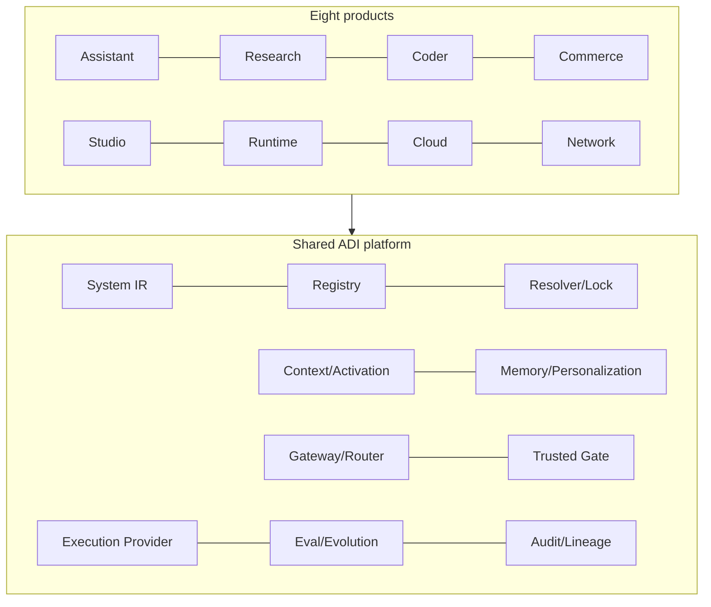

# Adaptive Intelligence Architecture — Shared Platform Capability (PROPOSED)

> **Status:** `proposed` 2026-11-23 (mission VIBE-ARCH-CONSOLIDATION-ADI-001). Awaiting owner acceptance; never silently accepted. ADI is a shared capability across the eight Vibe products — not a ninth product, not a new IR, not a new manifest kind in v1, not a new runtime. Canonical pipeline: Intent → System Manifest → IR Validation → Capability Resolution → Composition Lock → Context Assembly → Activation → Policy Enforcement → Execution → Evaluation → Controlled Evolution. Preserved: D7 one System IR, D8/D8.1 M1-MCP freeze with stdio PoC exception, D9 M0 slice, D10 eight products, D11 one contract set, D12 Cloudflare as provider, D13 wasmCloud evaluation-only, D14 no token/chain in MVP, D15 identity/lifecycle split, D16 provider contract C1-C18, D17 one control plane, D18 one Tool vocabulary plus one mcp.Gate plus one AuditSink. Related: `composition-lock.md`, `context-activation-and-memory.md`, `evaluation-and-evolution.md`, `adr-adaptive-intelligence-boundaries.md`, `../ecosystem/04-system-architecture.md`, `../ecosystem/05-agent-platform-architecture.md`, `../ecosystem/06-runtime-and-execution-architecture.md`, `system-ir.md`, `manifest-schemas.md`.

## 1. Scope and definition

Adaptive Intelligence (ADI) composes authorized Intelligence components, selects suitable components per context, personalizes behavior within declared scopes, evaluates outcomes, and governs controlled evolution. It reuses identity, IR, registry, policy, execution, audit, versioning — never duplicates them. ADI = Composition (what a System may use) + Activation (what this run uses) + Context/Memory/Personalization (what the run sees) + Model policy routing + Evaluation/Evolution (whether the composition improves), on the live Go control plane, light Worker edge plane, D1/Redis state, Cloudflare Workflows execution, gateway/router model layer, and mcp.Gate trust boundary.

## 2. Intelligence taxonomy (conceptual, never microservices by default)

Domain, strategy, rules, context, memory, personalization, reasoning, risk, knowledge, model, evaluation intelligences are vocabulary. Mapping to the smallest existing contract: domain/strategy/rules to Skill plus Tool manifests plus spec.policies; context/memory/personalization to `context-activation-and-memory.md` over Redis VFS plus D1 lineage; reasoning to the existing Eino runtime (`backend/pkg/agent`, `backend/pkg/engine`); risk to policy checks plus mcp.Gate; knowledge to retrieval (`backend/pkg/engine/vector.go`) plus knowledge refs; model to `backend/pkg/gateway` plus `backend/pkg/modelrouter`; evaluation to `evaluation-and-evolution.md`. No taxonomy entry becomes a service without measured need plus an ADR; modular monolith plus existing Go/Worker/D1/Redis boundaries first.

## 3. Relationship to the eight products

Assistant, Research, Coder, Commerce consume ADI through product experiences; Studio authors and publishes; Runtime resolves, locks, activates, executes; Cloud hosts and operates the same contracts; Network (future) distributes execution. Products evolve independently through shared contracts (D10/D11); ADI ships no product surface of its own in v1.

## 4. Core vs extension boundary

Trusted core (platform-owned): identity/tenancy, agent lifecycle, System IR, manifest validation, dependency resolution, composition locking, authorization/policy, memory-scope enforcement, execution/idempotency, audit/lineage, evaluation gates, versioning/rollback. Extensions (community/domain-owned): domain Skills, specialized Tools, knowledge sources, strategy packages, risk evaluators, evaluation datasets, model adapters. Extensions consume shared contracts and cannot create tenant identity, grants, audit, secrets, or execution authority (D18).

## 5. Manifests: Agent, Skill, Tool, Knowledge, Policy, System, Bundle

Only four manifest kinds in v1 (`manifest-schemas.md`). Knowledge, model-policy, eval are reserved reference namespaces resolved by owning registries, not new kinds. The Intelligence Bundle (one System plus pinned Agent/Skill/Tool/Knowledge/Model-Policy/Eval assets, digests, provenance; no secrets/grants; no execution authority; no competing IR) is a PROPOSED distribution grouping documented in `composition-lock.md`.

## 6. Composition vs activation

Composition declares allowed capabilities with exact pins; activation selects an authorized subset for one run. Activation cannot install packages, change pins, issue grants, bypass mcp.Gate/policy, or mutate the manifest. Every decision is attributable (decision/run/composition-digest/policy-ref/activated/skipped/reasons). Deterministic policy has final authority over probabilistic ranking. Full contracts: `composition-lock.md`, `context-activation-and-memory.md`.

## 7. Context and memory boundaries

Working Context (per-run assembly) vs Persistent Memory (run/conversation/agent/team/tenant scopes, enforced) vs Knowledge (retrieved sources) vs Personalization Profile (explicit plus inferred, provenance/precedence, inferred never silently overrides explicit) vs Execution State (durable rows). Tenant data never crosses tenants. Details: `context-activation-and-memory.md`.

## 8. Model selection and provider independence

Preserved: `backend/pkg/gateway` (registry, policy, budget/health guards, vault: secrets), `backend/pkg/modelrouter` (Eino failover composition), Eino orchestration, provider-neutral policies, cost/context/health/fallback guards. Routing dimensions: task type, complexity, risk, latency, budget, context window, privacy, accuracy, availability. No mandatory fine-tuning, no training platform in MVP, no vendor coupling in manifests; O5/O16 stay open.

## 9. Evaluation and evolution

Five layers (structural, capability, behavioral, operational, safety); lifecycle observe, evidence, candidate, regression/security review, approval, controlled rollout, promote/rollback. No self-modification, no unverified auto-publication, no silent snapshot mutation; failed evaluation blocks promotion; everything auditable. Details: `evaluation-and-evolution.md`.

## 10. Diagrams

```mermaid
flowchart LR
    INT["Intent"] --> SYS["System Manifest kind:System"]
    SYS --> VAL["IR Validation schema+I1-I6"]
    VAL --> RES["Capability Resolution exact pins"]
    RES --> LOCK["Composition Lock PROPOSED"]
    LOCK --> CTX["Context Assembly"]
    CTX --> ACT["Activation policy wins"]
    ACT --> POL["Policy + mcp.Gate"]
    POL --> EXE["Execution C1-C18"]
    EXE --> EVL["Evaluation"]
    EVL --> EVO["Controlled Evolution"]
```

## 11. Implementation status and phased maturity

| Layer | Status | Evidence / next |
|---|---|---|
| System IR + schemas + Go reader | IMPLEMENTED (reader) | backend/pkg/ir, validate-system-ir.mjs, validate-manifests.mjs |
| MCP Gate + stdio PoC | PARTIAL | backend/pkg/mcp, in-memory stores, D8-gated |
| Skill/OpenAPI loaders + tool search | IMPLEMENTED (loader scope) | backend/pkg/agentskills, backend/pkg/openapiimport, backend/pkg/toolsearch |
| Execution contract + Fake + Cloudflare adapter | PARTIAL | backend/pkg/execution, fake 18/18, adapter unverified live |
| Run control cancel/pause/capabilities | PARTIAL | P7-RUN-001c: control plane verified locally (`backend/pkg/api/workflows_control_test.go`), worker rules in `worker/workflow/VibeWorkflow.test.ts` (CI-run) |
| Gateway + router | PARTIAL | backend/pkg/gateway, backend/pkg/modelrouter |
| Composition Lock contract | DESIGNED (contract complete) | composition-lock.md (ADI-FOUND-002): artifact shape, digests, resolution modes, failure taxonomy, snapshot semantics |
| Resolver design | DESIGNED | composition-resolver.md (ADI-FOUND-003): AssetSource contract, 8-step algorithm, 11 failure codes, 21-case test spec |
| Resolver implementation (bundled mode) | IMPLEMENTED | backend/pkg/composition (ADI-FOUND-003a): 24 tests green incl. -race, golden M1 lock, no network/D1/route |
| Snapshot contract (run binding) | DESIGNED | run-snapshot.md (ADI-FOUND-004): one snapshot per run, digest identity, admission verification, retention, migration |
| Snapshot storage + admission rules | IMPLEMENTED | ADI-FOUND-004a: `composition_snapshots` + nullable `snapshot_id`, `composition.AdmitRun`/`Verify`, D1 adapter, 13 tests |
| System-to-run binding | DESIGNED + IMPLEMENTED (procedural) | ir-to-run-binding.md (ADI-FOUND-005): procedural compiles 1:1 onto the existing DAG; agentic refused by design (E_BIND_SHAPE); `backend/pkg/plan` (ADI-FOUND-005a): 10 tests |
| Snapshot binding on live traffic | IMPLEMENTED (opt-in, producer live) | ADI-FOUND-004b: opt-in `snapshotId` on the trigger, `AdmitRunSnapshot` guard before any row exists, `CONTROL_PLANE_REQUIRE_SNAPSHOT`; 7 route tests. ADI-FOUND-004c (`ad69c8b`): producer resolve → persist → compile → start on the same path; 12 route tests + 2 bundle tests; migration 0019 (`plan_kind`, `plan_digest`, `compiler_version`). Evidence: `architecture/adi-implementation-evidence.md` |
| Context assembly contract | DESIGNED | context-assembly.md (ADI-CTX-001): envelope shape, segment taxonomy, bounds, drop order, failure codes; no assembler code (audit 2026-11-24) |
| Activation policy contract | DESIGNED | activation-policy.md (ADI-CTX-002): eligibility/ranking/gate split, closure invariant, deny-overrides, decision record; no engine code (audit 2026-11-24) |
| Activation engine (eligibility core) | IMPLEMENTED (library, no caller) | ADI-CTX-003: `backend/pkg/activation` — pure `Decide()` over (envelope, policy, closure, grants), deny-overrides, default-deny, E_ACTIVATION_ESCALATION+audit, budget-before-bound, ranking intersection, canonical record |
| Activation decision trace | PREPARED (not started) | ADI-CTX-004: persist the record per run; dependency (ADI-CTX-003) satisfied 2026-11-25, store shape decided at implementation |
| Memory provider interface | DESIGNED | memory-provider.md (ADI-MEM-001): 3 operations, scope ladder, provenance, bounds, retention |
| Memory scope enforcement | DESIGNED | memory-provider.md §3-§7 (ADI-MEM-002 delivered there, not as a second document) |
| Personalization profile | DESIGNED | personalization-profile.md (ADI-MEM-003): three namespaces, evidence-required inference, explicit never overridden |
| Context retrieval integration | DESIGNED | context-retrieval.md (ADI-MEM-004): profile->memory->knowledge order, one bounded query, providerKind recorded (lexical today), no query expansion |
| Memory adapter (code) | PARTIAL (lexical, D1, no caller) | backend/pkg/memory + memory/d1store (ADI-MEM-001a): 11 tests, additive migration 0018, `SemanticRecall: false`, no route/agent caller; retrieval contract stays DESIGNED |
| Agentic execution | PROPOSED ADR, undecided | `adr-agentic-execution.md` (2026-11-24): `agent` node kind vs topology-aware executor vs keep refusing; lowering rejected by default; never NEXT without a decision |
| Event envelope | DESIGNED | event-envelope.md (ADI-EVT-001): identity, dedupe, both timestamps, at-least-once semantics; no transport, no code (audit 2026-11-24) |
| Durable event delivery | DESIGNED | durable-event-delivery.md (ADI-EVT-002): transactional outbox + durable inbox on D1, lease claim, backoff, dead letters, loop guard; no broker, no code (audit 2026-11-24) |
| Event-to-run integration | DESIGNED | event-to-activation.md (ADI-EVT-003): data-layer subscriptions, deterministic filter, pointer-resolved snapshot, per-binding dedupe; the event never grants; no code (audit 2026-11-24) |
| Evaluation contract | DESIGNED | evaluation-contract.md (ADI-EVAL-001): snapshot subject, five layers, verdicts where not_evaluated never passes, no composite score |
| Benchmark runner | PARTIAL (L1 + L2 executable) | backend/pkg/evaluation (ADI-EVAL-002a): 13 tests, exit codes 0/1/2/3, L3-L5 honestly not_evaluated; no dataset catalog (O28), no runtime integration |
| Benchmark runner design | DESIGNED | benchmark-runner.md (ADI-EVAL-002): request contract, per-layer execution, canonical artifact, exit codes |
| Candidate lifecycle | DESIGNED | candidate-lifecycle.md (ADI-EVAL-003): candidate = snapshot, stable = pointer, CAS promotion, expiry; no executor code (audit 2026-11-24) |
| Controlled promotion / rollback | DESIGNED | promotion-and-rollback.md (ADI-EVAL-004): four-condition conjunction, artifact-bound approvals, environment-pointer rollout, rollback vs emergency pin, audit_logs; no code (audit 2026-11-24) |
| Bundle distribution / marketplace | BLOCKED (design rules exist) | composition-lock.md bundle section, ADI-ECO-001..004 BLOCKED on O24/O25/O27; bundled `AssetSource` is the stand-in, not a registry |

Evidence matrix: `adi-implementation-evidence.md` (created 2026-11-24, HEAD `ad69c8b`) links every row above to code file:line, migration, test names, verification type and commit SHA.

First executable proof: single-agent adaptive composition (M0-consistent, D8/D9-gated); see evaluation-and-evolution.md slice section plus backlog.
