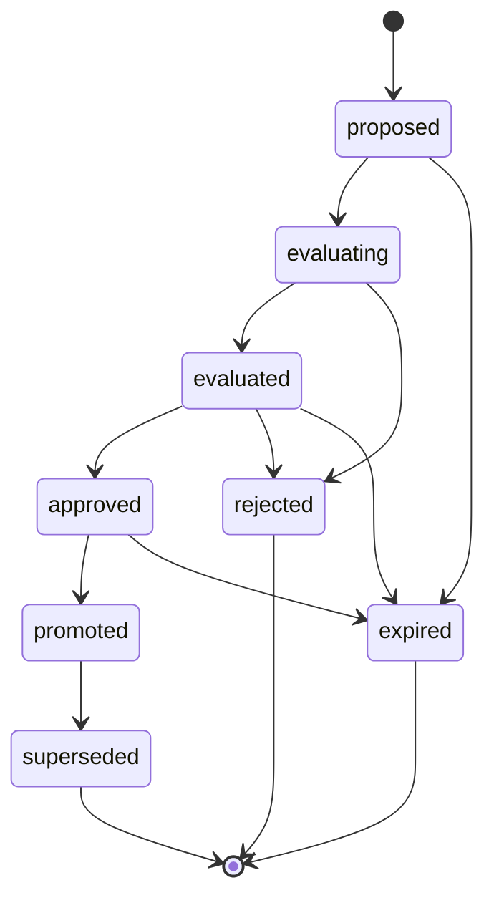

# Candidate Composition Lifecycle — Normative (PROPOSED, ADI-EVAL-003)

> **Status:** `proposed` (2026-11-23) — design only. No table, no state store, no code in this change.
> **Builds on:** the snapshot ([`run-snapshot.md`](run-snapshot.md)) and the evaluation result ([`benchmark-runner.md`](benchmark-runner.md)). **Feeds:** controlled promotion and rollback (ADI-EVAL-004, [`evaluation-and-evolution.md`](evaluation-and-evolution.md) §4).

## 1. The invariant that shapes everything

**A candidate is a snapshot. A stable composition is a pointer.**

There is no "candidate lock format" and no editable stable artifact. A candidate is an existing `snapshotId` plus a lifecycle record; promotion moves a pointer; rollback moves it back. Nothing that has ever run is rewritten.

That single choice answers the acceptance criterion — *candidate versions are created without changing stable compositions* — structurally rather than by policy: a candidate cannot alter a stable composition because it has no write path to it.



## 2. Vocabulary

| Term | Meaning |
|---|---|
| **Stable pointer** | A record `(tenantKey, systemRef, environment) → snapshotId`. Exactly one snapshot is stable per key. |
| **Candidate** | A lifecycle record referencing one `snapshotId`, its evaluation artifact, its state and its actors. |
| **Promotion** | A compare-and-set on the stable pointer from the previous `snapshotId` to the candidate's. |
| **Rollback** | The same operation, pointed at a previously stable snapshot (ADI-EVAL-004). |
| **Environment** | The logical target named by the System's `spec.deployment.environment` (`development`/`staging`/`production`). With D17 there is one control plane; the environment is a label on the pointer, not a second deployment. |

## 3. Candidate record

| Field | Rule |
|---|---|
| `candidateId` | Stable identifier for the lifecycle record (not the snapshot's). |
| `snapshotId` | The subject. Verified with `composition.Verify` before the record is usable. |
| `systemRef`, `environment` | Which pointer this candidate would move. |
| `state` | One of §4. |
| `evaluation` | Artifact digest + `evaluatorVersion` + per-layer verdicts summary. The artifact itself is the evidence; this field is what the gate reads. |
| `actors[]` | Who proposed, who approved, who promoted — with timestamps. A transition without an actor is a defect. |
| `expiresAt` | Bound on how long un-promoted evidence stays promotable (§6). |
| `tenantKey` | Ownership; a candidate never crosses tenants. |

**Nothing here lives in a manifest or a lock.** Lifecycle is data-layer state, exactly as D15 requires for agent identity — the same rule, applied to compositions so the two cannot drift into different philosophies.

## 4. States and legal transitions

| From → To | Guard |
|---|---|
| `proposed` → `evaluating` | A runner request exists for this snapshot (ADI-EVAL-002) |
| `evaluating` → `evaluated` | Every required layer has a non-`not_evaluated` verdict (or a recorded waiver) |
| `evaluating` → `rejected` | The evaluation failed, or the request was abandoned; reason required |
| `evaluated` → `approved` | Gate verdict is passing **and** a named approver accepted, with a reason |
| `evaluated` → `rejected` | Approver declined, or the gate failed; reason required |
| `approved` → `promoted` | Pointer compare-and-set succeeded (§5) |
| `approved`/`evaluated`/`proposed` → `expired` | `expiresAt` passed before promotion |
| `promoted` → `superseded` | A later candidate was promoted to the same pointer |

Anything else is `E_CAND_STATE`. The state machine is closed: adding a state is a contract change, not a local convenience, because every consumer (UI, audit, ops runbook) has to know what it means.

Two guards are non-negotiable and appear twice on purpose (here and in §5): **no promotion without a passing gate**, and **no promotion without an approval actor**.

## 5. Promotion is a compare-and-set

```text
promote(candidateId, expectedCurrentSnapshotId) -> newStableSnapshotId
```

1. Load the candidate; require state `approved` and a non-expired `expiresAt`.
2. Require `expectedCurrentSnapshotId` to equal the pointer's current value. Mismatch is `E_CAND_CONFLICT` — the caller re-reads and decides again, rather than overwriting a promotion that happened while they were looking.
3. Swap the pointer to the candidate's `snapshotId` in one operation.
4. Mark the candidate `promoted`; mark the displaced candidate (if any) `superseded`.
5. Emit an audit event naming actor, from, to and the evaluation artifact digest.

Why compare-and-set rather than a plain write: two operators promoting two different candidates is not a theoretical race, and last-writer-wins would silently discard one of them — with a real consequence, since the discarded snapshot is what runs would have used. The check converts a silent loss into a visible retry.

**Rollback uses the same operation** with an earlier snapshot as the target (ADI-EVAL-004). It is not a special mode: it re-points, it never restores.

## 6. Evidence freshness

Evaluation evidence is valid for the triple **(`snapshotId`, dataset digest, `evaluatorVersion`)**. That has three consequences:

| Change | Effect on the candidate |
|---|---|
| A dataset gains a new version | The old artifact is still true *about the old dataset*; the gate policy decides whether re-evaluation is required before promotion |
| The runner version changes | Same: the artifact records `evaluatorVersion`, so "measured by an older runner" is visible rather than assumed equivalent |
| The snapshot is unchanged (always, by construction) | Evidence never silently applies to different content |
| `expiresAt` passes | The candidate becomes `expired`; promoting it again requires either a fresh evaluation or an explicitly recorded decision by a named approver |

Expiry exists because a candidate evaluated a quarter ago describes a closure nobody has exercise-tested since; keeping it "promotable forever" would let stale evidence wear the appearance of current evidence.

## 7. Relationship to runs and to the tenant

- **New runs** take whatever snapshot they are given; promotion changes the **default** a caller resolves when it does not name a snapshot.
- **In-flight and completed runs are untouched** — they are already snapshot-bound (`run-snapshot.md` §2), which is the whole point of binding them.
- **Tenant isolation is a wall:** a candidate and its pointer belong to one tenant. Cross-tenant promotion is `E_CAND_TENANT`, never a shared pointer.
- **Stable is per (tenant, systemRef, environment).** A System may be stable in `development` and a different version stable in `production`; with D17 that is a label on one control plane, not two deployments.

## 8. Failure modes

| Code | Condition | Behaviour |
|---|---|---|
| `E_CAND_SNAPSHOT` | The candidate's snapshot is missing or fails `Verify` | Refuse; the record is unusable until the snapshot verifies |
| `E_CAND_STATE` | A transition not in §4 | Refuse; no implicit transitions |
| `E_CAND_EVIDENCE` | Promotion attempted without a passing gate or without an approver | Refuse; both are required |
| `E_CAND_CONFLICT` | Pointer compare-and-set failed | Return the current value; caller re-reads |
| `E_CAND_EXPIRED` | `expiresAt` passed | Refuse the promotion; re-evaluate or record a named decision |
| `E_CAND_MUTATE` | Any attempt to modify a stable composition in place | Refuse by construction: there is no write path |
| `E_CAND_TENANT` | Candidate or pointer used across tenants | Refuse |

## 9. What this design does not do

- No promotion policy of its own: the gate and the approver decide (ADI-EVAL-001/004).
- No automatic promotion, ever — evidence informs a decision, it does not make one.
- No canary percentages, staged rollout or traffic splitting (ADI-EVAL-004).
- No UI, no notifications, no scheduler.
- No storage decision: state needs a durable home with compare-and-set semantics, and that choice (§11) is deferred rather than assumed.

## 10. Tests this design will need (ADI-EVAL-003a, when code starts)

1. Creating a candidate never changes the stable pointer; runs keep using the old snapshot.
2. `proposed → approved` is refused with `E_CAND_STATE` (skipping evaluation).
3. `evaluated → approved` without an approver actor is refused with `E_CAND_EVIDENCE`.
4. `approved → promoted` with a stale `expectedCurrentSnapshotId` is refused with `E_CAND_CONFLICT` and leaves the pointer unchanged.
5. A successful promotion swaps the pointer once and marks the previous candidate `superseded`.
6. Promoting an `expired` candidate is refused with `E_CAND_EXPIRED`.
7. A candidate whose snapshot fails `Verify` is refused with `E_CAND_SNAPSHOT` before any state change.
8. Two candidates for the same pointer coexist; only the promoted one becomes stable.
9. A cross-tenant promotion is refused with `E_CAND_TENANT` and writes nothing.
10. The audit event for a promotion names actor, from, to and the evaluation artifact digest.
11. Rollback re-points to an earlier snapshot and leaves the newer candidate's record intact as `superseded`.
12. A run started before the promotion still resolves its original closure afterwards.

## 11. Open items

| Item | Why it is open |
|---|---|
| State storage with compare-and-set semantics | D1 supports it (`UPDATE ... WHERE`), but the table shape and whether lifecycle lives beside snapshots is the same O27-adjacent decision |
| Default `expiresAt` window | A policy number; too short wastes evaluation spend, too long lets stale evidence look current |
| Whether `production` requires two approvers | An organisational policy decision, not a platform default |
| Whether a rejected candidate's snapshot is retained | Retention cost vs audit value; the snapshot is immutable content, so only the record's fate is in question |
| Environment model (labels vs separate stable pointers per environment) | §7 assumes labels on one control plane (D17); if a real second environment ever exists this must be revisited explicitly |
