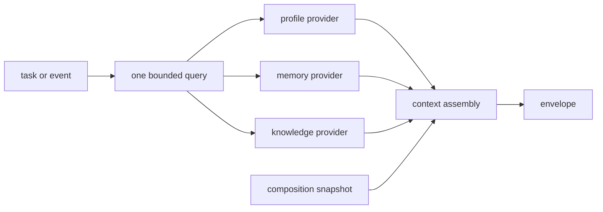

# Context Retrieval Integration — Design (PROPOSED, ADI-MEM-004)

> **Status:** `proposed` (2026-11-23) — design only. No provider, index or code in this change.
> **Fills:** the provider side of [`context-assembly.md`](context-assembly.md) — how `knowledge`, `memory` and `profile` segments are actually obtained. **Depends on:** [`memory-provider.md`](memory-provider.md) (ADI-MEM-001/002) and [`personalization-profile.md`](personalization-profile.md) (ADI-MEM-003).

## 1. What this layer is

Assembly defines the envelope; this document defines how the three pushy parts of it are fetched. It is orchestration, not storage: every source stays behind the interface its own contract defines, and this layer's job is to ask **the right provider, with the right bounds, in the right order**, and to keep the three kinds of evidence distinguishable.



## 2. What exists today (evidence)

| Source | Implementation | Reality |
|---|---|---|
| **Knowledge** | `backend/pkg/engine/vector.go` — `SearchVFS(ctx, query, k)` returning `{Path, Text, Score}` from a RediSearch KNN index (`idx:vfs`), **scoped to one room's files** | Real and working, but the embedding is `HashEmbedding`, a deterministic n-gram hash: **lexical, not semantic** |
| **Memory** | none | `memory-provider.md` defines the interface; there is no store |
| **Profile** | none | `personalization-profile.md` defines the contract; no store or projection exists |

One consequence has to be stated plainly rather than buried: **knowledge retrieval today is lexical.** Any claim of semantic recall would be false, so the design records the provider kind in the segment provenance (§5) instead of letting the label do the lying.

## 3. Order of retrieval mirrors the order of dropping

Assembly drops optional segments in a defined order (`context-assembly.md` §5.1). Retrieval therefore runs in the **reverse** of that order — cheapest and least droppable first:

```text
1. profile    (small, bounded by key count, never dropped for size)
2. memory     (scoped, bounded by MaxItems/MaxTokens)
3. knowledge  (most expensive, first to be dropped)
```

| Why this order | Detail |
|---|---|
| A cheap source must not be crowded out by an expensive one | If knowledge ran first and filled the budget, the profile would be omitted for no reason |
| A later source sees the remaining budget | Knowledge is asked for `limit - spent`, so the requested slice is honest and the provider is not asked for data that will be thrown away |
| The order is deterministic | No preference scoring across sources: a profile is not "more relevant" than a document, it is simply less droppable |

## 4. One query, built once, bounded

| Rule | Detail |
|---|---|
| Query text = the normalised task/event input (`intent` when present, else the payload's textual fields) | Never the assembled context (chicken-and-egg), never a secret, never the whole conversation |
| Length bound | Truncated at a stated character bound before reaching any provider; a giant query is a bug, not a feature |
| **No LLM query expansion in v1** | Expansion is probabilistic, costs a model call, and needs evaluation evidence before it is allowed near retrieval |
| Same query for all three sources | One string, three providers; a per-source query would make the envelope unexplainable |
| Empty query is legal | Means "most recent" for memory and "no knowledge hit" for knowledge — not an error |

## 5. Provenance per segment (what makes the three kinds distinguishable)

Every retrieved segment carries, in addition to the assembly fields:

| Field | Knowledge | Memory | Profile |
|---|---|---|---|
| `kind` | `knowledge` | `memory` | `profile` |
| `scope` | project/tenant (the room's scope) | the memory ladder scope it was read at | `user` / `team` / `agent` |
| `source` | `vfs-search` + `index: idx:vfs` | provider id + version | provider id + version |
| `providerKind` | **`lexical`** today (`HashEmbedding`); `semantic` only after a measured upgrade | `lexical` or `semantic` per the provider's `Capabilities` | n/a (keyed lookup) |
| `rank` | KNN score | provider score | none |
| `ref` | `path` of the file the chunk came from | memory record id | profile key |

Three rules follow:

1. **`providerKind` is recorded, not inferred later.** "Why did retrieval miss?" is answerable only if the trace says whether the provider was lexical or semantic at the time.
2. **A knowledge hit can never be relabelled a memory row** (or vice versa) — the distinction is structural in `context-assembly.md` §4.1, and this layer is where a lazy implementation would be tempted to collapse it.
3. **`ref` is mandatory.** A segment whose origin cannot be named is not context, it is noise; assembly may drop it.

## 6. Bounds, and defence in depth

| Bound | Where enforced | Behaviour on excess |
|---|---|---|
| Per-source `MaxItems` | provider | Provider refuses (`E_MEMORY_BOUNDS`) or returns at most the bound |
| Per-source token slice | this layer | Requests only the remaining budget; never over-asks |
| Envelope total | assembly | Drops in the defined order, records `omitted[]` with `budget`/`bound` |
| Oversized single item | this layer | Omitted whole, never cut mid-item; reason recorded |

The envelope re-checks every bound even when a provider claims compliance. A provider bug must not become a budget breach, and "the provider said it was small" is not evidence.

## 7. Scopes: each provider's own wall

| Source | Scope authority comes from | Cross-boundary attempt |
|---|---|---|
| Knowledge | the room/project the run belongs to; `idx:vfs` is per-room by construction | Not representable: the index keys are room-scoped |
| Memory | the memory provider's ladder (`memory-provider.md` §3) | `E_MEMORY_SCOPE` / `E_MEMORY_TENANT` from the provider, refused by assembly as `E_CONTEXT_TENANT` |
| Profile | the profile contract's namespaces and layers | `E_PROFILE_TENANT` / `E_PROFILE_SCOPE` |

This layer adds **no** authorization of its own: it passes the run's tenant and scope to each provider and refuses to compose anything the provider marks out of scope (`E_CONTEXT_SCOPE`). A retrieval layer that widened scope "to be helpful" would be a security defect with a friendly face.

## 8. Freshness and determinism

| Question | Answer |
|---|---|
| Does retrieval reflect writes made a second ago? | Knowledge: as fresh as `idx:vfs` (`IndexFile`/`ReindexVFS` maintain it). Memory/profile: as fresh as the provider's write path |
| Is a re-run identical? | For a fixed index and fixed query, yes — `HashEmbedding` is deterministic. Across a changing index, **no** — which is why `providerKind` and `rank` are recorded so a difference is explainable rather than mysterious |
| Is there an index generation to cite? | Not today. If the index gains one, it belongs in `source`; inventing a surrogate here would be worse than omitting it |
| Clock | Injected, as everywhere; retrieval never reads wall time to decide what is fresh |

## 9. Degradation

| Situation | Behaviour |
|---|---|
| Memory provider unavailable | Segments omitted; `degraded` names the provider; the run continues (memory is optional) |
| Profile unavailable | Same; the run uses platform/tenant defaults |
| Knowledge index unavailable or empty | Omitted with `degraded`; a run without knowledge is thinner, not broken |
| Provider returns an out-of-scope item | `E_CONTEXT_SCOPE` — **refuse**, do not filter: a filtered read still proves the item existed |
| Provider returns more than its bound | Truncate at the bound, record `omitted` with `bound`, and log the provider defect |

## 10. What this design does not do

- No embedding model, no vector database, no chunking strategy: today's index is reused as-is.
- No query expansion, no re-ranking model, no relevance tuning without a dataset.
- No new storage: memory and profile **have no store yet**, and this document does not invent one.
- No cross-tenant or cross-project retrieval.
- No caching layer (a cache would need its own invalidation story).

## 11. Tests this design will need (ADI-MEM-004a, when code starts)

1. One query reaches all three providers; the envelope contains `profile`, `memory` and `knowledge` segments with the correct `kind`, `scope` and `ref`.
2. Retrieval order is profile → memory → knowledge, and knowledge is asked for only the remaining budget.
3. A knowledge hit and a memory row with identical text remain distinguishable by `kind`, `source` and `ref`.
4. `providerKind` records `lexical` for the current knowledge provider (no semantic claim).
5. A provider returning an out-of-scope item yields `E_CONTEXT_SCOPE`, not a filtered envelope.
6. An unavailable memory provider yields `degraded` plus omitted segments, and the envelope still validates.
7. A provider that ignores `MaxItems` is truncated at the bound with `omitted`/`bound` recorded.
8. An oversized single knowledge chunk is omitted whole, never cut.
9. An empty query returns recent memory and no knowledge hits, without error.
10. A query longer than the character bound is truncated before reaching any provider.
11. Two assemblies over a fixed index produce identical knowledge segments and ranks.
12. A profile entry that names a capability outside the closure changes nothing: activation still refuses it.

## 12. Open items

| Item | Why it is open |
|---|---|
| Semantic upgrade for knowledge (`HashEmbedding` → a real model) | Needs an evaluation dataset and a measured win; the lexical baseline is good enough to ship and honest enough to describe |
| Chunking strategy for long documents | Today's index is per file; chunks need their own contract and a cost story |
| Knowledge scope: room/project vs tenant-wide corpus | Today it is per-room; a tenant corpus is a product decision with a tenancy review |
| Index generation identity | Would make replay exact; the current index exposes no generation, so it is not invented here |
| Query construction for events with no `intent` | Payload-derived text is a heuristic; it needs real event shapes before it is fixed |
