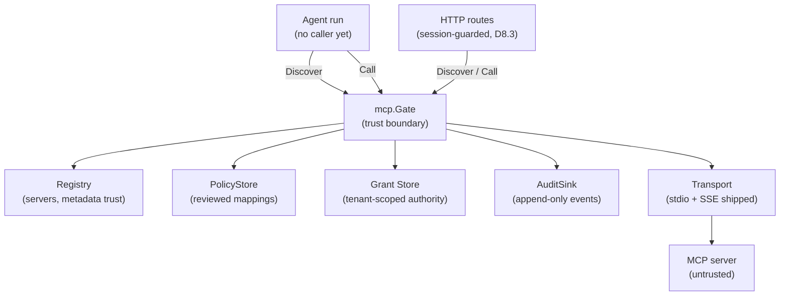

# MCP Trust Slice — Governed Bridge (P7.3)

> **Scope:** the boundary between the VibeSDK agent runtime and external MCP
> servers: registration, discovery, policy mapping, tenant-scoped grants,
> execution gate, idempotency and audit. Implements checklist task **P7.3**
> ([`../DEV_CHECKLIST.md`](../DEV_CHECKLIST.md)); implements the MCP priority
> named in [`../12-agentic-platform-strategy.md`](../12-agentic-platform-strategy.md)
> and the untrusted-boundary rule in
> [`../07-multitenancy-security.md`](../07-multitenancy-security.md).
>
> **Status:** `verified` for the trust boundary, the stdio transport
> (2026-11-22), the SSE binding (2026-11-24, D8.2) and the authenticated route
> surface (2026-11-24, D8.3) and the server-side credential store (2026-11-24,
> D8.4) — twelve gate unit tests,
> five transport tests that spawn a real MCP server process, seven SSE tests
> against a stub HTTP+SSE server, and 12 route/store tests; nothing yet calls the
> gate from an agent run, and registry/policy/grant stores are still in memory.
> Last reviewed: 2026-11-24.
>
> **Bounded by:** [`manifest-schemas.md`](manifest-schemas.md) (Tool Manifest
> contract), [`system-ir.md`](system-ir.md) (agents reference capabilities;
> grants are runtime state, never IR fields).

## Contents

| Section | Anchor |
|---|---|
| The rule | [`#rule`](#rule) |
| Trust levels | [`#levels`](#levels) |
| Architecture | [`#architecture`](#architecture) |
| The execution gate (11 checks) | [`#gate`](#gate) |
| Audit contract | [`#audit`](#audit) |
| Idempotency | [`#idempotency`](#idempotency) |
| The stdio transport | [`#transport`](#transport) |
| The authenticated route surface (D8.3) | [`#routes`](#routes) |
| The credential store (D8.4) | [`#vault`](#vault) |
| Deliberately out of scope | [`#scope`](#scope) |
| Tests that prove it | [`#tests`](#tests) |
| Open items | [`#open-items`](#open-items) |

## The rule

MCP servers are **untrusted external boundaries**. Discovery returns read-only
metadata and never grants execution. Every invocation requires an explicit,
tenant-scoped grant that records who approved it, and every attempt — allowed,
denied, or transport-failed — appends an audit event.

Two consequences are load-bearing:

1. **Identity comes from the caller, never from arguments.** Tool arguments are
   model-controlled; a tenant or user id inside them is an attack vector, not a
   fact. Every entry point takes an explicit `Identity`.
2. **A fresh server declaration never outranks review.** Discovery may report
   new tools and new side-effect claims; execution uses only the reviewed
   `ToolPolicy` snapshot the grant was issued against.

## Trust levels

| Level | What it allows | How it is obtained |
|---|---|---|
| Registered | Talk to the server; read tool metadata | `Registry.Register` (name, endpoint, registered-by, timestamp) |
| Policy-mapped | Review what a tool may do: permissions, side effect, approvals, secrets, idempotency | `PolicyStore.Put` (validated, pinned to a Tool Manifest version) |
| Granted | Execute one tool, for one tenant, until revoked/expired | `Store.Issue` (identity + pinned ref + policy snapshot + granted-by) |
| Approved | Execute a call that needs a live human decision | `HumanApproved` grant + `ApprovalRef` on the call |

Registration is intentionally the weakest level: it is metadata trust, not

## Architecture

The gate is the only path to a transport. Nothing else in the platform may call
`Transport.InvokeTool`, which is why the trust checks cannot be bypassed by a
future caller.

## The execution gate (11 checks)

`Gate.Call` fails closed, in this order, and audits the verdict of whichever
check decided:

1. tenant identity present (from the caller);
2. ref well-formed and pinned (`mcp/server/tool@MAJOR.MINOR.PATCH`);
3. server still registered (removal revokes immediately);
4. grant id present — *discovery does not authorize execution*;
5. grant exists **for this tenant**;
6. grant not revoked;
7. grant not expired;
8. grant covers exactly this server/tool/version;
9. a current policy exists and its authority-bearing fields match the grant
   snapshot (drift → re-grant);
10. human-required tools have a human-approved grant **and** a per-call
    `ApprovalRef`;
11. the declared idempotency field resolves in the arguments (dotted paths
    supported, e.g. `lead.id`).

Only then does the transport run. A transport error is audited as a denied
attempt with its own verdict (`transport error: …`) rather than being conflated
with an authorization denial.

## Audit contract

Every `AuditEvent` carries: timestamp (UTC), tenant, user, agent, server, tool,
version, grant id, decision (`allowed`/`denied`), verdict, approval reference,
and idempotency key.

Rules:

- append-only; the package never mutates or deletes events;
- a sink failure must never *grant* authority — logging is not a trust check;
- denied attempts matter as much as allowed ones: they are the evidence the
  boundary works;
- secrets never appear: policies accept only `vault:` references, so a literal
  credential cannot reach an event.

`MemorySink` is the reference implementation used by the tests; a persistent
sink (lineage/audit tables) is a follow-up.

## Idempotency

When a policy declares `IdempotencyKey`, the gate resolves that argument path
and records the result per tenant. A repeat with the same key returns the
recorded output and is audited as `idempotent replay: already executed` — the
transport is not called twice, which is what makes retries safe for external
side effects.

## The stdio transport (P1-AGT-003, 2026-11-22)

`Transport` was defined so a live adapter could land "without touching policy,
grant, or audit code". `StdioTransport` (`backend/pkg/mcp/stdio.go`) is that
adapter for MCP's stdio binding: newline-delimited JSON-RPC 2.0 over a child
process, with the `initialize` + `notifications/initialized` handshake before
`tools/list` or `tools/call`.

Rules it enforces, each with a test:

| Rule | Why | Test |
|---|---|---|
| stdout is the protocol channel **only** | a sloppy server must not smuggle free text into a tool result | `TestStdioTransportRejectsNonJSONStdout` |
| one deadline covers the exchange; expiry kills the process | a hanging server cannot pin a worker | `TestStdioTransportTimesOut` |
| `isError: true` becomes an error, never an empty success | the platform never reports a failed tool as success | `TestStdioTransportPropagatesToolError` |
| no grant ⇒ the process is **never spawned** | discovery authorizes nothing, so denial must not even start the server | `TestStdioTransportGrantlessCallNeverSpawns` |
| a granted call really round-trips | the trust checks are not bypassed — they are *exercised* | `TestStdioTransportLiveRoundTrip` |

The live test builds and spawns `testdata/stub-mcp` (a real separate process), so
the protocol path is proven end to end rather than against a mocked function.

**Deliberate limits of this PoC** (documented, not silent): one process per call
(no persistent session or reconnect rules yet), and the child's environment is
exactly what the caller passes — a tool cannot read ambient control-plane secrets.

### The SSE binding (P1-AGT-004 / D8.2, 2026-11-24)

`SSETransport` (`backend/pkg/mcp/sse.go`) is the second binding behind the same
interface: one GET opens the event stream, the server names a POST endpoint, and
JSON-RPC replies arrive as `message` events. Result parsing lives in
`backend/pkg/mcp/result.go`, so both bindings enforce one contract and a server
cannot behave differently because of the wire.

| Rule | Why | Test |
|---|---|---|
| the event stream is the protocol channel **only** | free text must not be smuggled into a tool result | `TestSSETransportRejectsNonJSONStream` |
| one deadline covers the whole exchange | a silent server cannot pin a worker | `TestSSETransportTimesOut` |
| a JSON-RPC error or `isError: true` is an error | never an empty success | `TestSSETransportPropagatesToolError` |
| a non-2xx POST acknowledgement fails closed | "accepted" must mean accepted | `TestSSETransportPostRefusalFailsClosed` |
| no grant ⇒ the server is **never dialed** | denial happens before any connection | `TestSSETransportGrantlessCallNeverDials` |
| `https` only, except a loopback host; no redirects | a credential must not cross the wire in clear text or go to a host the registration never named | `TestSSETransportRefusesUnsafeEndpoints` |
| a granted call really round-trips with caller-supplied headers | the trust checks are exercised, and the adapter never resolves a secret itself | `TestSSETransportLiveRoundTrip` |

**Deliberate limits** (documented, not silent): one stream per exchange (no
persistent session or reconnect rules — matching the stdio PoC), replies must
arrive on the event stream (no streamable-HTTP body), and no batching/pagination.

**What remains after D8.3/D8.4:** the gate now has a route surface and a
server-side credential store, so an authenticated route can discover, grant and
execute. Still out: an **agent run** caller (no agent consumes MCP tools yet),
registry/policy/grant **persistence** (in memory), a **registration route**
(platform configuration, P7.6), the **UI**, and a per-secret **header mapping**
(a policy naming two `vault:` refs is refused rather than guessed).

### The authenticated route surface (P1-AGT-004 / D8.3, 2026-11-24)

`backend/pkg/api/mcp.go` exposes the Gate over HTTP. Every route runs the
session guard; the tenant is the session's user id, never a body field, so a
caller cannot address another tenant's grants or runs. With the boundary off
there is no session identity, and the routes fail closed with 401 rather than
inventing a tenant.

| Route | What it may do | Refusals |
|---|---|---|
| `GET /api/mcp/servers` | list registrations (name, transport scheme, tools) | 401 anonymous |
| `GET /api/mcp/servers/:server/tools` | discover through the Gate (metadata only) | 401, 404 unknown server, 409 unroutable (stdio), 502 transport failure |
| `GET /api/mcp/grants` | list the caller's grants | 401 |
| `POST /api/mcp/grants` | issue a grant for a **reviewed** `ToolPolicy` | 400 malformed/unpinned ref, 404 no reviewed policy, 409 version drift |
| `POST /api/mcp/grants/:grantId/revoke` | revoke the caller's grant | 404 unknown/foreign (no oracle) |
| `POST /api/mcp/call` | execute a granted tool through the SSE binding | 400 malformed, 404 grant, 403 Gate denial, 409 unroutable, 503 policy needs the vault, 502 transport failure |

Rules the surface keeps:

- **The body never carries authority.** A grant request names `server/tool/version`;
  permissions, side effect and approvals come from the reviewed policy. A body
  that adds them is ignored (`TestMCPGrantIssueIsBoundedByReview`).
- **No process spawn.** Only `http(s)` registrations are routable; a `stdio://`
  server answers 409 instead of dialing (`TestMCPUnroutableServerIsConflict`).
- **No unresolved secret.** A policy listing `vault:` refs is refused with 503
  before the transport is built (`TestMCPSecretPolicyNeedsTheVault`) until the
  generic credential store lands.
- **Nothing is dialed on a refusal** — every 4xx/5xx above happens before the
  transport (the counting stub in `backend/pkg/api/mcp_test.go` proves it).

Still out: a registration route (platform configuration, P7.6), persistence for
registry/policy/grants (in memory), the UI, and the generic credential store.

### The credential store (P1-AGT-004 / D8.4, 2026-11-24)

`backend/pkg/vault` is the generic store an MCP policy's `vault:` references
resolve against. It is **server-encrypted**: one row per tenant+name in
`vault_secrets` (migration `0020`), value sealed as an AES-256-GCM envelope
(`enc:v1:<iv>:<ct>`) with the **same key derivation** as
`worker/light/tokenVault.ts` and AAD binding `vault:<tenant>:<name>`, so a row
copied to another tenant (or renamed) fails to open instead of handing out a
credential.

| Route | What it may do | Refusals |
|---|---|---|
| `GET /api/vault/status` | report whether the store is configured, mode, count | 401 |
| `GET /api/vault/secrets` | list names + refs + timestamps | 401 |
| `POST /api/vault/secrets` | seal and upsert `{name, value}` | 400 unsafe name / empty value, 503 no key material |
| `DELETE /api/vault/secrets/:name` | delete (idempotent; `?name=` for slashed names) | 401, 400 unsafe name |

Rules that make it a vault rather than a column:

- **No route returns a value.** The write answers metadata, the list answers
  names; the only reader is `handleMCPCall` (`TestVaultStoresWithoutEchoingTheValue`).
- **Resolution is call-time only.** A granted policy that names one `vault:` ref
  gets it resolved inside the call and turned into `Authorization: Bearer …` on
  the transport; two refs are refused because no per-secret header mapping
  exists yet (`TestMCPSecretResolvesAtCallTime`).
- **No key, no store.** Without `VAULT_SECRET`/`JWT_SECRET` the routes answer
  503 and status says `exists: false`; nothing is ever written in plaintext
  (`TestVaultUnavailableWithoutKeyMaterial`).
- **Tenant wall.** Another tenant's row is `ErrNotFound` for reads and a no-op
  delete — never an oracle (`TestVaultIsTenantScoped`).

Not adopted on purpose: the SPA's zero-knowledge `/api/vault/{config,setup,reset}`
contract (client KDF, recovery codes). D8.4 chose the server-side model; those
routes stay unserved rather than answered with a fake KDF config.

## Deliberately out of scope

| Not in this slice | Why | Owner |
|---|---|---|
| MCP wire transport (stdio/SSE handshake, schema negotiation) | **stdio landed 2026-11-22** (`StdioTransport`, P1-AGT-003); **SSE landed 2026-11-24** (`SSETransport`, P1-AGT-004/D8.2); schema negotiation stays open | P1-AGT-004 (schema negotiation) |
| Persistent registry/policy/grant stores | Needs the tenancy model in the store, not in the caller | P7.6 + P0.9 follow-up |
| Credential vault resolution | **landed 2026-11-24** (`backend/pkg/vault`, server-side envelopes + `vault:` refs resolved at call time); client-KDF `/api/vault/{config,setup,reset}` intentionally unserved | P1-AGT-004 (UI only) |
| HTTP routes / UI for granting | **routes landed 2026-11-24** (D8.3, session-guarded, SSE only); UI and registration stay out | P7.6 (registration persistence) + product UI |
| Multi-agent delegated MCP calls | Team semantics land with M1 | M1 |
| MCP catalog / marketplace, publisher identity, security scanning | Distribution layer | M5 |
| Memory/knowledge integration for MCP results | P7.6 | P7.6 |

## Tests that prove it

`backend/pkg/mcp/execution_test.go` — 12 tests, all green
(`cd backend && go test ./pkg/mcp/`):

| Test | Proves |
|---|---|
| `TestDiscoverReturnsMetadataOnlyAndGrantsNothing` | discovery issues no grant; a grantless call is denied before the transport |
| `TestDiscoverRequiresTenantAndRegistration` | no tenant / no registration → error |
| `TestGrantedCallAuditsIdentityApprovalAndIdempotencyKey` | allowed call audits tenant/user/agent, grant, pinned ref, idempotency key |
| `TestApprovalRefIsAuditedWhenPolicyRequiresIt` | human-required tools reject standing-policy grants and missing per-call refs |
| `TestRevokedGrantFailsClosedImmediately` | revocation is immediate |
| `TestExpiredGrantFailsClosed` | expiry enforced through the clock seam |
| `TestPolicyDriftForcesRegrant` | widening a policy does not widen an existing grant |
| `TestCrossTenantGrantIsInvisible` | another tenant cannot see or use the grant; the attempt is audited under its own tenant |
| `TestIdempotentReplaySkipsSecondExecution` | replay returns the recorded output without a second transport call |
| `TestUnregisteredServerAndMissingIdempotencyKeyAreDenied` | server removal revokes at once; missing idempotency key denies |
| `TestTransportErrorIsAuditedAndNotAllowed` | transport failure is audited separately, never as allowed |
| `TestPolicyAndRefValidationRejectsUnsafeShapes` | literal secrets, irreversible-without-approval, unpinned versions, non-semver refs, tenantless grants all rejected |

`backend/pkg/mcp/stdio_test.go` — 5 tests against a **real spawned MCP server
process** (`testdata/stub-mcp`, built by the test):

| Test | Proves |
|---|---|
| `TestStdioTransportLiveRoundTrip` | discover → 2 tools; granted call → the server's text content, with the authorizing grant echoed |
| `TestStdioTransportGrantlessCallNeverSpawns` | a grantless call is denied by the gate and the server process is never started (the command is a non-existent binary, so any spawn would surface differently) |
| `TestStdioTransportRejectsNonJSONStdout` | anything but JSON-RPC on stdout is a protocol error |
| `TestStdioTransportTimesOut` | a hanging server is killed and reported within the deadline |
| `TestStdioTransportPropagatesToolError` | `isError: true` becomes an error, never an empty success |

`backend/pkg/mcp/sse_test.go` — 7 tests (5 subtests) against a **stub HTTP+SSE
server** (`httptest`, real stream + POST endpoint):

| Test | Proves |
|---|---|
| `TestSSETransportLiveRoundTrip` | discover → 2 tools; granted call → the server's text content, the authorizing grant echoed, and the caller-supplied headers on every request |
| `TestSSETransportGrantlessCallNeverDials` | a denied call opens no stream and posts nothing (counting stub: streams=0, posts=0) |
| `TestSSETransportRejectsNonJSONStream` | anything but JSON-RPC on the event stream is a protocol error |
| `TestSSETransportTimesOut` | a server that answers the handshake then goes silent fails within the deadline |
| `TestSSETransportPropagatesToolError` | both error shapes (JSON-RPC `error`, `isError: true`) become errors |
| `TestSSETransportPostRefusalFailsClosed` | a non-2xx POST acknowledgement is an error |
| `TestSSETransportRefusesUnsafeEndpoints` | `http` off loopback, a `stdio://` endpoint, and an empty endpoint (no silent default) all fail before dialing |

`backend/pkg/api/mcp_test.go` — 7 route tests over the real Fiber routes with an
in-memory surface and a counting transport (no socket is opened):

| Test | Proves |
|---|---|
| `TestMCPRoutesRequireSession` | all six routes answer 401 anonymously; no store write, nothing dialed |
| `TestMCPDiscoverGrantAndCallRoundTrip` | discover → issue against the reviewed policy → granted call executes, output and grant echoed |
| `TestMCPCallWithoutAuthorityIsRefusedBeforeDialing` | unknown grant 404, revoked grant 403 + audit, foreign grant 404, transport untouched |
| `TestMCPGrantIssueIsBoundedByReview` | unpinned version 409, unreviewed tool 404, smuggled permissions/side-effect ignored |
| `TestMCPCrossTenantGrantsAreInvisible` | list/revoke/call against another tenant's grant behave as if it did not exist |
| `TestMCPUnroutableServerIsConflict` | a `stdio://` registration is 409 on discover and call; nothing spawns |
| `TestMCPSecretPolicyNeedsTheVault` | with no key material a secret-bearing policy is 503 before the transport is built |
| `TestMCPSecretResolvesAtCallTime` | a stored secret becomes the transport `Authorization: Bearer` header; a missing secret is 409; two refs are 503 |
| `TestMCPRouteExecutesAgainstARealServer` | the whole chain — authenticated route → Gate → real HTTP+SSE server → output back — with the server's actual text asserted |

`backend/pkg/vault/vault_test.go` (5 tests) and the vault routes in
`backend/pkg/api/vault_test.go` (5 tests) prove the envelope and the store:

| Test | Proves |
|---|---|
| `TestSealerBindsTheEnvelopeToTenantAndName` | fresh IV per seal; wrong tenant/name and tampering fail; empty secret is `ErrNotConfigured` |
| `TestParseRefIsStrict` | only `vault:<valid-name>` is a ref |
| `TestStoreRoundTripKeepsThePlaintextOutOfD1` | seal → store → read; D1 holds an envelope; upsert keeps `createdAt` |
| `TestStoreResolvesRefsAtCallTimeOnly` | refs resolve for their tenant; unknown/foreign/invalid refs fail closed |
| `TestStoreFailsClosed` | no D1/key, D1 outage and unsafe names never look like success |
| `TestVaultRoutesRequireSession` | all four routes answer 401 anonymously |
| `TestVaultStoresWithoutEchoingTheValue` | 201 + metadata only; D1 envelope; status/list truthful |
| `TestVaultIsTenantScoped` | another tenant's list is empty and its delete is a no-op |
| `TestVaultUnavailableWithoutKeyMaterial` | status says `exists: false`; a write is 503 |
| `TestVaultRejectsUnsafeNames` | traversal names and empty values are 400 |

## Open items

| Item | Owner |
|---|---|
| ~~Wire a real transport behind `Transport` and prove one live server round-trip~~ — **DONE 2026-11-22** (`StdioTransport` + 5 tests against a spawned stub process) | P1-AGT-003 |
| ~~SSE binding behind the same `Transport`~~ — **DONE 2026-11-24** (`SSETransport` + 7 tests, D8.2) | P1-AGT-004 |
| Persist registry/policy/grants with tenant isolation enforced in the store | P7.6 + P0 |
| ~~Expose grant/revoke/discover/execute through authenticated routes~~ — **DONE 2026-11-24** (`backend/pkg/api/mcp.go`, 7 route tests + a real-server end-to-end test, D8.3; tools/skills/imports still use their own loaders until the unified route lands) | unified-loader follow-up |
| ~~Generic credential store so an MCP server's own secrets are `vault:` refs~~ — **DONE 2026-11-24** (`backend/pkg/vault` + four `/api/vault/*` routes + call-time resolution, D8.4) | P1-AGT-004 |
| Map MCP tool results into the run trace (tool-call span) | P7.7 |
| Promotion from `verified` to production-ready | after a route-level test plus the stores above |

execution trust.
