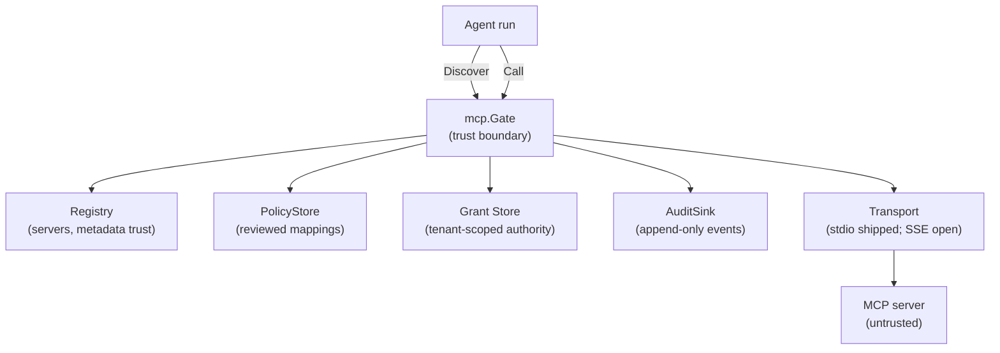

# MCP Trust Slice — Governed Bridge (P7.3)

> **Scope:** the boundary between the VibeSDK agent runtime and external MCP
> servers: registration, discovery, policy mapping, tenant-scoped grants,
> execution gate, idempotency and audit. Implements checklist task **P7.3**
> ([`../DEV_CHECKLIST.md`](../DEV_CHECKLIST.md)); implements the MCP priority
> named in [`../12-agentic-platform-strategy.md`](../12-agentic-platform-strategy.md)
> and the untrusted-boundary rule in
> [`../07-multitenancy-security.md`](../07-multitenancy-security.md).
>
> **Status:** `verified` for the trust boundary and the stdio transport
> (2026-11-22) — twelve gate unit tests plus five new transport tests that spawn a
> real MCP server process; nothing yet calls the gate from an HTTP route or an
> agent run, and the registry/grants are still in memory. Last reviewed: 2026-11-22.
>
> **Bounded by:** [`manifest-schemas.md`](manifest-schemas.md) (Tool Manifest
> contract), [`system-ir.md`](system-ir.md) (agents reference capabilities;
> grants are runtime state, never IR fields).

## Contents

| Section | Anchor |
|---|---|
| The rule | [`#rule`](#rule) |
| Trust levels | [`#levels`](#levels) |
| Architecture | [`#architecture`](#architecture) |
| The execution gate (11 checks) | [`#gate`](#gate) |
| Audit contract | [`#audit`](#audit) |
| Idempotency | [`#idempotency`](#idempotency) |
| The stdio transport | [`#transport`](#transport) |
| Deliberately out of scope | [`#scope`](#scope) |
| Tests that prove it | [`#tests`](#tests) |
| Open items | [`#open-items`](#open-items) |

## The rule

MCP servers are **untrusted external boundaries**. Discovery returns read-only
metadata and never grants execution. Every invocation requires an explicit,
tenant-scoped grant that records who approved it, and every attempt — allowed,
denied, or transport-failed — appends an audit event.

Two consequences are load-bearing:

1. **Identity comes from the caller, never from arguments.** Tool arguments are
   model-controlled; a tenant or user id inside them is an attack vector, not a
   fact. Every entry point takes an explicit `Identity`.
2. **A fresh server declaration never outranks review.** Discovery may report
   new tools and new side-effect claims; execution uses only the reviewed
   `ToolPolicy` snapshot the grant was issued against.

## Trust levels

| Level | What it allows | How it is obtained |
|---|---|---|
| Registered | Talk to the server; read tool metadata | `Registry.Register` (name, endpoint, registered-by, timestamp) |
| Policy-mapped | Review what a tool may do: permissions, side effect, approvals, secrets, idempotency | `PolicyStore.Put` (validated, pinned to a Tool Manifest version) |
| Granted | Execute one tool, for one tenant, until revoked/expired | `Store.Issue` (identity + pinned ref + policy snapshot + granted-by) |
| Approved | Execute a call that needs a live human decision | `HumanApproved` grant + `ApprovalRef` on the call |

Registration is intentionally the weakest level: it is metadata trust, not

## Architecture

The gate is the only path to a transport. Nothing else in the platform may call
`Transport.InvokeTool`, which is why the trust checks cannot be bypassed by a
future caller.

## The execution gate (11 checks)

`Gate.Call` fails closed, in this order, and audits the verdict of whichever
check decided:

1. tenant identity present (from the caller);
2. ref well-formed and pinned (`mcp/server/tool@MAJOR.MINOR.PATCH`);
3. server still registered (removal revokes immediately);
4. grant id present — *discovery does not authorize execution*;
5. grant exists **for this tenant**;
6. grant not revoked;
7. grant not expired;
8. grant covers exactly this server/tool/version;
9. a current policy exists and its authority-bearing fields match the grant
   snapshot (drift → re-grant);
10. human-required tools have a human-approved grant **and** a per-call
    `ApprovalRef`;
11. the declared idempotency field resolves in the arguments (dotted paths
    supported, e.g. `lead.id`).

Only then does the transport run. A transport error is audited as a denied
attempt with its own verdict (`transport error: …`) rather than being conflated
with an authorization denial.

## Audit contract

Every `AuditEvent` carries: timestamp (UTC), tenant, user, agent, server, tool,
version, grant id, decision (`allowed`/`denied`), verdict, approval reference,
and idempotency key.

Rules:

- append-only; the package never mutates or deletes events;
- a sink failure must never *grant* authority — logging is not a trust check;
- denied attempts matter as much as allowed ones: they are the evidence the
  boundary works;
- secrets never appear: policies accept only `vault:` references, so a literal
  credential cannot reach an event.

`MemorySink` is the reference implementation used by the tests; a persistent
sink (lineage/audit tables) is a follow-up.

## Idempotency

When a policy declares `IdempotencyKey`, the gate resolves that argument path
and records the result per tenant. A repeat with the same key returns the
recorded output and is audited as `idempotent replay: already executed` — the
transport is not called twice, which is what makes retries safe for external
side effects.

## The stdio transport (P1-AGT-003, 2026-11-22)

`Transport` was defined so a live adapter could land "without touching policy,
grant, or audit code". `StdioTransport` (`backend/pkg/mcp/stdio.go`) is that
adapter for MCP's stdio binding: newline-delimited JSON-RPC 2.0 over a child
process, with the `initialize` + `notifications/initialized` handshake before
`tools/list` or `tools/call`.

Rules it enforces, each with a test:

| Rule | Why | Test |
|---|---|---|
| stdout is the protocol channel **only** | a sloppy server must not smuggle free text into a tool result | `TestStdioTransportRejectsNonJSONStdout` |
| one deadline covers the exchange; expiry kills the process | a hanging server cannot pin a worker | `TestStdioTransportTimesOut` |
| `isError: true` becomes an error, never an empty success | the platform never reports a failed tool as success | `TestStdioTransportPropagatesToolError` |
| no grant ⇒ the process is **never spawned** | discovery authorizes nothing, so denial must not even start the server | `TestStdioTransportGrantlessCallNeverSpawns` |
| a granted call really round-trips | the trust checks are not bypassed — they are *exercised* | `TestStdioTransportLiveRoundTrip` |

The live test builds and spawns `testdata/stub-mcp` (a real separate process), so
the protocol path is proven end to end rather than against a mocked function.

**Deliberate limits of this PoC** (documented, not silent): one process per call
(no persistent session or reconnect rules yet), no SSE binding, and the child's
environment is exactly what the caller passes — a tool cannot read ambient
control-plane secrets.

**Still missing before a route or an agent run may use it:** the gate has no HTTP
surface and the registry/grants are in memory; and an MCP server's own
credentials still need the generic secret store (only the GitHub token vault
exists today). Both are tracked as `P1-AGT-004`.

## Deliberately out of scope

| Not in this slice | Why | Owner |
|---|---|---|
| MCP wire transport (stdio/SSE handshake, schema negotiation) | **stdio landed 2026-11-22** (`StdioTransport`, P1-AGT-003); SSE stays open | P1-AGT-004 (SSE) |
| Persistent registry/policy/grant stores | Needs the tenancy model in the store, not in the caller | P7.6 + P0.9 follow-up |
| Credential vault resolution | Secrets are refs here; resolution belongs to the vault, and only the GitHub token vault exists today | P1-AGT-004 |
| HTTP routes / UI for granting | Needs auth + CSRF + tenant context from P0 | P1-AGT-004 |
| Multi-agent delegated MCP calls | Team semantics land with M1 | M1 |
| MCP catalog / marketplace, publisher identity, security scanning | Distribution layer | M5 |
| Memory/knowledge integration for MCP results | P7.6 | P7.6 |

## Tests that prove it

`backend/pkg/mcp/execution_test.go` — 12 tests, all green
(`cd backend && go test ./pkg/mcp/`):

| Test | Proves |
|---|---|
| `TestDiscoverReturnsMetadataOnlyAndGrantsNothing` | discovery issues no grant; a grantless call is denied before the transport |
| `TestDiscoverRequiresTenantAndRegistration` | no tenant / no registration → error |
| `TestGrantedCallAuditsIdentityApprovalAndIdempotencyKey` | allowed call audits tenant/user/agent, grant, pinned ref, idempotency key |
| `TestApprovalRefIsAuditedWhenPolicyRequiresIt` | human-required tools reject standing-policy grants and missing per-call refs |
| `TestRevokedGrantFailsClosedImmediately` | revocation is immediate |
| `TestExpiredGrantFailsClosed` | expiry enforced through the clock seam |
| `TestPolicyDriftForcesRegrant` | widening a policy does not widen an existing grant |
| `TestCrossTenantGrantIsInvisible` | another tenant cannot see or use the grant; the attempt is audited under its own tenant |
| `TestIdempotentReplaySkipsSecondExecution` | replay returns the recorded output without a second transport call |
| `TestUnregisteredServerAndMissingIdempotencyKeyAreDenied` | server removal revokes at once; missing idempotency key denies |
| `TestTransportErrorIsAuditedAndNotAllowed` | transport failure is audited separately, never as allowed |
| `TestPolicyAndRefValidationRejectsUnsafeShapes` | literal secrets, irreversible-without-approval, unpinned versions, non-semver refs, tenantless grants all rejected |

`backend/pkg/mcp/stdio_test.go` — 5 tests against a **real spawned MCP server
process** (`testdata/stub-mcp`, built by the test):

| Test | Proves |
|---|---|
| `TestStdioTransportLiveRoundTrip` | discover → 2 tools; granted call → the server's text content, with the authorizing grant echoed |
| `TestStdioTransportGrantlessCallNeverSpawns` | a grantless call is denied by the gate and the server process is never started (the command is a non-existent binary, so any spawn would surface differently) |
| `TestStdioTransportRejectsNonJSONStdout` | anything but JSON-RPC on stdout is a protocol error |
| `TestStdioTransportTimesOut` | a hanging server is killed and reported within the deadline |
| `TestStdioTransportPropagatesToolError` | `isError: true` becomes an error, never an empty success |

## Open items

| Item | Owner |
|---|---|
| ~~Wire a real transport behind `Transport` and prove one live server round-trip~~ — **DONE 2026-11-22** (`StdioTransport` + 5 tests against a spawned stub process) | P1-AGT-003 |
| SSE binding behind the same `Transport` (`P7-SCH` search stays transport-agnostic) | P1-AGT-004 |
| Persist registry/policy/grants with tenant isolation enforced in the store | P7.6 + P0 |
| Expose grant/revoke/discover/execute through authenticated routes (unified: tools, skills and imports conduct through the same routes per proposal 7) | P1-AGT-004 |
| Generic credential store so an MCP server's own secrets are `vault:` refs (only the GitHub token vault exists today) | P1-AGT-004 |
| Map MCP tool results into the run trace (tool-call span) | P7.7 |
| Promotion from `verified` to production-ready | after a route-level test plus the stores above |

execution trust.
