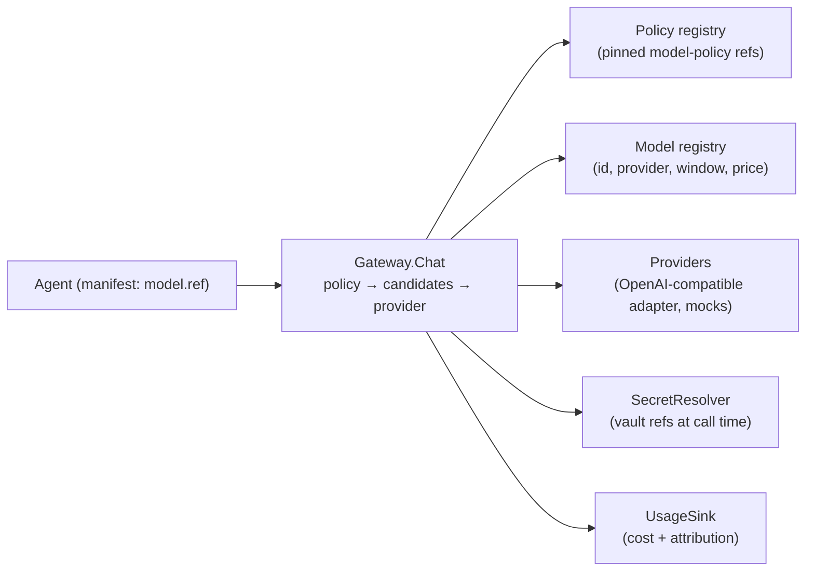

# Model Gateway (P7.4)

> **Scope:** one contract in front of every model provider: registry, pinned
> model policies, routing with fallback, pre-flight budget guards, cost
> estimation, usage attribution and provider health. Implements checklist task
> **P7.4** ([`../DEV_CHECKLIST.md`](../DEV_CHECKLIST.md)) and the Model Gateway
> requirements in [`../12-agentic-platform-strategy.md`](../12-agentic-platform-strategy.md).
>
> **Status:** `implemented_unverified` — the gateway package and its twelve
> tests exist (`backend/pkg/gateway`); no generation path calls it yet (the
> engine still builds per-role models directly) and streaming is not
> implemented. Last reviewed: 2026-11-16.
>
> **Bounded by:** [`manifest-schemas.md`](manifest-schemas.md) (agents carry a
> `model.ref` policy ref, never a provider), [`system-ir.md`](system-ir.md)
> (model choice is a policy ref in the IR too).

## Contents

| Section | Anchor |
|---|---|
| Why a gateway | [`#why`](#why) |
| Layers | [`#layers`](#layers) |
| Model policies (the only thing agents name) | [`#policies`](#policies) |
| Routing and fallback | [`#routing`](#routing) |
| Pre-flight guards | [`#guards`](#guards) |
| Cost and attribution | [`#cost`](#cost) |
| Open and self-hosted models | [`#open-models`](#open-models) |
| Deliberately out of scope | [`#scope`](#scope) |
| Tests that prove it | [`#tests`](#tests) |
| Open items | [`#open-items`](#open-items) |

<a id="why"></a>
## Why a gateway

Without one, provider choice leaks into Agent manifests, prompts and business
logic: swapping a model becomes a code change, a fallback becomes a `try/catch`
in the wrong layer, and cost is discovered after the invoice. The gateway makes
provider choice a **registry entry**, so "run on a cheaper model when the
expensive one is down" is configuration, not code.

<a id="layers"></a>
## Layers



<a id="policies"></a>
## Model policies (the only thing agents name)

A policy is pinned and versioned exactly like every other manifest reference:

```
model-policy/standard@1.0.0
```

It carries `temperature`, a `MaxTokens` ceiling, an optional `BudgetUSD` cap
per call, and an **ordered** `Candidates` list of registry model IDs. Immutable
once registered: changing behaviour means a new version, which is what makes a

<a id="routing"></a>
## Routing and fallback

The candidate list is tried in order. A failure moves to the next candidate
regardless of class — the caller asked for a *policy*, not a provider:

| Outcome | Routing behaviour |
|---|---|
| Success | return; record usage |
| `retryable` (429, 5xx, transport, decode) | mark provider unhealthy, try next |
| `fatal` (auth, bad request, unknown model) | try next immediately |
| `budget` (window or cost guard) | try next without dispatching |
| provider unhealthy (≥3 consecutive retryable failures) | skip without dispatching |

A provider is cleared from the unhealthy set on its next success, so recovery
needs no operator action.

<a id="guards"></a>
## Pre-flight guards

Both guards run **before** any provider is called, because a refused call that
still costs money is not a guard:

1. **Context window** — `estimatedPrompt + maxTokens` must fit the model's
   window. The estimate is chars/4 (a documented heuristic); providers'
   reported usage is what gets recorded.
2. **Cost budget** — the worst-case cost (`prompt × priceIn + maxTokens ×
   priceOut`) must fit the policy budget or the per-call override.

Per-call overrides can only **narrow**: a caller may ask for fewer tokens or a
smaller budget, never more than the policy allows.

<a id="cost"></a>
## Cost and attribution

Prices live in the model registry in USD per million tokens, so cost is
arithmetic rather than a guess:

```
cost = promptTokens/1e6 × priceIn + completionTokens/1e6 × priceOut
```

Each successful call records one event carrying: policy ref, model + provider
that actually ran, usage, cost, tenant, agent, run id, `FallbacksUsed`, and the
per-attempt error classes of every candidate that failed first. That is exactly
the attribution the run trace (P7.7) and cost rollups need — recorded at the
source instead of reconstructed later.

<a id="open-models"></a>
## Open and self-hosted models

An open or self-hosted model is not a special case: it is a registry entry
whose provider is either an OpenAI-compatible shim
(`HTTPProvider{BaseURL: …}`) or a dedicated adapter. Open models get the same
routing, fallback, guards, cost (zero or self-host rates) and evaluation hooks
as hosted ones — which is what "provider-agnostic" has to mean to be worth
anything.

<a id="scope"></a>
## Deliberately out of scope

| Not in this slice | Why | Owner |
|---|---|---|
| Streaming responses | The generation engine streams today through its own client; replacing that is a separate, observable-behaviour change | P7.4 follow-up |
| Provider-specific parameter translation (tool-calling, reasoning knobs) | The gateway stays OpenAI-compatible in v1; adapters add translation | follow-up |
| Prompt caching, rate-limit leases, request coalescing | Needs workload evidence | M2+ |
| LoRA / adapter routing | Future direction, no training pipeline exists | M4+ |
| Wiring the engine to call the gateway | Must not change generation behaviour mid-slice | P7.4 follow-up |
| Persistent usage/billing tables | Sink interface exists; storage belongs with metering | P7.7 |

<a id="tests"></a>
## Tests that prove it

`backend/pkg/gateway/gateway_test.go` — 12 tests, all green
(`cd backend && go test ./pkg/gateway/`):

| Test | Proves |
|---|---|
| `TestPolicyMustBePinnedAndKnown` | floating `@latest` and unknown policies are rejected |
| `TestTenantIsRequired` | calls are attributed; an unnormed caller cannot spend |
| `TestNoResolverIsRejectedAtConstruction` | a gateway with no secret resolver cannot exist |
| `TestChatResolvesPolicyAndAttributesUsage` | policy resolution, cost arithmetic (per-MTok), tenant/agent/run attribution |
| `TestFallbackOnRetryableFailure` | fallback runs the next candidate and the failed attempt is recorded with its class |
| `TestHTTPProviderRoundTrip` | a real OpenAI-compatible provider works end to end; the key comes from the vault ref, never from config |
| `TestContextWindowGuardFailsClosedAndFallsBack` | an oversized prompt is never dispatched to a small model |
| `TestCostBudgetGuardFailsClosed` | a call exceeding its budget never reaches the provider |
| `TestPerCallOverridesCannotWidenPolicy` | callers may narrow but never widen the policy ceiling |
| `TestUnhealthyProviderIsSkipped` | a sick provider is skipped without a dispatch attempt |
| `TestNoCandidateSurfacesAttempts` | exhaustion reports every attempt |
| `TestPolicyRegistryRejectsFloatingAndUnknown` | unpinned versions, unknown models and orphan models are rejected |

<a id="open-items"></a>
## Open items

| Item | Owner |
|---|---|
| Route the generation engine through the gateway (with streaming) without changing output | P7.4 follow-up |
| Provider health persistence (currently per-process) | M2 |
| Persistent usage/billing sink and cost rollups per tenant | P7.7 |
| Model evaluation harness comparing candidates on a dataset | M4 |
| Promotion from `implemented_unverified` to `verified` | after the engine calls the gateway and its tests exercise fallback + budget on the real path |

diff reviewable.
