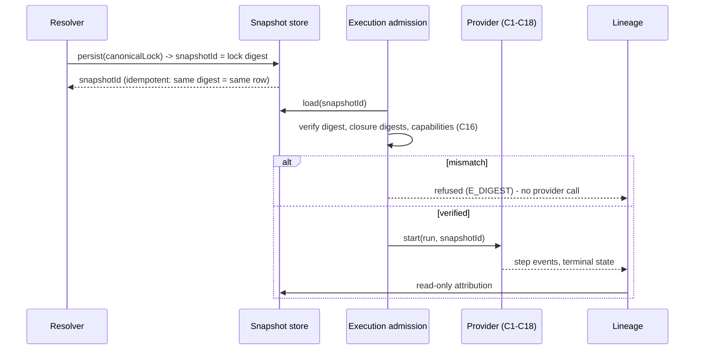

# Run Composition Snapshot — Design (PROPOSED, ADI-FOUND-004)

> **Status:** `proposed` (2026-11-23) — design only. No migration, no table, no column, no code in this change.
> **Contract it binds:** `composition-lock.md` (§9 invariants, §10 admission) and `composition-resolver.md` (the lock the resolver produces). **Runtime base:** `../ecosystem/06-runtime-and-execution-architecture.md` (provider contract C1–C18).
> **Decision record:** `adr-adaptive-intelligence-boundaries.md`.

## 1. What a snapshot is, and what it is not

| Term | Meaning |
|---|---|
| **Lock** | The resolver's output: exact closure plus digests, for one System version. Content-addressed, but not yet tied to anything that ran. |
| **Snapshot** | A **stored** lock, made immutable, identified by its lock digest, and referenced by a run. |
| **Run** | One execution. It points at exactly one snapshot for its whole life. |

The lock is a value; the snapshot is that value made durable. Keeping the two apart is what lets a lock be produced in a test with no database at all (`backend/pkg/composition` does exactly that) while a run still has something permanent to point at.

## 2. The run-to-snapshot relation (normative)

1. **Exactly one.** A run references exactly one snapshot. Not a set, not a range, not "the current one".
2. **Written before admission.** The snapshot row exists before the run is admitted; admission verifies against it. A run that starts without a stored snapshot is a defect, not a degraded mode.
3. **Identity is the lock digest.** `snapshotId == lock.Digest()` (`sha256:<hex>` over the canonical lock excluding `generatedAt`). Two runs over the same closure share a snapshot; two different closures cannot collide.
4. **Append-only.** No `UPDATE` may change a snapshot's closure, digests, `systemRef`, `compilerVersion` or `resolutionMode`. A correction is a new snapshot.
5. **Never "current composition".** No run row, and no execution path, may resolve "the composition" at read time. The only legal source is the snapshot the run points at.
6. **Deduplication is content-based.** Re-resolving an unchanged closure produces the same `snapshotId`, so a second run reuses the row instead of writing a duplicate. Because `generatedAt` is excluded from the digest, a re-resolution at a different minute is still the same snapshot.

## 3. The stored record

### 3.1 Fields (design)

| Field | Source | Notes |
|---|---|---|
| `snapshotId` | `lock.Digest()` | Primary key; also the content address. |
| `lockVersion` | lock | Format version of the stored artifact. |
| `systemRef` | lock | `system/<name>@<version>` — identity only, never resolved as an asset. |
| `systemDigest` | lock | Digest of the canonical System bytes. |
| `compilerVersion` | lock | Which resolver produced it. |
| `resolutionMode` | lock | `registry` / `bundled` / `offline-cache` — qualifies what the lock proves. |
| `canonicalLock` | `lock.Canonical()` | The full lock document, including `resolvedClosure`. Storing the whole thing is what makes a run attributable without a registry. |
| `tenantKey` | the tenant that first wrote it | Needed to answer "may this run read this snapshot?"; **not** part of the digest. |
| `closedAt` | clock at write | Audit only; excluded from the digest (it is `generatedAt`). |
| `retentionClass` | policy at write | Decides whether the row can be deleted with the runs that use it. |

**Nothing else.** In particular: no status, no run id list, no cost, no timings, no secrets. Run state lives on the run; the snapshot is content.

### 3.2 Where it could live (open, with measurements)

| Option | Fit | Evidence |
|---|---|---|
| D1 row, lock JSON in a TEXT column | Smallest step; joins naturally with `workflow_instances` and `generations` in the same database | The real M1 golden lock is **2,930 bytes for 9 entries** (~264 bytes/entry). A 50-asset closure is therefore a few KB, far inside a row's practical budget |
| Object store blob + D1 index row | Handles very large closures and keeps the database lean | Adds a second consistency domain; needs a delete story for retention |
| Keep the lock only on the run row | Fewest moving parts | Kills deduplication and makes "which closure is this" unanswerable without the run |

**Implemented as D1 TEXT (ADI-FOUND-004a):** `composition_snapshots` stores the canonical lock in a text column, which the measured size comfortably allows. The object-store option is held for measured large closures; the *shared* storage shape stays **O27** for the registry decision, but the snapshot table itself is now real.

### 3.3 Where the run points (evidence from the live schema)

`worker/database/schema.ts` already has the run side: `workflow_instances` (`id`, `workflow_id`, `status`, `user_id` as the tenant, `input`/`output` JSON, timestamps) and `workflow_step_logs` (per node-id + attempt). `generations` carries the lineage side (`parent` self-FK, `commit_sha`, `branch`, `fork`).

**The migration landed (ADI-FOUND-004a):** `migrations/0017_nebulous_shatterstar.sql` adds `composition_snapshots` plus a nullable `snapshot_id` on `workflow_instances` and its index. It is purely additive — one `CREATE TABLE`, one `ALTER TABLE ... ADD COLUMN`, three indexes, **no** `DROP` and **no** backfill, because inventing a closure for an existing run would be a fabrication.

**Binding is wired, and opt-in (ADI-FOUND-004b).** `POST /api/workflows/trigger` accepts an optional `snapshotId`; when the hub has a store installed the id is verified before the instance row is created, and the binding is recorded on the run. `CONTROL_PLANE_REQUIRE_SNAPSHOT` decides whether an *absent* id is allowed:

- **off (default):** unbound runs keep working exactly as before; a run that *does* pass an id is verified (soft rollout).
- **on:** every new run must reference a stored snapshot; unbound runs are refused with `E_SNAPSHOT_MISSING` before anything durable exists.

Because nothing writes snapshots yet (the resolver is not wired into the run path), turning the switch on today refuses **every** run. That is intentional: the switch exists to make the rollout a decision, not an accident.

## 4. Lifecycle (normative sequence)

1. **Resolve** → lock (the resolver, `backend/pkg/composition`).
2. **Persist** → snapshot row, keyed by the lock digest. Idempotent by construction: the key *is* the content.
3. **Bind** → the run records `snapshot_id`. A run without it cannot be admitted.
4. **Admit** → re-verify (10) before the provider is called.
5. **Execute** → the provider runs the plan; the snapshot is read-only input.
6. **Attribute** → lineage rows join run → snapshot → exact assets.

## 5. Immutability rules (what must never happen)

| Forbidden | Why |
|---|---|
| Updating a snapshot's closure or digests | Destroys the answer to "what ran?"; the whole artifact becomes untrustworthy |
| Deleting a snapshot that a run references | Orphans that run's attribution permanently |
| Reusing a `snapshotId` for different content | The id is a content digest; reuse would mean the digest lies |
| Resolving assets at execution time instead of reading them from the snapshot | Reintroduces the drift the snapshot exists to stop |
| Storing tenant grants or secrets in a snapshot | It is shared, logged and diffed; grants are the gate's business (D18) |
| Writing `status`, timings or costs into a snapshot | Runtime state belongs to the run (invariant I2's spirit, D15) |

## 6. Admission verification (the only enforcement point)

Before a provider is asked to start:

1. load the snapshot by the run's `snapshot_id` — absent → refuse (`E_SNAPSHOT_MISSING`);
2. recompute the lock digest from `canonicalLock` and compare with `snapshotId` → mismatch → `E_DIGEST`;
3. verify each closure entry's digest against the stored asset bytes **if the executor needs the bytes**, or against the stored digests when it does not — never re-resolve from a registry;
4. derive required capabilities from the plan and compare with the provider's advertisement → missing guarantee → refuse (C16), which is a `rejected` run, not a failed one;
5. only then `start`.

Every refusal in this list happens **before** the first durable step, so a refused run leaves no partial execution to explain.

**Where it lives:** `composition.AdmitRun` performs 1, 2 and 3 (existence, tenant, digest chain) in one call with one result shape, and `composition.Verify` is the pure digest check underneath it. Steps 4-5 stay where they already are, in `execution.Admit` (capability refusal, C16). Since ADI-FOUND-004b the trigger handler calls `hub.AdmitRunSnapshot` **before** `CreateWorkflowInstanceRow`, so a refusal writes no run row and starts no runtime instance; the codes map to HTTP as `E_TENANT` → 403, `E_SOURCE` → 503, everything else → 409.

## 7. Attribution and lineage

- **Run → snapshot → assets** is a foreign-key walk, not a lookup in a live registry.
- The lineage tables (`generations`, `workflow_step_logs`) answer *what happened*; the snapshot answers *what it was allowed to be*. Keeping them separate means a lineage query never needs the registry and a closure query never needs step logs.
- A completed run is attributable forever: its outcome, its steps and its exact closure all survive a later package release.
- "Which runs used the vulnerable version of `tool/x@1.2.0`?" is a snapshot query by closure membership — the operational reason this artifact exists.

## 8. Retention and deletion

| Case | Rule |
|---|---|
| Delete runs of a tenant | Snapshots referenced by nothing else may be deleted; a shared snapshot survives while any run references it. |
| Tenant erasure (GDPR) | Run payloads are tenant data and are deleted; snapshots contain **no tenant identifiers** by construction (§3.1), so they can survive as content. Where law requires otherwise, delete and accept that attribution for that run is gone — record the choice. |
| Retirement of an asset version | Does **not** delete snapshots. Retirement blocks *new* pins (`05-agent-platform-architecture.md`); existing snapshots keep resolving. |

## 9. Migration and rollback

1. **Lock format migration** (`lockVersion` MAJOR, `composition-lock.md` §12) is a transformer over stored snapshots, applied by `snapshotId` — never an in-place re-resolution, because re-resolution would change the id and break every reference.
2. **Compiler upgrade** produces new snapshots for new runs; it never rewrites old ones. A `compilerVersion` difference between two snapshots is a fact worth keeping.
3. **Rollback** points new runs at an earlier snapshot; it never re-points or deletes existing runs.
4. **Pinning forward** (`systemRef` version bump) is a new snapshot — an explicit event, visible as a diff, never a silent upgrade.
5. **Schema migration** for the table itself follows the repository rule: additive, nullable, generated through drizzle (`worker/database/schema.ts`), applied remotely via the documented commands — not hand-written SQL.

## 10. Failure modes

| Code | Condition | Behaviour |
|---|---|---|
| `E_SNAPSHOT_MISSING` | The run references a snapshot that is not stored. | Refuse before any step. |
| `E_DIGEST` | Recomputed lock digest ≠ `snapshotId`, or a closure digest mismatches. | Refuse before any step. |
| `E_CAPABILITY` | The plan needs a guarantee the provider does not advertise (C16). | `rejected` run, not `failed`. |
| `E_TENANT` | The snapshot belongs to another tenant and is not shared. | Refuse; never a cross-tenant read. |
| `E_RETIRED` | A new pin would reference a retired asset. | Refuse at resolution time, not at admission. |

## 11. What this design does not include

No migration, no table, no column, no Drizzle change, no route, no admission code, no change to `workflow_instances` or `generations`. The design exists so the change can be small and reviewable: one table, one nullable column, one verification function, one set of tests.

## 12. Open items

| ID | Question | Why it is open |
|---|---|---|
| O27 | Storage shape: D1 TEXT vs object store (+ the tenant key on the snapshot) | Shared with the registry decision; a snapshot can exist before a registry, but the *shared* storage decision should be made once. |
| — | Retention window for unreferenced snapshots | Operational policy; needs a real volume figure. |
| — | Whether admission re-hashes stored asset bytes or trusts stored digests | Depends on whether the executor ever needs the bytes; today it needs the closure, not the contents. |
| — | Freshness policy for `offline-cache` snapshots | Belongs with the cache adapter (ADI-ECO-002). |
| — | Whether a snapshot may be shared across tenants at all | Today the rule is **first-writer-wins**, and a second tenant persisting identical content gets `ErrSnapshotTenant` at write time rather than `E_TENANT` later at admission — the failure surfaces where it can be fixed. Whether sharing should be allowed at all still needs a security review, not a default. |

## 13. Implementation status

### Done — ADI-FOUND-004a (2026-11-23)

| Piece | Evidence |
|---|---|
| `composition_snapshots` table + nullable `snapshot_id` on `workflow_instances` | `worker/database/schema.ts`, `migrations/0017_nebulous_shatterstar.sql` (additive: create table, add column, three indexes, no drop, no backfill) |
| `Snapshot` / `NewSnapshot` / `SnapshotStore` | `backend/pkg/composition/snapshot.go` — id is the lock digest; the document round-trips |
| Admission rules | `composition.AdmitRun` (existence, tenant, digest chain) + `composition.Verify` (pure); codes `E_SNAPSHOT_MISSING`, `E_DIGEST`, `E_TENANT` |
| D1 adapter | `backend/pkg/composition/d1store` over a two-method `Querier` (no Cloudflare import, no network in tests); insert is `ON CONFLICT DO NOTHING`, there is no update path at all |
| Tests | `go test ./pkg/composition/...` — 7 snapshot cases (identity, dedupe, immutability, tamper detection, unbound refusal, cross-tenant, changed-asset attribution) + 6 store cases (append-only, round-trip, missing, second tenant, collision, unconfigured) |

### Done — ADI-FOUND-004b (2026-11-23, live wiring)

| Piece | Evidence |
|---|---|
| Optional `snapshotId` on the trigger request | `backend/pkg/api/workflows.go`; the response echoes it when present |
| Optional store on the hub, no-op when absent | `EngineHub.SetSnapshotBinding` / `AdmitRunSnapshot` (`backend/pkg/engine/hub.go`) — the same idiom `SessionVerifier` uses |
| Binding recorded on the run | `CreateWorkflowInstanceRow` writes `NULLIF(?, '')` into `snapshot_id`, so an unbound run records NULL rather than a fabricated closure |
| Refusal before anything durable | `AdmitRunSnapshot` runs before the instance row; tests assert **zero** instance rows and **zero** runtime instances after every refusal |
| Rollout switch | `CONTROL_PLANE_REQUIRE_SNAPSHOT` read in `backend/cmd/main.go`; documented in `DEPLOY_RENDER_CLOUDFLARE.md` |
| Tests | 7 route-level cases in `backend/pkg/api/workflows_snapshot_test.go`: unbound refusal, soft-mode regression, unknown id, tampered document, cross-tenant, valid binding, required-without-store |

### Remaining, deliberately not done here

1. **Nothing writes snapshots yet.** The resolver is not wired into the run path, so there is no producer for a `snapshotId`. Enabling `CONTROL_PLANE_REQUIRE_SNAPSHOT` today refuses every run; the switch is a rollout decision, and a producer task must land first.
2. **The M1 outcome route has the same need.** `src/lib/api-client.ts` calls `/api/outcomes/trigger`, which is not registered yet; when it lands it must admit exactly like the workflow trigger, or the two entry points will disagree about what a bound run is.
3. **No UI sends the field.** The SPA has no trigger form today, so `src/api-types.ts` was deliberately left untouched: adding an unused type would be dead code, and the honesty rule is to add it with its consumer.
