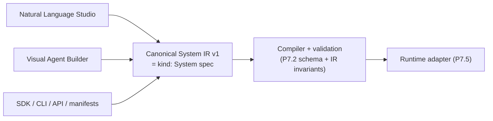

# Canonical System IR v1 (P7.2)

> **Scope:** the intermediate representation every creation surface compiles to
> and every runtime executes: what v1 must represent, its invariants, how it is
> versioned and diffed, what it deliberately omits, and the four-case test that
> proves it is expressive enough to start. Implements checklist task **P7.2**
> ([`../DEV_CHECKLIST.md`](../DEV_CHECKLIST.md)); closes the design half of
> open decision **O9** ([`../10-decisions-and-open-questions.md`](../10-decisions-and-open-questions.md)).
> Decision record: [`adr-system-ir-v1.md`](adr-system-ir-v1.md).
>
> **Status:** `implemented_unverified` — the contract, four fixtures and the
> `system-ir` gate are in place and run in `bun run docs:check`; no compiler or
> runtime consumes the IR yet (P7.3/P7.4/P7.5). Last reviewed: 2026-11-16.
>
> **Bounded by:** [`../12-agentic-platform-strategy.md`](../12-agentic-platform-strategy.md)
> (IR requirements), [`manifest-schemas.md`](manifest-schemas.md) (manifest
> envelope and semver), [`../06-functions-and-tools.md`](../06-functions-and-tools.md)
> (System Manifest = serializable IR v1).

## Contents

| Section | Anchor |
|---|---|
| One representation, no parallel format | [`#one-representation`](#one-representation) |
| The pipeline | [`#pipeline`](#pipeline) |
| What v1 represents | [`#represents`](#represents) |
| Two execution shapes | [`#shapes`](#shapes) |
| Invariants | [`#invariants`](#invariants) |
| Desired state vs runtime state | [`#desired-vs-runtime`](#desired-vs-runtime) |
| Versioning, compatibility, migration | [`#versioning`](#versioning) |
| Diff and determinism | [`#diff`](#diff) |
| Four cases (the expressiveness test) | [`#four-cases`](#four-cases) |
| Rejected for v1 | [`#rejected`](#rejected) |
| Validation gate | [`#gate`](#gate) |
| Consumer (`backend/pkg/ir`) | [`#consumer`](#consumer) |
| Open items | [`#open-items`](#open-items) |

## One representation, no parallel format

IR v1 **is** the `kind: System` manifest `spec` — the same envelope, semver,
canonical serialization and validation rules as the other three manifests. It
is not a second file format: "System Manifest" (authoring/registry view) and
"Canonical System IR" (compiler/runtime view) are the same bytes.

Consequence: the Visual Builder, the Natural Language Studio, the SDK/CLI and
hand-written manifests all converge here by construction, which is why the
platform cannot develop two divergent agent models (decision D7).

## The pipeline

User intent → intent parsing → requirement clarification → system planning →
**system compiler** → Canonical System IR → schema validation → policy
validation → capability resolution → deployment planning → agent runtime →
execution → observability → evaluation → versioning.

v1 owns the middle of that pipeline. Everything before it (intent extraction,
clarification) and after it (resolution against a live registry, deployment)
is other tasks; the IR gate only proves the representation is sound.

## What v1 represents

Required identity: `apiVersion`, `kind: System`, `metadata.name`,
`metadata.version` (semver), `metadata.publisher`, `metadata.license`.

Required `spec` core:

| Field | Meaning |
|---|---|
| `outcome` | The stated result, in the user's terms — the only free-text purpose field. |
| `agents` **or** `workflow` | The execution shape (exactly one; see below). |
| `topology` | Ordered run steps referencing declared agent names (`run`, `after`, `when`, `on`). |

Optional `spec` fields: `routing` (`parallel`, `onError`), `approvals`
(`on` + typed `approver`), `deployment` (`environment`, `replicas`),
`evaluation` (`dataset` ref + `thresholds`).

References are content-addressed and pinned: `agent/name@X.Y.Z`,
`tool/…`, `skill/…`, plus the external namespaces `model-policy/…`,
`knowledge/…`, `eval/…`. Model choice is a policy ref, never a provider name.

## Two execution shapes

v1 accepts exactly one shape per system, and the schema enforces it
(`spec.oneOf`):

1. **Agentic** — `agents` (one or more, with optional `delegatesTo`) plus
   `topology`. Covers M0 single agents, M1 teams, and the live App Builder
   reference workload.
2. **Procedural** — `workflow` with typed nodes and edges. Covers workloads
   that are pipes rather than collaborators; the node `kind` vocabulary is the
   seven live interpreter node types (`trigger`, `http`, `db`, `ai`, `email`,
   `condition`, `sleep`), so nothing here is speculative.

Both shapes are fully validated and neither is privileged: an agent system is
not "workflow with AI nodes", and a workflow is not a degenerate team. What
they share is identity, outcome, policies, approvals, deployment, evaluation
and refs — which is precisely what makes one IR useful.

A hybrid (agents *and* workflow in one system) is **rejected in v1**. If a real
workload needs it, that is an ADR-level change with evidence, not a silent

## Invariants

JSON Schema covers structure; these invariants cover meaning, and the gate
(`scripts/validate-system-ir.mjs`) enforces them:

| # | Invariant | Why |
|---|---|---|
| I1 | Exactly one execution shape (`agents` xor `workflow`). | Prevents the "every workload is a graph" drift and keeps the compiler honest. |
| I2 | No runtime state anywhere (no `status`, `state`, `health`, `lastRun`, `runId`, `metrics`, `telemetry`, `logs`). | The IR is desired state; runs, cost and health belong to the data layer and the trace (P7.7). |
| I3 | Agent refs are pinned `agent/name@X.Y.Z`; a key is a slug; delegation targets exist and are not self. | Floats and typos must fail at compile, not at deploy. |
| I4 | Every `topology.run` / `.after` names a declared agent; one step per agent in v1. | A step that runs nothing is a lie the runtime would have to interpret. |
| I5 | Workflow node ids are unique; `kind` is one of the seven; `next`/`entry` resolve; every node reachable from the entry set. | Dangling edges are the classic silent-failure source in DAG execution. |
| I6 | `approvals[].approver` is `role:`/`user:`/`group:`. | Approval must name an accountable principal, not a free string. |

## Desired state vs runtime state

The IR declares **what should exist**. It never carries what happened:

| Lives in the IR (desired) | Lives outside the IR (runtime) |
|---|---|
| Outcome, agents/teams, topology, workflow | Run ids, attempts, retries taken |
| Policies, approvals, limits | Approval decisions, approver identity at decision time |
| Deployment target + replicas | Actual replicas, health, rollout state |
| Evaluation dataset + thresholds | Scores, pass/fail, human feedback |
| Pinned refs to capabilities | Resolved closure at run time, secret handles |

This split is what makes an IR file reviewable in a pull request and safe to
export: nothing in it goes stale, and a diff never mixes intent with
telemetry.

## Versioning, compatibility, migration

1. **Envelope version** — `apiVersion: vibesdk/v1`. Changing the envelope is a
   platform event requiring an ADR.
2. **IR version is the envelope version**: there is no separate `irVersion`,
   because a second version counter would immediately disagree with the first.
3. **Semver of a system** — `MAJOR` changes structure or meaning; `MINOR` adds
   optional fields; `PATCH` changes text only. See
   [`manifest-schemas.md`](manifest-schemas.md).
4. **Backward compatibility** — the compiler must accept any `v1` document that
   validated when it was published; adding a required field is a `MAJOR` event,
   not a schema edit.
5. **Migration** — a new `MAJOR` ships with a deterministic transformer from the
   previous version plus a migration note; systems are never silently
   re-interpreted.

## Diff and determinism

- Canonical serialization (sorted keys, 2-space indent, one trailing newline,
  no runtime fields) makes diffs semantic rather than cosmetic; the gate fails
  a non-canonical fixture.
- Structural diff classes: `identity`, `outcome` (prose), `topology`/`workflow`
  (execution shape), `capabilities` (refs), `policy` (approvals/limits),
  `deployment`, `evaluation`.
- A `policy` or `capabilities` diff is security-relevant and must be reviewed
  even in a `PATCH`; text-only diffs are not.
- Two documents differing only in key order or whitespace are byte-identical
  after canonicalization, so "no change" means no change.

## Four cases (the expressiveness test)

v1 is only useful if it covers today's real workloads plus the next two
phases. The gate validates one canonical fixture per case
(`docs/architecture/system-ir/examples/`) — all four must pass, and each is
also checked for its shape:

| # | Case | Fixture | Shape | What it proves |
|---|---|---|---|---|
| 1 | App Builder reference workload (live) | `app-builder.system.json` | agentic | Today's planner + coordinator/coder/reviewer pipeline, approval-gated deploy and evaluation, with no invented fields. |
| 2 | M0 single agent | `m0-single-agent.system.json` | agentic | The MVP's minimal system is a legal IR, not a special case. |
| 3 | M1 multi-agent team | `m1-team.system.json` | agentic | Delegation, ordered steps, conditions and a review gate fit in `topology`. |
| 4 | Visual workflow | `visual-workflow.system.json` | procedural | A seven-kind DAG is expressible without an agent or graph-UI field. |

If a case needs a new field, the IR is wrong for v1 — not the case. That is the
guard against building the universal IR prematurely.

## Rejected for v1 (deliberately absent)

| Absent | Reason | Where it belongs |
|---|---|---|
| Hybrid systems (agents + workflow together) | No evidence it is needed; adds composition semantics v1 cannot validate. | ADR when a real workload demands it |
| Inline memory/knowledge configuration (vectors, chunking, embeddings) | Provider decisions belong to the memory layer. | P7.6 |
| Model parameters beyond a policy ref | Provider leakage into the contract. | Model gateway (P7.4) |
| Per-step retry/timeout matrices | Limits live in agent policies and the runtime adapter. | P7.5 |
| Visual coordinates, canvas layout, node positions | UI state, not system state — it would fork the IR per surface. | Visual Builder (client) |
| Secrets, credentials, provider keys | Structural impossibility is the security control. | Credential vault |
| Marketplace/pricing/publisher reputation | Distribution metadata, not execution semantics. | M5 |
| Telemetry, cost tables, evaluation results | Runtime/observation data. | P7.7 trace |
| Prose fields beyond `outcome` | Free text multiplies ambiguity; instructions live in Agent manifests. | Agent manifest |

## Validation gate

`node scripts/validate-system-ir.mjs` (wired into `bun run docs:check`) checks:

1. the fixture is `kind: System` and validates against the P7.1 schema;
2. invariants I1–I6 hold — including **no cycles** and **every node reachable**
   from the entry set (both are errors since ADI-FOUND-001a, matching Go);
3. the declared shape matches the case, and the workflow case exercises all
   seven node kinds;
4. canonical serialization round-trips byte-identically, and a positive control
   (`../system-ir/positive-control.system.json`, every optional field populated)
   loads cleanly so a tightened rule cannot over-reject;
5. seventeen negative probes are **rejected** — runtime `status`, a `telemetry`
   block, an unpinned `@latest` ref, an unknown delegation target, both shapes
   at once, a dangling workflow edge, plus the eleven parity probes N1–N11
   (length, semver, outcome, topology, approval class, evaluation dataset,
   duplicate edge, cycle, unreachable node).

A negative probe that passes is a failure: v1's value is what it refuses.

## Consumer — `backend/pkg/ir` (P1-AGT-002, 2026-11-22)

The IR was previously only *stored*: `scripts/validate-system-ir.mjs` proved the
four fixtures and rejected six negative probes, but no Go code could read a
System document. `backend/pkg/ir` is that reader, and it implements the same
invariants so the platform has one answer to "is this IR valid?".

| Surface | Contract |
|---|---|
| `Load(data)` | Decodes into typed structs and returns the system plus every violation (nil = valid). Unknown fields are rejected, which is how the schema's `additionalProperties: false` reaches the compiler. |
| `Canonicalize(data)` | Re-serializes with sorted keys, 2-space indent, exactly one trailing newline, and **HTML escaping disabled** (the IR carries conditions like `score >= 80`). |
| `System` / `Spec` | Typed view the compiler consumes: pinned `agent/name@X.Y.Z` refs, delegation, topology, workflow nodes with the seven live kinds, approvals, desired deployment state. |

Invariants enforced in Go: I1 one execution shape, I2 no runtime state (walked,
not just field-checked), I3 pinned agent refs + known delegation targets, I4
topology references declared agents once, I5 workflow graph integrity (unique ids,
known kinds, no dangling `next`/`entry`), I6 typed approvers.

**Evidence (executed):** `go test ./pkg/ir/` — 4/4 fixtures load, 4/4 canonical
round-trips are byte-identical to the stored files, and 6/6 negative probes are
rejected **for the stated reason** (the test asserts the message, not just that
something failed); plus "neither shape", a pinned-closure walk over the M1 team,
and a broken-JSON guard. `go vet ./...` clean.

**Parity status (2026-11-23):** the "same answer" claim is now **enforced**, not aspirational. ADI-FOUND-001 found the gaps by executed probe; ADI-FOUND-001a closed them. Both readers reject the same thirteen probes, the gate refuses cycles and unreachable nodes, and a shared positive control guards against over-rejection ([`ir-parity-audit.md`](ir-parity-audit.md) §8). Two documented asymmetries remain: JSON Schema cannot express acyclicity/reachability (the invariants carry them), and `JSON.parse` cannot see duplicate keys (Go rejects them on both paths; the gate does not).

**Historical audit (2026-11-23, ADI-FOUND-001):** the claim was aspirational before the fix. An executed two-sided probe found that Go accepts documents the P7.1 schema rejects — 63-char caps on `metadata.name`/node ids, semver leading zeros, a missing `spec.outcome`, `agents` without `topology`, `approvals[].on` outside the vocabulary, `evaluation` without `dataset`, and duplicate `next`/`delegatesTo` items — plus cycles and reachability that neither implementation checks at the IR boundary, a `Canonicalize` that accepts trailing content although `Load` rejects it, and last-wins duplicate JSON keys. Matrix, severities and the 13-case negative test contract: [`ir-parity-audit.md`](ir-parity-audit.md). The fix is ADI-FOUND-001a; until it lands, treat the schema (not the reader) as the stricter contract.

**Not built here:** compilation itself — capability resolution against a live
registry, policy validation, deployment planning (P7.3/P7.4). This is the reader
they will call, not the compiler.

## ADI position (2026-11-23, PROPOSED)

The IR stays the single authoring/runtime representation (D7). The Composition Lock (`composition-lock.md`) derives immutable snapshots from it; the resolver is its first compiler consumer (backlog ADI-FOUNDATION). No IR change in this mission.

## Open items

| Item | Owner |
|---|---|
| Capability-closure resolution against a live registry (existence, not only grammar) — contract written in [`composition-lock.md`](composition-lock.md) §6–§8; implementation is ADI-FOUND-003a, designed in [`composition-resolver.md`](composition-resolver.md) | P7.3 / P7.4 + ADI-FOUND-003a |
| Cycle detection inside **capability** graphs (skill → tool → skill) — distinct from workflow cycles, which I5 now refuses | compiler |
| Deterministic `MAJOR` migration transformers | first `MAJOR` bump |
| Compiler-side policy validation (e.g. `irreversible` requires approval + idempotency) | P7.2 follow-up / P7.3 |
| Promotion from `implemented_unverified` to `verified` | after the compiler loads the IR in its own tests |

schema growth.
