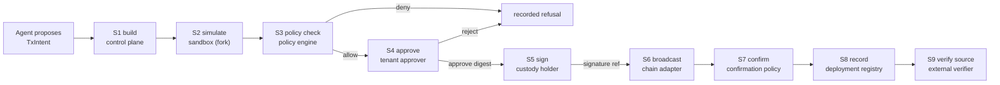

# Web3 — Wallet, Signing and Deployment Lifecycle (PROPOSED, DESIGN ONLY)

> **Status:** `proposed` 2026-11-25. Design only: **no wallet SDK, signer, RPC
> client, route, table, or deploy path exists** in the tree.
> Task: `W3-WEB3-01` (acceptance: lifecycle stages with distinct owners; mainnet
> approval mandatory by default; agent-held keys explicitly refused).
> Companions: `web3-security-signing.md` (the normative invariants this design
> implements), `web3-security-gates.md` (G9 produces the policy decision consumed
> here), `web3-chain-abstraction.md` (the adapter interface the stages call),
> `web3-compilation-and-artifacts.md` (the artifact manifest a deployment names),
> `adr-web3-signing-authority.md` (PROPOSED decision record).
> Labels: FACT (primary source read 2026-11-25), ASSUMPTION, OPEN.

## What this settles

One lifecycle — **intent → simulate → policy → approve → sign → broadcast →
confirm → record → verify** — where every arrow is an authorization boundary, not a
function call. The design answers four questions:

1. **Who** may perform each stage, and who may never.
2. **What** crosses each boundary (a digest, never a key).
3. **When** a human is mandatory (mainnet: always, by default).
4. **How** a deployment is recorded so it can be audited and reproduced later.

It does not pick a wallet vendor, a multisig product, an RPC vendor, or a managed
signer. Those stay OPEN (managed signing is deferred to **O34**).

## Non-negotiable rules

These five are the acceptance criteria in operational form. Each is stated as a
structural fact — "there is no field for it" beats "we promise not to".

**N1 — An agent holds no key, ever.** The agent's tool surface has no method that
accepts or returns key material, and the intent schema below has no key, seed, or
signature field. The only thing an agent can produce is a *proposed intent*. If a
future tool needs a secret, it is the wrong design, not a missing permission.
Enforced also by G10 (secret scan) and by the fact that the build sandbox and the
signing boundary are separate trust domains.

**N2 — Approve, sign and broadcast are three different owners.** No component may
perform two of them. The control plane can build, simulate, check policy and
broadcast; it can never approve or sign. The custody holder can approve and sign;
it can never broadcast or record. This is the same "one decision, one owner" pattern
the repo already uses for gates and waivers.

**N3 — Approval binds to a digest, not to a transaction.** An approval authorizes
exactly one canonical `TxIntent` digest for one chain, one nonce and one expiry. A
second transaction — even to the same contract with the same value — needs a new
approval. FACT (EIP-712, Final): typed-data signing deliberately excludes replay
protection, so binding and single-use are the application's responsibility.

**N4 — Mainnet never auto-approves.** Testnet may auto-approve a narrow, explicitly
configured set of low-risk operations, and the auto-approval is recorded with the
policy version that allowed it. There is no configuration flag that makes a mainnet
deployment self-approving.

**N5 — No secret material in any stage's inputs, outputs, logs, or prompts.** A
signature is not a secret, but it is single-use and is treated as sensitive: it is
recorded as a reference plus the recovered address, never as a reusable blob.

## Actors and their limits

| Actor | May | May **not** |
|---|---|---|
| Agent (LLM) | propose an intent, request simulation, read status, read its own records | approve, sign, broadcast, set `approver`, hold or request a key, waive a gate |
| Control plane (policy engine) | run G0–G10 checks, produce `policy-decision`, build and broadcast signed bytes, write records | sign, approve, mint or read a private key |
| Build/simulation sandbox | compile, test, simulate on a fork | reach the network, hold secrets, sign, deploy |
| Tenant approver (human role) | approve or reject an intent digest, set multisig/timelock policy within limits | sign, broadcast, edit an approval after use |
| Custody holder (wallet / hardware wallet / multisig) | sign an approved intent, reject it | broadcast, alter calldata, approve its own request |
| Chain adapter | estimate fees, build the payload, submit signed bytes, read receipts, report finality | construct or modify calldata after signing, hold keys |
| Verification service (external) | publish source ↔ bytecode verification | grant approvals, mark anything audited |
| Deployment registry | store deployment records and events | approve, sign, or rewrite history |

## Lifecycle stages and their owners (acceptance criterion 1)



| # | Stage | Owner | Input | Output (what crosses the boundary) | Refuses to run when |
|---|---|---|---|---|---|
| S1 | Build intent | Control plane | artifact manifest + deployment profile + caller identity | `TxIntent` with `intentDigest` | artifact digest missing, chain not in the registry, profile unknown |
| S2 | Simulate | Sandbox | intent + fork reference | simulation evidence (`simulation.json`) | no pinned fork, network egress needed, intent is a mainnet write and the profile forbids unsimulated deploys |
| S3 | Policy check | Policy engine (deterministic, no LLM) | intent + evidence digests + risk class + policy version | `policy-decision.json` (allow/deny + required approvals) | evidence missing or stale (different artifact digest), policy version unrecorded |
| S4 | Approve | Tenant approver (human role or multisig/timelock) | `intentDigest` + decision record | one approval record bound to the digest | caller is the agent, the requester, or a component of the control plane; digest mismatch; approval expired or already used |
| S5 | Sign | Custody holder (wallet / hardware / multisig) | approved intent + typed payload | signature reference + recovered address | approval is missing, expired, used, or bound to another digest; recovered address ≠ expected signer |
| S6 | Broadcast | Chain adapter | signed bytes + nonce reservation | transaction hash + submission record | signature does not recover to the approved address; nonce already used; chain id mismatch |
| S7 | Confirm | Chain adapter + confirmation policy | tx hash + chain profile | status transitions up to the profile's finality rule | receipt exists but confirmations < profile count (status stays `included`) |
| S8 | Record | Deployment registry | confirmed receipt + manifest + decision + approvals | deployment record + events | confirmation policy not satisfied |
| S9 | Verify source | Verification service | address + chain + sources + metadata | `source_verified` flag + verification ref | artifact metadata missing; service unavailable (recorded as `not_verified`, never as success) |

Rules that make the owner column real:

- Stage order is enforced by **state**, not by convention: an intent exists in
  exactly one stage at a time, and a stage transition writes the new state with the
  evidence digest that justified it.
- A stage may not accept an input from a non-owner. S6 in particular accepts only
  bytes that recover to the address S4 authorized.
- Skipping is not a mode. There is no "deploy without simulation" flag; a profile
  that does not require simulation still records `S2: not_applicable` with a reason.

## The `TxIntent` object

One canonical object per proposed on-chain action; it is the unit of approval and
the unit of audit.

```json
{
  "apiVersion": "vibesdk-txintent/v1",
  "intentId": "ti_01J8…",
  "tenant": "tenant_42",
  "purpose": "deploy",
  "chain": { "caip2": "eip155:84532", "profile": "base-sepolia/v1" },
  "from": { "kind": "wallet-ref", "ref": "wallet:tenant_42:0x5aAeb6053F3E94C9b9A09f33669435E7Ef1BeAed" },
  "to": null,
  "value": "0",
  "data": { "kind": "deploy", "artifactDigest": "sha256:5d7b…", "constructorArgsDigest": "sha256:0e12…" },
  "nonce": 17,
  "fees": { "model": "eip1559", "maxFeePerGas": "…", "maxPriorityFeePerGas": "…" },
  "riskClass": "standard",
  "policyVersion": "policy/2026-11-25",
  "simulationRef": "sha256:aa01…",
  "expiresAt": "2026-11-25T15:40:00Z",
  "intentDigest": "sha256:2b91…"
}
```

Digest rules:

- `intentDigest` is the SHA-256 of the **canonical serialization** of every field
  except `intentDigest` itself (sorted keys, 2-space indent, one trailing newline —
  the repo's existing canonical rule). A human approving "2b91…" is approving those
  exact bytes; changing any field changes the digest.
- `from.ref` is a **wallet reference**, never a key. It embeds the tenant, and the
  address is stored and displayed **checksummed** (FACT: ERC-55, Final, mixed-case
  checksum encoding — roughly 15 check bits, a random typo passes only ~0.02% of the
  time).
- `expiresAt` is mandatory. An expired intent cannot be approved, signed, or
  broadcast, even with a valid signature — expiry is checked at the boundary, not
  only in the UI.
- `riskClass` and `policyVersion` are copied into the intent so a later reader can
  reconstruct *why* it was allowed without consulting a moving config.
- No field in this schema can carry a secret. If a future requirement seems to need
  one, the requirement is wrong (N1).


## Wallet connection and session

The wallet is the custody holder; the platform never proxies it.

| Concern | Design | Evidence / status |
|---|---|---|
| Provider API | Speak the injected provider interface (request/events) rather than a vendor SDK | FACT: EIP-1193 "Ethereum Provider JavaScript API", Final |
| Multi-wallet discovery | Support provider announcement instead of assuming a single `window.ethereum` | FACT: EIP-6963 "Multi Injected Provider Discovery", Final (requires EIP-1193) |
| Session auth | Off-chain session established by a signed message with domain, nonce, issued-at and expiry; the nonce is single-use | FACT: ERC-4361 "Sign-In with Ethereum", Final |
| Chain selection | Session records the chain the wallet is on; a mismatch with the intent's chain is a hard refusal at S4/S5, never an automatic switch | — |
| Address identity | `wallet:<tenant>:<checksummed-address>`; the same address in two tenants is two references, and cross-tenant reuse is refused | FACT: ERC-55 checksum |
| Signing payload | Typed structured data with a domain separator, so the wallet displays fields rather than an opaque blob | FACT: EIP-712 "Typed structured data hashing and signing", Final |
| Session lifetime | Bounded, revocable, and invalidated by a chain change, an account change, or a policy-version change | ASSUMPTION: exact TTL is a product decision (OPEN) |
| What is stored | Address, chain, session nonce state, and the policy version — never a key, seed, or exported signature | N1/N5 |

A disconnection is not an error state to work around: it is a failure of S5, recorded
as such. The platform never asks a user to paste a private key, a mnemonic, or a
keystore JSON. Any UI copy that suggests it is a bug.

## Approvals

Approvals are the only human-in-the-loop mechanism, so their binding rules matter
more than their UX.

- **Unit of approval:** one `intentDigest`, one chain, one nonce, one expiry. Not a
  "session approval", not a "contract approval", not a spending limit.
- **Approver identity:** a tenant-scoped role (`approver`, `deployer`, or a
  multisig/timelock contract reference). The role is checked at approval time and
  recorded; a later role change does not retroactively validate an old approval.
- **Self-approval refusal:** the actor who requested the intent cannot approve it,
  and neither can any component of the control plane. This mirrors the waiver rule in
  `web3-security-gates.md` (the requesting agent may not waive its own gate).
- **Single use:** an approval is consumed at S5. Replaying an approval is a recorded
  policy violation, not a silent no-op.
- **Revocation:** before S5, an approver may revoke; after S5 (signature produced),
  revocation cannot unsign — the only remedy is not to broadcast, plus a recorded
  incident.
- **Quorum:** a multisig or timelock profile declares `threshold` and signer set in
  the deployment profile *before* mainnet use; the platform records the on-chain
  confirmation of that policy rather than trusting a copy in config (OPEN: exact
  verification method).

**Mainnet default (acceptance criterion 2):** `riskClass = high` requires an
explicit human or multisig approval, simulation evidence, and a rollback or pause
plan reference. The policy engine's allow verdict is necessary but never sufficient —
S4 cannot be auto-satisfied for mainnet, and no configuration value changes that.
Testnet may auto-approve only when the profile names the exact operation kinds, and
each auto-approval is recorded with `autoApprovedBy: "policy/…"` plus simulation
evidence.

## The signing boundary

The only component that talks to a custody holder. In wallet-first mode it holds no
keys at all — it is an orchestrator and a verifier, not a custodian.

**What it does, in order:**

1. Read the approved intent and refuse if the approval is missing, expired, used,
   revoked, or bound to a different digest.
2. Rebuild the typed payload from the intent (never from a cached blob) and compute
   the payload hash; the wallet signs *that* hash.
3. Ask the custody holder to sign (injected provider, hardware device, or multisig
   proposal).
4. Verify the returned signature recovers to the authorized address, and record
   `{intentDigest, recoveredAddress, signatureRef}`.
5. Hand the signed bytes to S6. It never broadcasts, and it never writes the
   deployment record.

**What it refuses:** unapproved or expired intents; a digest mismatch; a signature
from the wrong address; any request to sign raw bytes that do not decode to the
approved intent; any request that carries a key or seed.

**What it never logs:** the signature material itself, or anything that would let a
reader reconstruct a reusable authorization. A reference plus the recovered address
is enough for audit and insufficient for replay.


## Broadcast and confirmation

Broadcast is a dumb pipe by design: it can submit, and it can report. It cannot
construct calldata, change a value, or retry with different parameters.

- **Idempotency key:** `(chainId, from, nonce)`. A second submit of the same key is
  a no-op that returns the existing transaction hash; a submit with different bytes
  for a used nonce is refused as a policy violation.
- **Nonce ownership:** the adapter reserves the nonce at S1 and records the
  reservation. Two intents cannot hold the same nonce; a stuck nonce is resolved by an
  explicit replacement intent (new `intentDigest`, new approval), never by silently
  reusing the slot.
- **Replacement:** the same nonce with a higher fee is a *new* intent, because it is
  a new authorization. This is the practical consequence of N3.
- **Status vocabulary:** `submitted → included → confirmed → finalized`, plus
  `reverted`, `replaced`, and `dropped`. `included` is not finality: a receipt exists
  but the confirmation policy is not satisfied.
- **Finality** follows the chain profile's rule (confirmations or epoch). FACT: the
  chain-abstraction doc already states receipt status is never treated as finality.
- **Reorg:** if a previously included transaction disappears before finality, the
  state returns to `submitted`/`replaced` and the record keeps both observations —
  nothing is rewritten.
- **Retry:** a transport failure retries the *submit* with identical bytes; a
  `reverted` outcome is terminal for that intent and requires a new intent plus a new
  approval.
- **Fee strategy:** per chain profile (EIP-1559-style fields versus legacy). OPEN:
  the exact field policy and the bump rule.

## Deployment record

The record is the platform's memory of what is live. It is append-only, tenant-scoped,
and never rewritten by a later stage.

```json
{
  "apiVersion": "vibesdk-deployment/v1",
  "deploymentId": "dep_01J8…",
  "tenant": "tenant_42",
  "contract": { "ref": "vibe/escrow-vault@0.1.0", "artifactDigest": "sha256:5d7b…" },
  "chain": { "caip2": "eip155:84532", "profile": "base-sepolia/v1" },
  "address": "0x5aAeb6053F3E94C9b9A09f33669435E7Ef1BeAed",
  "tx": { "hash": "0x…", "blockNumber": 12345678, "nonce": 17 },
  "proxy": { "kind": "none" },
  "constructorArgsDigest": "sha256:0e12…",
  "policy": { "version": "policy/2026-11-25", "riskClass": "standard", "decisionRef": "sha256:…" },
  "approvals": [{ "approverRef": "role:approver:tenant_42", "at": "…", "digest": "sha256:2b91…" }],
  "simulationRef": "sha256:aa01…",
  "finality": { "rule": "12-confirmations", "confirmations": 12, "finalizedAt": "…" },
  "verification": { "status": "source_verified", "ref": "sourcify:…" },
  "recordedAt": "…"
}
```

Field rules:

- `address` is stored checksummed (ERC-55). A non-checksummed stored address is a
  defect, because it defeats the one built-in typo check the ecosystem has.
- `proxy.kind` is `none`, `uups`, or `transparent`, and a proxy record **must** list
  the implementation address(es) and the admin reference; otherwise an upgrade later
  cannot be explained.
- `verification.status` is `not_verified | pending | source_verified | mismatched`.
  `source_verified` means the published source compiles to the deployed bytecode —
  **nothing more**. It is never rendered as "audited" (see the forbidden-label list in
  `web3-security-gates.md`).
- Timestamps are allowed here, unlike in the artifact manifest: this is an *event*
  record, not a reproduction claim.
- `approvals[]` stores references and digests, never signatures.
- Nothing in the record is mutable; a new deployment is a new record with a
  `supersedes` pointer when it replaces a previous one.

## Tenancy, audit and events

- Every stage writes an event with `{tenant, intentDigest, stage, actorKind,
  policyVersion, evidenceRef, outcome}` — actor *kind* and a reference, never a
  secret and never a raw signature.
- Queries are tenant-scoped at the store boundary, not in application filters, and a
  cross-tenant reference is refused (same failure mode the control plane already has
  for rooms and workflows).
- The audit trail must be sufficient to answer, months later: who approved this
  exact bytecode, under which policy version, with which simulation evidence, and on
  which chain and block.


## Failure and recovery matrix

Every row answers the same three questions: who may retry, what is safe to retry, and
what needs a new approval.

| Failure | Owner who handles it | Retry semantics | New approval? |
|---|---|---|---|
| Simulation fails or is unavailable | Control plane | Retry S2; the intent may be re-simulated without a new approval | No |
| Policy denies | Control plane records the refusal | No retry of the same intent; the request must change | Yes (new intent) |
| Approval expired before signing | Approver | Re-approve the same digest if still valid | New approval record |
| Approval consumed / replayed | Policy engine raises an incident | Never retried | Yes |
| Wallet disconnected / user rejected | Custody holder | Retry S5 with the same approval if unexpired | No |
| Signature recovers to the wrong address | Signing boundary | Refused; re-request from the authorized account | No |
| Nonce already used | Chain adapter | Refused; a replacement is a new intent | Yes |
| Broadcast transport error | Chain adapter | Retry with identical bytes (idempotent key) | No |
| Transaction reverts | Chain adapter | Terminal for the intent; diagnose, then new intent | Yes |
| Reorg before finality | Chain adapter | Re-observe; nothing rewritten | No |
| Verification service down | Verification stage | Retry later; record `pending`, never `source_verified` | No |
| Record write fails after finality | Deployment registry | Retry the write; on-chain state cannot be undone so the record must eventually land | No |

Two rules follow from the matrix: a **retry never widens authority** (same digest,
same bytes or nothing), and a **terminal failure never auto-escalates** (no silent
increase in fee, scope, or risk class to "make it work").

## Acceptance criteria mapping

| Criterion (backlog) | Where it is answered |
|---|---|
| Lifecycle stages with distinct owners | "Lifecycle stages and their owners": nine stages, an owner column, a refuses-to-run column, and N2 (no component performs two of approve/sign/broadcast) reinforced by the actors table |
| Mainnet approval mandatory by default | N4 plus the mainnet paragraph in "Approvals": the policy allow verdict is necessary but never sufficient; no configuration value makes mainnet self-approving |
| Agent-held keys explicitly refused | N1 (no field, no tool, no method), the `TxIntent` schema having no key/signature field, the actors table forbidding the agent from approving/signing, and the "never asks a user to paste a key" rule |

Verification for this task is documentation-only: `bun run docs:check` must stay green
(six validators), and no wallet SDK, RPC client, route, table, or dependency may
appear. `go.mod`, `package.json`, and `bun.lock` are untouched by design.

## What this does not do

No wallet connection is implemented; no signer, RPC client, fee estimator, nonce
manager, verification client, or deployment table exists; no mainnet or testnet
deployment happens; no managed signer is designed (deferred to **O34**); and no claim
is made that any contract is ready to deploy — the gates in
`web3-security-gates.md` are defined but not implemented, and passing them is still
not an audit.

## Open items

- **Wallet standard pin.** EIP-1193 plus EIP-6963 cover the injected family; the
  remote/QR family (WalletConnect-style) needs an evaluation and a pinned version.
- **Managed-signer custody** — O34; explicitly out of scope here, and it must arrive
  with its own ADR and custody review.
- **Approval policy schema.** This document defines the fields the policy consumes
  (`riskClass`, `policyVersion`, `requiredApprovals`, `rollbackPlanRef`); the final
  schema and its versioning belong to `adr-web3-signing-authority.md`.
- **Multisig/timelock verification.** Whether the platform trusts a configured
  threshold or verifies the on-chain policy is OPEN; the record must not claim more
  than it verified.
- **Confirmation counts per chain** and the replacement/bump rule — chain-profile
  values, still OPEN.
- **Session TTL and revocation propagation** — product decision.
- **Verifier default** (Sourcify/Blockscout-style) stays OPEN, with
  `verification.status: pending` as the honest default until it is chosen.

