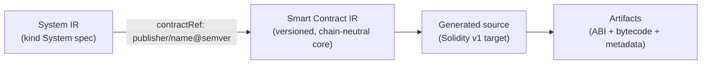

# Smart Contract IR — Canonical On-Chain Contract Model (ACCEPTED, D22)

> **Status:** `accepted` 2026-11-25 (decision **D22**): a versioned, canonical,
> target-independent Contract IR with a generic semantic core and explicit
> target-specific extensions. EVM/Solidity is the initial target. The contract
> and its schema plus fixtures exist; **no generator, compiler, or registry
> exists** yet.
> Companion: `system-ir.md` (off-chain system model, accepted),
> `web3-chain-abstraction.md`, `web3-layerzero-interop.md`,
> `web3-toolchain-pipeline.md`, `web3-security-signing.md`.
> Generation scope on top of this IR (in/out kinds, pinned module set with digests,
> template lifecycle): `web3-solidity-generation-scope.md` (W1-WEB3-01).
> Decisions: `adr-web3-ir-separation.md` and
> `adr-web3-contract-ir-versioning.md` (both ACCEPTED 2026-11-25).
> Schema: `contract-ir/contract.schema.json`; fixtures: `contract-ir/examples/`.
> Gate: `scripts/validate-contract-ir.mjs` inside `bun run docs:check`.
> Research notes in this file are labelled FACT (verified in primary docs
> 2026-11-25), ASSUMPTION, or OPEN.

## Generic core versus target extensions (normative)

The accepted decision fixes one structural rule that every later change must
respect: **the semantic core is target-independent; anything EVM- or
vendor-specific lives in an explicit, namespaced extension.**

| Layer | Content | Rule |
|---|---|---|
| `spec.abstract` | purpose, interface (functions/events/errors), state, roles/policies, invariants, assets (generic kinds), dependencies, upgradeability strategy, security assumptions, required tests, provenance | Must contain **no** VM, compiler, chain-id, token-standard, bridge, or vendor field |
| `spec.targets` | target declaration: `vm`, `language`, `chains`, plus one target block per VM (v1: `evm` with solc/evm version, optimizer, EVM token standard mapping) | Only place where VM/compiler/chain specifics are legal |
| `spec.extensions` | namespaced vendor configuration (for example `layerzero-v2`) | Never may override a core field; never required by a core-only contract |

Consequence: a future non-EVM target adds a `targets.<vm>` block plus a new
adapter ADR. It does not change the core, and it does not change System IR.

## Why a second IR

System IR v1 is the `kind System` manifest spec: exactly one execution
shape (agentic or procedural), desired state only, no runtime state. It must
stay independent of any VM, compiler, or bridge. Smart contracts need a
different domain model: deterministic bytecode, storage layout, gas,
finality, upgradeability, and audit provenance. Merging that into System IR
would couple every agent definition to Solidity and to LayerZero. So:

- System IR remains the canonical model of the whole application.
- Smart Contract IR is a separate versioned domain model for on-chain components.
- A System references contracts by stable typed identifiers plus a contract
  manifest, never by embedding compiler or bridge settings.



## Contract identity and version

- `contractId`: DNS-safe `publisher/name`, immutable once published (same rule
  as agent manifests in `manifest-schemas.md`).
- `version`: exact semver, no ranges, no `latest`.
- `irVersion`: envelope version of this IR (independent from contract version).
- `toolchain`: compiler name plus exact version plus settings hash, recorded
  for reproducibility (FACT: Solidity docs describe optimizer settings, EVM
  target versions, and metadata hash as part of the build; source URL
  `https://docs.soliditylang.org` read 2026-11-25).
- Every generated file links back to `(contractId, version, irVersion,
  toolchain, source digest)`.

## Conceptual model (accepted v1 scope)

Required sections of one Contract IR document, split by layer:

`spec.abstract` (target-independent):

1. modules and dependencies: pinned `publisher/name@semver` plus source
   digest; no floating refs.
2. storage model: state variables, generic types, visibility, layout notes.
3. functions: name, inputs, outputs, mutability class
   (`pure/view/state-changing/payable`), access policy ref.
4. events and custom errors.
5. roles, permissions, access-control policy (owner, roles, multisig/timelock refs).
6. assets: generic asset kinds (`none`, `fungible`, `non-fungible`) plus
   behavior flags; the concrete token standard is an EVM target mapping.
7. invariants and business constraints (human-readable plus test refs).
8. upgradeability: `immutable`, `proxy`, or `modular` with risk note; default
   is immutable unless an ADR-backed reason exists.
9. external dependencies: other contracts, oracles, bridges (bridge-specific
   settings live in `spec.extensions`, never in the core).
10. security requirements and threat assumptions.
11. test and verification specs (unit, integration, fuzz/invariant, static
    analysis — owned by `web3-toolchain-pipeline.md`).
12. deployment configuration refs (chain profile plus constructor args schema).
13. provenance: author, generator version, source IR digest, audit trail refs.

`spec.targets` (target-specific):

14. target declaration: `vm`, `language`, `chains`, and the per-VM block.
    The v1 `evm` block carries the solc version, EVM version, optimizer
    settings, and the token-standard mapping.
15. compilation settings and reproducibility metadata live here, not in the
    core (FACT: Solidity documents optimizer settings, EVM versions, and
    metadata hash as build inputs; `https://docs.soliditylang.org` read
    2026-11-25).

`spec.extensions` (vendor-specific):

16. namespaced configuration for an interoperability provider, recorded per
    app in the interop manifest and referenced here by namespace only.

Deliberately outside v1: Yul-only contracts, non-EVM targets (Solana/Move
need their own `targets.<vm>` block plus an adapter ADR), formal-verification
proofs as IR fields, price or tokenomics.

## Relationships

- System IR to Contract IR: `contractRef` (typed, pinned). The System never
  names a compiler flag or an endpoint ID.
- Contract IR to chain profile: chain-neutral core plus optional
  chain-specific deployment profile (chain id, confirmations, verifier).
- Contract IR to LayerZero: only via the interop manifest. A generic
  `messagingProvider` slot may name `layerzero-v2`; no Endpoint IDs, DVN
  lists, or executor settings in the core.
- Generated source traceability: source header carries the IR digest and
  toolchain triple, so an auditor can re-derive the artifact.

## Versioning, validation, migration

- Envelope `apiVersion` versions the IR shape; contract `version` versions
  the content. A breaking IR shape change is a new `apiVersion` with a
  migration note, mirroring the System IR rule.
- Validation is staged: schema shape, then semantic rules (for example
  upgradeability risk acknowledged, access policy present on payable
  functions), then compiler resolution against a live registry. No silent repair.
- Canonical serialization mirrors manifests: sorted keys, 2-space indent,
  one trailing newline, no duplicate keys.

## Worked example (fixture shape, not a rendered contract)

The canonical fixtures live in `contract-ir/examples/`. One core-only EVM
contract (no extensions) and one with a vendor namespace prove the boundary:

```json
{
  "apiVersion": "vibesdk-contract/v1",
  "kind": "SmartContract",
  "metadata": { "license": "MIT", "name": "escrow-vault", "publisher": "vibe", "version": "0.1.0" },
  "spec": {
    "abstract": {
      "assets": [{ "behaviors": ["transferable"], "kind": "fungible" }],
      "dependencies": [],
      "functions": [{ "mutability": "state-changing", "name": "release", "policy": "owner-only" }],
      "provenance": {
        "irDigest": "sha256:0123456789abcdef0123456789abcdef0123456789abcdef0123456789abcdef",
        "toolchain": { "name": "solc", "version": "0.8.28" }
      },
      "state": [{ "name": "beneficiary", "type": "address", "visibility": "private" }],
      "upgradeability": { "risksAcknowledged": false, "strategy": "immutable" }
    },
    "targets": {
      "chains": ["eip155:84532"],
      "evm": { "evmVersion": "cancun", "optimizer": { "enabled": true, "runs": 200 }, "solc": "0.8.28" },
      "language": "solidity",
      "vm": "evm"
    }
  }
}
```

Fixtures use placeholder digests on purpose: they are schema fixtures, not
evidence of a real build.

## Open items

- Whether NatSpec becomes a required core field.
- Registry storage shape for contract manifests (shared with O27).
- Fuzz/invariant corpus linkage format.
- Additional `targets.<vm>` blocks (each needs an adapter ADR).
