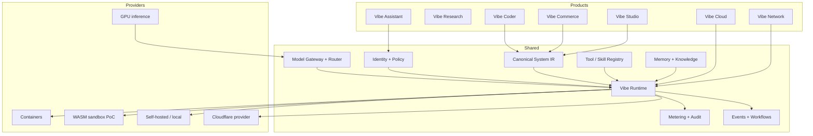

# System Architecture — Ecosystem Target (Canonical)

> **Status:** `adopted` 2026-11-21. Live: `architecture-diagrams.md`, `llm.md`.
> History: `04-system-architecture.md` (preserved).

Outcome flows into validated System IR, then policy check, capability
resolution, durable execution with approvals and idempotency, tenant-scoped
state plus lineage plus audit, traces and evaluation, reported outcome.
Control never executes untrusted code; execution never owns identity truth.
Cloudflare is one provider, not the platform identity.
