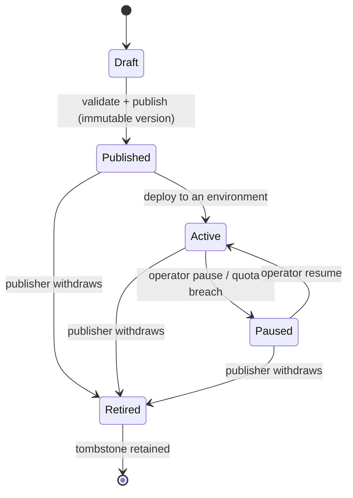

# Agent Platform Architecture (Canonical)

> **Status:** `adopted` 2026-11-21. Identity/lifecycle contract: P1-AGT-001
> (2026-11-22) — DESIGNED, no runtime consumer. History: `05-agent-runtime.md`.
> Manifests: `architecture/manifest-schemas.md`. IR: `architecture/system-ir.md`.
> Decision record: `architecture/adr-agent-identity-lifecycle.md`.

Agent identity and lifecycle, thirteen-part Agent Manifest contract, tool/skill
execution, memory scopes (run/conversation/agent/team/tenant), orchestration
(single, team, delegation, parallel), model gateway plus router composition,
MCP trust slice, A2A delegation contract. Live seed: Eino DeepAgent team plus
VFS/REST tools, role skills, gateway plus modelrouter with first live consumer
on the coder role, MCP trust boundary without wire transport.

Status: identity DESIGNED (platform-internal ids only today), manifests/IR
DESIGNED (docs gates, no runtime consumer), gateway PARTIAL, MCP PARTIAL (no
transport), memory PARTIAL (Redis VFS only), A2A DESIGNED.

## Agent identity — three separate identities

The single biggest failure mode in an agent platform is conflating three things
that must stay distinct. Vibe names them explicitly:

| # | Identity | What it identifies | Where it lives | Mutable? |
|---|---|---|---|---|
| 1 | **Definition identity** | The agent *as authored*: `publisher` + `name` | Manifest `metadata` | `name` never; `publisher` never (a transfer is a new publisher) |
| 2 | **Version identity** | One immutable revision of that definition | `metadata.version` (semver) | Never — a change publishes a new version |
| 3 | **Instance identity** | One deployed/running occurrence under a tenant | Data layer (registry/deployment records) | State changes; identity does not |

Consequences that must hold in every implementation:

- A run references **all three**: which definition, which exact version, and
  which deployment instance. Anything less cannot answer "what actually ran?".
- The manifest carries only identities 1 and 2. Instance identity, health,
  deployment environment, and run state are **never** in the manifest — the
  envelope forbids `status` outright, and the IR rejects runtime state (invariant
  I2 in `architecture/system-ir.md`).
- The thirteen-part contract in `05-agent-runtime.md` maps Identity → `metadata`;
  its "lifecycle is tracked in the data layer, never inside the contract" line is
  now normative, not aspirational.

## Identity rules (normative)

1. **The uniqueness key is `kind/name`, not `kind/name@version`.** Two publishers
   may not own the same `name` for the same `kind`; a version is a revision of one
   identity, never a separate agent.
2. **`metadata.name` is immutable once published.** Renaming publishes a new
   identity; the old one is retired (see below), never rewritten. Forking is a
   new name plus a provenance note, not a copy under the same name.
3. **Format:** DNS-safe, lowercase, `^[a-z0-9]([-a-z0-9]*[a-z0-9])?$`, ≤63 chars —
   already enforced by the four schemas' `name` definition.
4. **`metadata.version` is exact semver** with no ranges, no `latest`, no git
   refs. `MAJOR` may never change meaning silently; breaking changes need the
   bump **plus** a migration note in the publishing change.
5. **`publisher` is the custody boundary.** It is required on every manifest and
   bound to the signing identity once marketplace provenance lands (W3.1).
   Publisher transfer is a *new* publisher, not an edit.
6. **Pins are exact everywhere.** A System pins `agent/name@X.Y.Z`; the compiler
   rejects floating refs at deploy time (the schema rejects them earlier).
7. **Deleting a version is not a transition.** Published versions are immutable
   and resolvable; withdrawing an agent is a lifecycle state, never a delete.

## Agent lifecycle — six states, one owner

Lifecycle state belongs to an **instance** (or, for definition-level withdrawal,
to the `kind/name` identity). It is never a manifest field.

| State | Meaning | New Systems may pin it? | Existing runs continue? | Evidence required to enter |
|---|---|---|---|---|
| `draft` | Authored, not yet published; still editable | No | — | Schema validation green |
| `published` | Immutable version resolvable in the registry | Yes | — | Validation + exact-ref closure + evaluation thresholds declared |
| `active` | Deployed instance serving runs under a tenant | Yes (new pins use the same version) | Yes | Deployment policy satisfied (tenant scope, quotas, approvals) |
| `paused` | Instance temporarily refuses new runs; state preserved | No new *runs* (deploys still allowed) | In-flight runs finish or are cancelled per policy | Operator action or quota breach, logged |
| `retired` | Withdrawn by the publisher; terminal | **No** | Finishing runs complete; no new starts | Publisher action + retirement note |
| `obsolete` | Superseded *and* unsafe to run (security advisory) | No | **Cancelled**, not finished | Security decision + audit record |

Rules:

1. **Transitions are audited.** Every state change writes an audit record with
   actor, tenant, previous state, next state, and reason — the same discipline the
   workflow tenant guard already applies to denials.
2. **Publishing is one-way per version.** There is no unpublish → edit path; a
   correction publishes a new `PATCH`.
3. **`active` requires an instance.** A published definition with no deployment is
   not active; this keeps "exists" and "is running" separate (and keeps
   marketplace listings honest).
4. **Paused is reversible; retired is not.** A retired identity may be republished
   only under a new identity (new name), so provenance stays truthful.
5. **Quota or policy breach pauses an instance, never the definition** — a
   per-tenant problem must not take an agent away from other tenants.

## Retirement contract

Withdrawal is the hardest part of identity, because old systems still reference
the thing being withdrawn. The contract is:

- **Tombstone, not deletion.** A retired `kind/name` keeps a resolvable record
  (identity, versions, retirement reason, successor ref if any). Export and diff
  must still resolve it, so a year-old System manifest stays readable.
- **Existing pins keep resolving.** A retired version stays fetchable for
  read/audit; it simply cannot be pinned by a *new* System and cannot start new
  runs.
- **Finishing is allowed, starting is not.** In-flight runs complete (or are
  cancelled if the retirement is an `obsolete` security withdrawal) — the choice
  must be explicit in the retirement record, never implicit.
- **A successor is declared, never inferred.** If a retirement has a replacement,
  the record names `successor: agent/name@X.Y.Z`; the compiler may then suggest a
  migration, but never silently retargets a pin.
- **Clients are notified.** Marketplace and registry consumers get a deprecation
  event before retirement; the notice window is a publisher/marketplace policy
  (open, see below).

## Mapping to the manifest contract

| Contract element | Manifest field | Lifecycle interaction |
|---|---|---|
| Definition + version identity | `metadata.name`, `metadata.version`, `metadata.publisher` | Assigned at `draft`; frozen at `published` |
| Role / instructions / model / IO | `spec.*` | Changed only by publishing a new version |
| Capability closure (tools/skills/knowledge) | `spec.tools`, `spec.skills`, `spec.knowledge` | Exact pins; a retired dependency blocks new deploys, not running ones. See the unified tool contract in `ecosystem/19-integration-research.md` proposal 1: MCP, Skill, OpenAPI and builtin loaders all map onto this vocabulary and call through the same `mcp.Gate`. |
| Policies and limits | `spec.policies` | Tightening is a `MINOR`; relaxing a safety bound is `MAJOR` |
| Evaluation rules | `spec.evaluation` | Required before `published` when the agent is marketplace-bound |
| State / health / environment | **absent by design** | Lives in the data layer; the envelope rejects `status` |

`apiVersion` is orthogonal: it changes only when the envelope changes (an
ADR-backed platform event), never per agent.

## Current status and evidence

| Piece | Status | Evidence |
|---|---|---|
| Identity fields + naming pattern | DESIGNED (schema-enforced) | Four schemas under `architecture/manifest-schemas/` share the `name`/`version` definitions; `bun run docs:check` validates them |
| Exact-ref pinning, no floating refs | DESIGNED (schema-enforced) | `docs:check` rejects `@latest`; System IR negative probes reject unpinned refs |
| Lifecycle states and transitions | DESIGNED | This document; no registry or deployment store exists yet |
| Retirement / tombstone behaviour | DESIGNED | This document; no registry exists to enforce it |
| Audit of transitions | PLANNED | Depends on the P0 audit trail plus the registry (P4 Studio / P1 registry work) |

**Not implemented:** there is no agent registry, no deployment store, and no
lifecycle enforcement in code. The running system today identifies *roles*
(coordinator/coder/reviewer) and *generations*, not versioned agent identities.

## Open items

| Item | Owner |
|---|---|
| Registry storage shape (D1 tables vs object store) and its tenant key | P4 Studio registry work |
| Deprecation notice window and publisher obligations | marketplace policy, `09-marketplace-architecture.md` |
| Whether retired artifacts are deleted on request (GDPR/erasure) while tombstones survive | legal + `07-multitenancy-security.md` |
| Signing identity that binds `publisher` to a key | W3.1 provenance (ADR first) |
| Promotion gates per environment (who may move `published` → `active` in production) | P5 Cloud operations |

