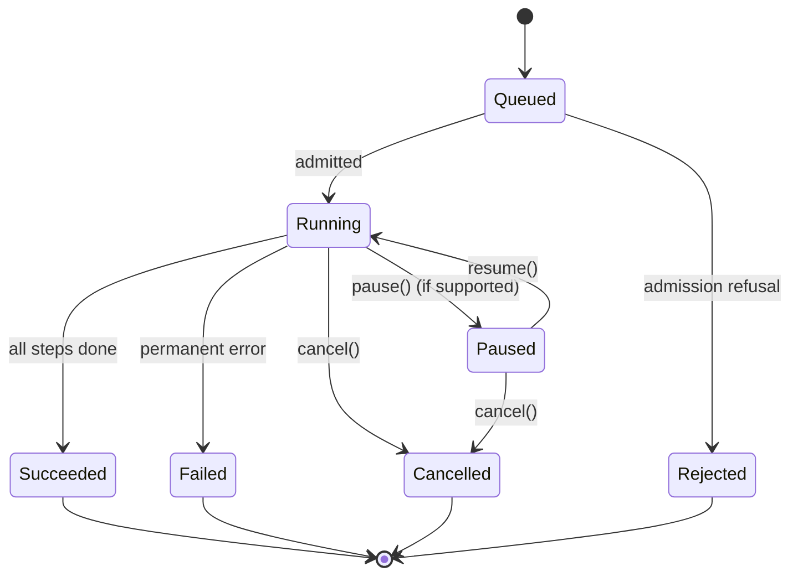

# Runtime and Execution Architecture (Canonical)

> **Status:** `adopted` 2026-11-21. Execution-provider contract: P7-RUN-001a
> (2026-11-22) — DESIGNED; adapters + conformance suite are P7-RUN-001b (TODO).
> Decision record: `architecture/adr-execution-provider-contract.md`.
> Related: `ecosystem/05-agent-platform-architecture.md` (agent identity),
> `ecosystem/02-product-boundaries.md` (plane split).

Execution Provider abstraction (local, Cloudflare adapter, WASM sandbox PoC,
containers, GPU inference kept separate from WASM), durable semantics
(checkpoints, pause/resume, retry, cancellation, scheduling, triggers,
quotas), history plus tracing, conformance tests. Live: Cloudflare Workflow
interpreter plus Go engine paths. wasmCloud is an evaluated provider option
only — never production until the contract plus a PoC exist. No Kubernetes
requirement for the MVP. No chain dependency in the core runtime.

<a id="why-contract-first"></a>

## Why the contract comes before any second provider

The repository already has two execution implementations (the Cloudflare
Workflow interpreter and the Go engine paths) and is being asked to add more
(local, WASM, container). Adding a third implementation without a contract means
each one re-decides what "durable", "retry" and "cancelled" mean — and the
product surface inherits three incompatible answers.

So the order is fixed: **contract → conformance suite → fake provider → adapters.**
No provider lands in production until it passes the suite.

<a id="unit"></a>

## The unit of execution: a Run over a RunPlan

| Term | Meaning |
|---|---|
| **RunPlan** | What to execute: an ordered, acyclic step graph. Today this is a workflow DAG (schema v2, seven node kinds); once P1-AGT-002 lands it is derived from the System IR. The contract is deliberately **plan-agnostic** — it accepts a plan, it does not know where the plan came from. |
| **Step** | One durable unit with a stable **name**, a callback, and optional retry/timeout config. Step names must be stable across replays: today the node id is the step name. |
| **Run** | One execution of a RunPlan under one tenant, with one instance id. |
| **Provider** | The thing that executes Runs and owns durability. Cloudflare Workflows is the current provider. |

**Hard rule:** a provider executes plans. It does not parse, validate or invent
them. Validation (schema, cycle, tenant) happens in the runtime before
`start`, and a provider must never "repair" an invalid plan.

<a id="interface"></a>

## Provider interface (normative)

Every provider implements exactly this surface. Language-neutral; the shapes are
the same in Go and TypeScript.

```text
start(run)                     -> RunHandle
status(runId)                  -> RunState
cancel(runId, reason)          -> CancelAck        (capability: cancel)
pause(runId)                   -> PauseAck         (capability: pause)
resume(runId)                  -> ResumeAck        (capability: pause)
step(handle, name, config, fn) -> Result           (durability primitive)
sleep(handle, duration)        -> Ack              (capability: long-sleep)
history(runId)                 -> StepEvent[]      (observability)
capabilities()                 -> ProviderCapabilities
```

Rules the contract imposes on every implementation:

1. **`step` is the only durability primitive.** Work done outside `step` may be
   re-executed after a restart; implementations must state this and callers must
   not put external side effects outside a step.
2. **Delivery is at-least-once.** A step may run more than once. Every step with
   an external side effect therefore needs an idempotency key; the contract
   forbids claiming exactly-once without proof.
3. **Step names are identity.** Replaying a run with renamed steps creates new
   work; the runtime must not rename steps between attempts.
4. **`start` is idempotent per run id.** Starting an already-started run returns
   the existing handle rather than a second execution.
5. **Terminal states are final.** `succeeded`, `failed` and `cancelled` never
   transition again; a retry is a new run.
6. **Tenant context is mandatory.** A run carries `tenantId`; a provider that
   cannot enforce it must refuse the plan at admission.

<a id="states"></a>

## Run state machine

Six states; today's Cloudflare path implements four of them (`queued`,
`running`, `succeeded`, `failed` — `cancelled` arrives with the cancel
capability, `paused` with the pause capability).



`Rejected` is distinct from `Failed` on purpose: **admission refusal is not a
runtime failure.** A missing capability, a tenant mismatch, or an invalid plan is
refused *before* the first step, and must never be recorded as "the run failed" —
that difference is what lets an operator tell "we misconfigured" from "it broke".

<a id="capabilities"></a>

## Capability advertisement

A provider declares what it can do, and the runtime adapts or refuses:

| Capability | Meaning if absent |
|---|---|
| `durable-steps` | The provider cannot be used for production runs at all (non-negotiable) |
| `retry` | Retry config is rejected at admission, not silently ignored |
| `timeout` | Same: reject, never ignore |
| `cancel` | Plans marked cancellable are refused; cancellation requests answer "unsupported", not "done" |
| `pause` | Human-approval plans (which must pause) are refused |
| `long-sleep` | Plans with long sleeps are refused or scheduled differently |
| `history` | Run is still executed; observability degrades and is reported as degraded |

**Rule: silently ignoring a requested guarantee is a contract violation.** It must
be a refusal at admission or an explicit capability gap — never a quiet no-op.
This is the same discipline the P0 security boundary applies (fail closed, not
fail open).

<a id="errors"></a>

## Error taxonomy and mapping

| Class | Retryable? | Run state | Notes |
|---|---|---|---|
| `transient` | Yes, per step retry policy | stays `Running` until budget exhausted, then `Failed` | Provider/network/rate-limit |
| `permanent` | No | `Failed` | Invalid input, unparseable payload — the equivalent of a non-retryable error today |
| `policy-denied` | No | `Failed` (with an audit record) | Tenant mismatch, permission refusal |
| `quota-exceeded` | No | `Failed` (or `Paused` if the provider supports pause) | Per-tenant caps |
| `cancelled` | No | `Cancelled` | Operator or publisher withdrawal |
| `admission-refused` | n/a | `Rejected` | Capability gap, invalid plan, unknown tenant |

Two honesty rules: a policy denial must be **audited**, not just counted; and a
failure must never be reported as a success with an empty result (the live
interpreter already pins this with an explicit `failed` row).

<a id="observability"></a>

## Observability: durable state vs best-effort events

The live interpreter writes run state (`workflow_instances`) and step logs
(`workflow_step_logs`); the step logs are written fire-and-forget through
`waitUntil`, so **a step log can be lost while the step actually succeeded**.

The contract therefore separates the two tiers explicitly:

| Tier | What | Guarantee |
|---|---|---|
| **Durable run state** | Run id, tenant, state, timestamps, terminal outcome/error | Must survive restart; the source of truth |
| **Best-effort events** | Per-step started/succeeded/failed/skipped log rows, traces | May be lost; used for debugging, never for billing or authorization |

**Consequence for metering:** usage must be derived from durable run/step
*results*, never from best-effort log rows, or a lost background write becomes a

<a id="conformance"></a>

## Conformance suite (normative test matrix)

Every provider must pass all of these before serving production traffic. Rows
marked *(capability)* are skipped-and-reported, never silently passed, when the
provider does not advertise that capability.

| # | Test | Expected |
|---|---|---|
| C1 | Start a two-step plan | Both steps run in dependency order; state `Succeeded` |
| C2 | Step replay after simulated restart | Completed steps are not re-executed; the run resumes at the first unfinished step |
| C3 | At-least-once idempotency | A deliberately re-delivered step runs twice; the side effect is applied once via the idempotency key |
| C4 | Transient error inside retry budget | Step retries per policy, then `Succeeded` |
| C5 | Permanent error | Step does not retry; run ends `Failed` with the error recorded |
| C6 | Retry budget exhausted | Run ends `Failed`; no partial success claim |
| C7 | Timeout on a step | Step is terminated at the bound; run does not hang |
| C8 | Tenant mismatch | `Rejected` before the first step; no step executes; an audit record exists |
| C9 | Invalid/cyclic plan | `Rejected` before the first step |
| C10 | Step name stability | Renaming between attempts is detected or impossible by construction |
| C11 | Terminal-state finality | No transition out of `Succeeded`/`Failed`/`Cancelled` |
| C12 | `start` idempotency | Starting the same run id twice yields one execution |
| C13 | Cancel mid-run *(cancel)* | Run ends `Cancelled`; in-flight step stops at a safe boundary |
| C14 | Pause/resume *(pause)* | State is preserved across the pause; no step re-executes on resume |
| C15 | Long sleep *(long-sleep)* | Sleep does not consume a worker for its duration; run resumes on time |
| C16 | Capability refusal | A plan requesting an unsupported guarantee is `Rejected`, never quietly downgraded |
| C17 | History completeness *(history)* | Every executed step appears in history with its outcome |
| C18 | Metering source | Usage is computed from durable results, not best-effort events |

The suite is the deliverable that makes "provider portability" a fact rather than
a diagram. **A provider without a green suite is not a provider.**

<a id="adapters"></a>

## Adapter status and mapping

| Provider | Status | Notes |
|---|---|---|
| **Cloudflare Workflows** (live) | PARTIAL | Durable steps, retry/timeout mapping, cycle and tenant refusal already real. Missing from the contract: `cancel`, `pause`/`resume`, declared `capabilities()`, unified error taxonomy, `history` as a contract surface. |
| **Local / self-hosted** | PLANNED | Required for the self-hosting promise (D12 keeps Cloudflare as one provider). Smallest useful second implementation. |
| **WASM sandbox** | PLANNED (PoC in P7) | Sandboxed *tool* execution, not a durable-run engine by itself; composes with a host provider. Component Model/WIT evaluated for the interface. |
| **Container** | PLANNED | For workloads that need a real filesystem/process; same contract, different isolation. |
| **wasmCloud** | EVALUATION ONLY | Not production until the contract plus a PoC exist (D13). |
| **GPU inference** | OUT OF SCOPE HERE | Inference is a *model* concern (gateway/router), never a workflow provider. Kept separate on purpose. |
| **Kubernetes** | NOT REQUIRED | No MVP dependency; a container provider may run on it without requiring it. |
| **Blockchain** | NOT PERMITTED | No chain in the core runtime; settlement is a Network concern (`11-web3-network-economy.md`). |

<a id="live-evidence"></a>

## What the live interpreter already proves (and what it does not)

Grounded in `worker/workflow/VibeWorkflow.ts` (schema v2, seven node kinds):
node-type validation and cycle detection before any step, tenant refusal before
any step with a recorded `failed` row, retry/timeout mapped 1:1 onto the
platform's step config, step names equal to node ids, AND-join semantics with
pruned targets logged as `skipped`, and `NonRetryableError` for plan-level
problems.

Not proven, and therefore not claimed: cancellation, pause/resume, exactly-once
delivery, that step logs are complete (they are `waitUntil` fire-and-forget), or
that a second provider behaves the same — that is what C1–C18 exist to settle.

<a id="open-items"></a>

## Open items

| Item | Owner |
|---|---|
| Bind `RunPlan` to the System IR payload (today: workflow DAG) | P1-AGT-002 (the reason P7-RUN-001b stays blocked on it) |
| Cancellation contract for in-flight steps (safe boundary definition) | P7-RUN-001b, with `06` revisited |
| Pause semantics for human-approval waits (pause vs long-sleep vs a distinct `waiting` state) | P3 durable-runtime work |
| Where `history` is stored per provider (D1 vs provider-native) | P7-RUN-001b |
| Whether metering reads durable results directly or an emitted usage event | P5 Cloud metering |

billing discrepancy. `backend/pkg/metering` is the only place that counts.


